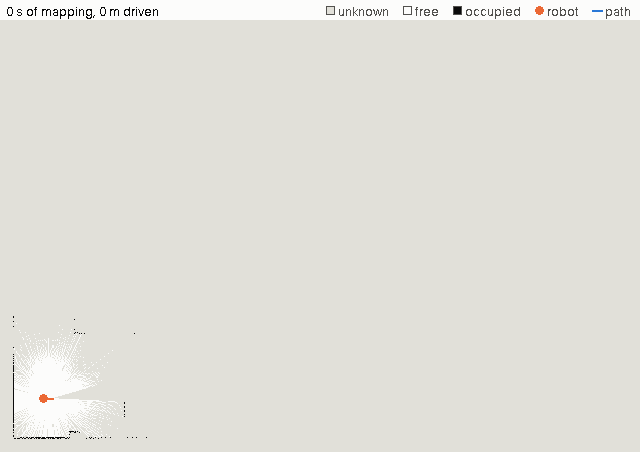

# Warehouse AMR

[](LICENSE)


A simulated warehouse in which autonomous mobile robots (AMRs) will fulfil orders, recharge
themselves, scan inventory and work as a fleet. It is being built with ROS 2 Jazzy, Nav2 and
Gazebo Harmonic, one phase at a time, and each phase will end with a recorded demo.

> **Status:** Phases 1 and 2 are done. Our own robot drives by keyboard teleop in a warehouse
> generated from one layout file, has mapped it with slam_toolbox, and localizes on that map with
> AMCL, within 0.10 m of the true pose. Phase 3 (navigation with keep-out and speed zones) is
> next. Phase 1's demo GIF is still to be recorded.

## Roadmap

| Milestone | Planned deliverables | Status |
|---|---|---|
| M0 Foundation (Phase 0) | CI green on a one-package repo, lint gates, GUI and headless dev containers, protected `main` | done (CI and lint gates removed on 2026-11-07, [ADR-008](docs/decisions/ADR-008-develop-on-main-without-automated-tests.md)) |
| M1 Core AMR (Phases 1-6, v1.0.0) | A custom tote-carrying AMR that fulfils a stream of orders in a generated warehouse, respects keepout and speed zones, docks to recharge on its own and logs KPIs. Operators submit orders and watch the live map in our Flask dashboard | in progress |
| M2 Perception (Phases 7-8, v2.0.0) | Docking on a detected ArUco tag. An inventory patrol that reads tote tags with the side cameras, keeps inventory state and flags discrepancies in RViz and the dashboard | planned |
| M3 Fleet (Phases 9-12, v3.0.0) | 3 identical robots, greedy then auction allocation, aisle traffic control, fleet and traffic views in the dashboard, and the final showcase | planned |
| Optional (Phases 8b, 13) | Learned tote detection trained on Colab (8b, research done) and mobile manipulation (13, stretch) | planned |

The full phased plan is in [docs/PROJECT_PLAN.md](docs/PROJECT_PLAN.md); design decisions are
recorded in [docs/decisions/](docs/decisions/).

## Phase 2: the warehouse, its map and localization



slam_toolbox maps the warehouse while the robot drives a scripted 176 m survey route (the blue
path, the robot in orange): 10 minutes of mapping in 8 seconds.

- **The warehouse from one file.** `layout.yaml` describes a 30 x 20 m hall with 8 shelf rows,
  4 pick aisles, 414 tote slots, a packing station, 3 charging docks and spawn poses for 3 robots.
  The Gazebo world, the location registry and the expected inventory are generated from it, and
  9 fit rules check it against the robot's size
  ([ADR-007](docs/decisions/ADR-007-generate-the-warehouse-from-one-layout.md)).
- **A map that is checked, not eyeballed.** `check_map` fits the saved map to the layout: it lies
  within 0.043 m and 0.015° of where it should (limits 0.05 m and 0.2°), with no ghost walls.
- **Localization on the map.** AMCL, started 0.42 m and 8° off, found the robot within 0.78 m of
  driving and then stayed within 0.092 m of Gazebo's ground truth for a 7-minute drive.

Try it (after the quick start below):

```bash
ros2 launch warehouse_bringup sim.launch.py world:=warehouse localization:=amcl
ros2 run warehouse_bringup teleop_window          # in a second terminal: drive with the arrow keys
```

The [Phase 2 report](docs/phase-reports/phase-02-warehouse-world.md) explains how it works and
has ten hands-on exercises, among them making a map of your own.

## Documentation

- [docs/PROJECT_STATUS.md](docs/PROJECT_STATUS.md): current status, every feature that exists
  (what it does, how to use it, where it lives) and a dated log of ideas and decisions.
- [docs/phase-reports/](docs/phase-reports/): one learning report per finished phase,
  explaining what was built, the concepts behind it, what went wrong and how it was fixed, with
  hands-on exercises. Start with
  [Phase 0: repository foundation](docs/phase-reports/phase-00-foundation.md), then
  [Phase 1: the robot](docs/phase-reports/phase-01-robot-description.md) and
  [Phase 2: the warehouse world, its map and localization](docs/phase-reports/phase-02-warehouse-world.md).
- [docs/decisions/](docs/decisions/): architecture decision records (ADRs).
- [docs/PROJECT_PLAN.md](docs/PROJECT_PLAN.md): the phased project plan.
- [docs/PERCEPTION.md](docs/PERCEPTION.md): the perception design (not built yet): ArUco
  tags for docking and inventory (Phases 7-8) and the optional learned tote detector (8b), with
  the plan changes it proposes. The learned method's research report is
  [docs/research/ML_PERCEPTION.md](docs/research/ML_PERCEPTION.md).
- [docs/research/PC_ASSESSMENT.md](docs/research/PC_ASSESSMENT.md): what the development laptop
  can run, measured: one robot up to cameras and Nav2, and three robots with Nav2.

## Quick start

Requires Ubuntu 24.04 with [ROS 2 Jazzy](https://docs.ros.org/en/jazzy/Installation.html)
(including `ros-dev-tools`), or the dev container below.

```bash
source /opt/ros/jazzy/setup.bash
git clone https://github.com/TANAY779/ros2-warehouse-amr.git ~/warehouse_ws
cd ~/warehouse_ws
vcs import --input dependencies.repos src
rosdep update
rosdep install --from-paths src --ignore-src -y
colcon build --symlink-install
```

The project has no automated tests or CI
([ADR-008](docs/decisions/ADR-008-develop-on-main-without-automated-tests.md)): check a change by
building it and running the system, as [CONTRIBUTING.md](CONTRIBUTING.md#build-and-run) shows.

First time using rosdep on this machine? Run `sudo rosdep init` once before `rosdep update`.

### Dev container

Open the repository in VS Code and run **Dev Containers: Reopen in Container**. The image
has ROS 2 Jazzy, Gazebo Harmonic, clang-format and gdb; the workspace is at `/home/ros/ws`.

- The default configuration, **ros2-warehouse-amr (ROS 2 Jazzy)**, is for a Linux desktop only:
  it needs `/dev/dri` and an X11 display. On any other host (macOS, Windows, a headless server),
  choose **ros2-warehouse-amr (headless)** when VS Code asks for a configuration. It has the
  same tools but no GUI or GPU access. GitHub Codespaces does not ask (and is not tested yet):
  create the codespace with **Code → Codespaces → ⋯ → New with options** and pick the headless
  configuration under *Dev container configuration*.
- GPU: `/dev/dri` is passed through. If your `render` group ID is not 992, put
  `export RENDER_GID=$(getent group render | cut -d: -f3)` in `~/.profile` and log in again
  (or start VS Code with `code .` from a shell that has it). VS Code started from the dock
  does not see variables set only in `~/.bashrc`. With the wrong ID, rendering falls back to
  software (llvmpipe) without an error; the container prints a warning when it starts.
- GUI apps (Gazebo, RViz) use X11, through XWayland on a Wayland desktop. Before the container
  starts, VS Code runs `xhost +SI:localuser:$(id -un)` on the host (`initializeCommand`), which
  lets only processes running with your UID, including the container user, open windows. Never
  use `xhost +local:`: it lets every local user and every container use your display.
- The container mounts the whole workspace at `/home/ros/ws`, so it shares `build/`, `install/`
  and `log/` with the host. When you switch between building on the host and in the container,
  run `rm -rf build install log` first: CMake refuses a build folder made at another path.
- The container sets `ROS_DOMAIN_ID=42` and `ROS_AUTOMATIC_DISCOVERY_RANGE=LOCALHOST`. Export
  the same values on the host to see the container's topics there.
- Security: the container shares the host network (`--network=host`) and IPC namespace
  (`--ipc=host`), has `CAP_SYS_PTRACE` (so `sudo gdb -p <pid>` can attach to a running node),
  and `ros` has passwordless sudo. Anything you install in it can listen on your network
  interfaces, read shared memory in `/dev/shm` and, through X11, see other windows and
  keystrokes. Install only trusted dependencies, and bind web servers (such as the Flask
  dashboard) to `127.0.0.1`.

## Development

Every change is committed straight to `main` with a
[Conventional Commits](https://www.conventionalcommits.org/) message: no branches, no pull
requests. Check it first by building it and running the system. See
[CONTRIBUTING.md](CONTRIBUTING.md) for the details.

## Repository layout

The repository root is the colcon workspace: packages live in `src/`, and colcon's `build/`,
`install/` and `log/` (git-ignored) appear next to it.

| Path | Contents |
|---|---|
| `src/warehouse_bringup/` | Top-level launch files (`sim.launch.py`, `localization:=none\|slam\|amcl`), RViz configurations, the teleop window |
| `src/warehouse_description/` | The robot: `robot.yaml`, xacro model, ros2_control and controller configuration |
| `src/warehouse_gazebo/` | Gazebo worlds (the warehouse world is generated by `warehouse_layout`), robot spawning, ros_gz bridge configuration |
| `src/warehouse_layout/` | The warehouse in one `layout.yaml`: fit rules, preview, generators, and the map tools `rasterize` and `check_map` |
| `src/warehouse_navigation/` | The odometry EKF, slam_toolbox mapping, AMCL localization and the warehouse map; Nav2 in Phase 3 |
| `src/warehouse_system_tests/` | Simulation test tools: `drive_route`, `evaluate_localization`, `map_timelapse`, `measure_load` |
| `docs/` | Project status, phase reports, project plan, perception design and research, architecture decision records |
| `.devcontainer/` | Development container (default and headless configurations) |

More packages are added as the phases need them (see the plan).

## License

[Apache-2.0](LICENSE)
