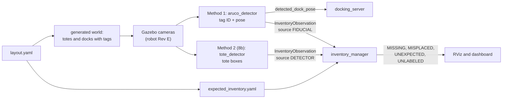
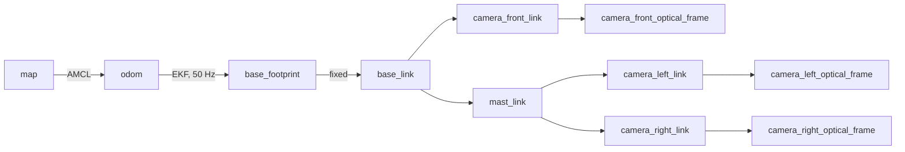
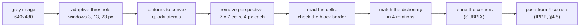
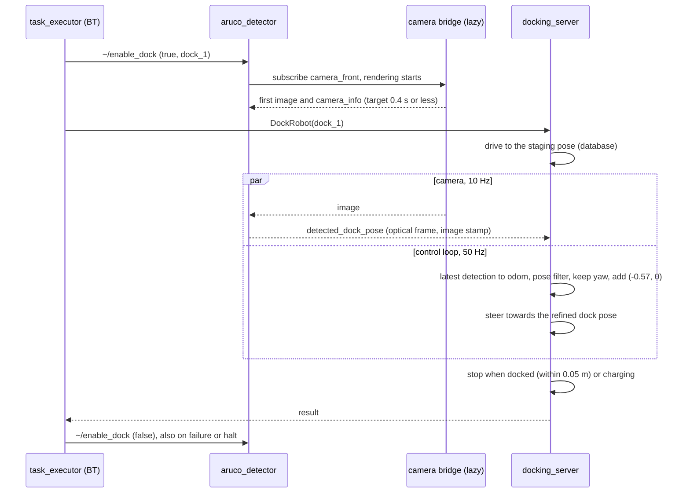
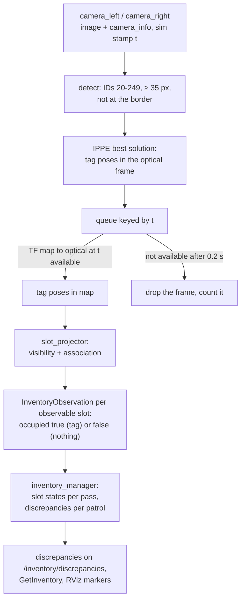
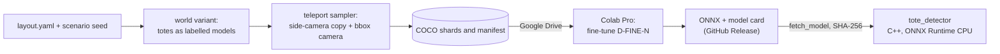
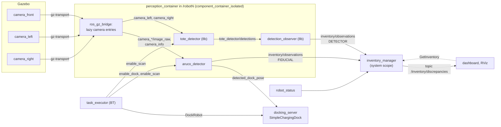

# Perception design: ArUco fiducials and learned tote detection

**In short.** The robot gets three cameras in Phase 7. It reads printed ArUco tags to dock with its charging contacts within 2 cm, and to check which tote stands in each of the warehouse's 414 shelf slots (Phases 7-8). A small neural network (Phase 8b, optional) later spots totes whose tag cannot be read. Both methods report through one message, so they can be compared head to head and combined. §8 lists the changes this design proposes to the plan, and §9.3 asks you five questions.

> **Status (2026-11-06): design only. Nothing in this document is built.** The robot is still revision B (a lidar and an IMU, no cameras) and Phase 2 (the warehouse world) is in progress. Cameras arrive with revision E in Phase 7. *Built* means in the repository and tested; *planned* means designed here or in the plan, which is true of every perception item today.
>
> **Scope:** how the robot will see tags and totes: the cameras (Phase 7), the ArUco fiducial method (Phases 7-8, milestone M2), the optional learned tote detector (Phase 8b), and how both feed one inventory.
>
> **Read first:** §1 (summary and decisions), §8 (the plan changes this document proposes) and §9.3 (the questions that need your answer).
>
> **How it was made:** from the ArUco research and its skeptical review (both 2026-11-06), the learned-perception report [research/ML_PERCEPTION.md](research/ML_PERCEPTION.md) (already reviewed and corrected), [PROJECT_PLAN.md](PROJECT_PLAN.md) and the Phase 2 layout code, then checked by two more reviewers. Every claim the reviews refuted is corrected here; §9.2 lists them. All geometry was recomputed from `layout.yaml` and `robot.yaml`.
>
> **Related files:** [PROJECT_PLAN.md](PROJECT_PLAN.md) (D23, D24, Phases 5, 7, 8, 8b), [PROJECT_STATUS.md](PROJECT_STATUS.md), [layout.yaml](../src/warehouse_layout/config/layout.yaml) and the [warehouse_layout README](../src/warehouse_layout/README.md) (both on the Phase 2 branch, not merged yet), [robot.yaml](../src/warehouse_description/config/robot.yaml).

**Evidence labels.** Numbers carry a label: **[V]** verified in source code or documentation, **[M]** measured in a named experiment (synthetic images so far, no Gazebo renders), **[C]** computed from stated inputs, **[E]** estimate, **[I]** inference from theory, still to be measured, **[U]** unverified. §10.3 explains them and lists the experiments. Codes from the plan, such as D23 (a decision), R7 (a risk) or P7.3 (a work item), are explained in §10.2.

## Contents

1. [Summary](#1-summary)
2. [The problem](#2-the-problem)
3. [The cameras (robot Rev E)](#3-the-cameras-robot-rev-e)
4. [Method 1: ArUco fiducials](#4-method-1-aruco-fiducials)
   - [4.1 What a fiducial is](#41-what-a-fiducial-is)
   - [4.2 How detection works, step by step](#42-how-detection-works-step-by-step)
   - [4.3 Dictionaries and Hamming distance](#43-dictionaries-and-hamming-distance)
   - [4.4 Corner refinement and the minimum tag size](#44-corner-refinement-and-the-minimum-tag-size)
   - [4.5 Pose from four corners: PnP and IPPE](#45-pose-from-four-corners-pnp-and-ippe)
   - [4.6 The planar ambiguity](#46-the-planar-ambiguity)
   - [4.7 Design choices: dictionary, size, carriers and IDs](#47-design-choices-dictionary-size-carriers-and-ids)
   - [4.8 Markers in the generated Gazebo world](#48-markers-in-the-generated-gazebo-world)
   - [4.9 The detector component (`aruco_detector`)](#49-the-detector-component-aruco_detector)
   - [4.10 Docking with tags](#410-docking-with-tags)
   - [4.11 Pose disambiguation for docking: the corrected rule](#411-pose-disambiguation-for-docking-the-corrected-rule)
   - [4.12 From detection to `InventoryObservation`](#412-from-detection-to-inventoryobservation)
   - [4.13 Testing and acceptance](#413-testing-and-acceptance)
   - [4.14 Work items and effort (Phases 7-8)](#414-work-items-and-effort-phases-7-8)
5. [Method 2: learned tote detection](#5-method-2-learned-tote-detection)
6. [How the two methods work together](#6-how-the-two-methods-work-together)
7. [Side-by-side comparison](#7-side-by-side-comparison)
8. [Proposed changes to the plan](#8-proposed-changes-to-the-plan)
9. [Risks, open issues and questions](#9-risks-open-issues-and-questions)
10. [Glossary, codes, evidence and sources](#10-glossary-codes-evidence-and-sources)

---

## 1. Summary

### 1.1 What perception does in this warehouse

The lidar sees walls and shelf plinths. It cannot read which tote stands on a shelf, and it cannot measure a dock to the centimetre. Cameras do two jobs:

1. **Dock precisely (Phase 7).** In Phase 5 the robot docks on the dock pose stored in the database, which comes from `layout.yaml`. In Phase 7 it measures the real pose from a tag on the dock, so a dock that was moved or turned still works. The charging contacts must meet within 2 cm sideways (the Rev D acceptance).
2. **Check the inventory (Phase 8).** A **patrol** visits every pick aisle once. Each aisle is one **pass** (one `SCAN_AISLE` task), in which the two side cameras look at both shelf faces, so one patrol covers all 414 slots, aisle by aisle. For each slot the robot decides whether a tote is there and which one; at the end of the patrol it compares that with the expected inventory and reports the differences (§2.1).

### 1.2 Two methods, one pipeline

| | Method 1: ArUco fiducials (Phases 7-8) | Method 2: learned tote detection (Phase 8b, optional) |
|---|---|---|
| Reads | A printed square tag on each tote and each dock: its ID and pose | The look of a tote: a box around each tote in the image |
| Answers | Which tote, and where exactly | Is a tote there |
| Role | The baseline, and the only source of identity | A second opinion on presence: catches totes whose tag is missing or covered |

§7 compares the two in full: compute, failure modes, effort and what each teaches.

How the parts fit together: `layout.yaml` generates the world and the expected inventory, the cameras feed both detectors, the dock tag's pose goes to Nav2's docking server, and `inventory_manager` compares what the robot saw with what should be there.



### 1.3 Why ArUco comes first

1. **Identity.** A tag carries the tote's ID, and `expected_inventory.yaml` maps that ID to a SKU. Every tote in this world is the same grey box (`style.tote: '#a7b0ba'`), and SKUs exist only as data, so no detector can tell totes apart by their look.
2. **Cost and determinism.** Tag detection takes about 3 ms per frame on one CPU thread [M] and gives the same answer every time. The learned detector needs 12-40 times that [U] and makes statistical errors.
3. **No training data.** Tags need none. The learned method needs a labelled dataset, which comes from the same world, cameras and tote models that Phase 7 builds.
4. **A baseline.** A learned result means little without a tuned, deterministic method to compare against. ArUco is that method, and Phase 8's inventory pipeline is what the learned method plugs into.
5. **Practice.** Warehouses identify stock with barcodes, RFID or fiducial labels. Camera "location occupancy" is sold as an add-on [U: vendor claim, ML report §1].

### 1.4 The main design decisions

"Plan" means already in [PROJECT_PLAN.md](PROJECT_PLAN.md); "changed" and "new" mark what this document proposes (§8 lists every edit). Where the last column names a question, the design assumes its default until you answer (§9.3).

| # | Decision, and why | vs plan | Where | Your call |
|---|---|---|---|---|
| 1 | Both methods report through one message, `InventoryObservation` (`source: FIDUCIAL` or `DETECTOR`), and `inventory_manager` combines them, so the two can be compared slot by slot | plan | §6 | |
| 2 | One tag on each tote's front face, its ID the tote's ID, and one on each dock; none on the shelves: identity travels with the tote | plan | §4.7 | |
| 3 | `DICT_5X5_250` tags, 0.12 m with a 2-cell white margin: the largest cells that fit the 0.20 m tote face, and 5 cells must be misread at once before one ID turns into another | plan (D23) | §4.3, §4.7 | |
| 4 | Side cameras stay landscape 640x480: a tag on the route is 48 px wide and seen 22-34 times per pass; portrait is the measured fallback | plan, now argued | §3.4 | |
| 5 | Our own small C++ detector on OpenCV 4.6 with sub-pixel corners. It ignores tags under 35 px, because smaller tags give bad corners and, rarely, wrong IDs; 40 px stays the layout's design target | plan; the 35 px minimum is new | §4.4, §4.9 | |
| 6 | A small tag's four corners fit two mirror-image poses. Take the one that fits the corners best, never the one nearest the stored dock yaw: in the review's test that made rotated docks worse | changed | §4.6, §4.11 | |
| 7 | The dock tag leans back 20°, so the mirror pose is plainly wrong: in synthetic tests the yaw error fell from about 1-2° to under 0.25°. Acceptance: dock yaw within 1° over the last 0.5 m | new | §4.11 | O5 |
| 8 | Image processing never waits for the robot's position (TF); the 20 ms budget covers detection only | changed | §4.12 | |
| 9 | Cameras render only while a detector needs them, are switched on before they are needed, and the bridge looks for subscribers every 0.1 s instead of every 1 s | plan; the heartbeat is new | §3.8 | |
| 10 | Each slot is decided once per pass from counted views: a tag seen twice, or three clear views without one; anything less is "unknown", never a discrepancy | plan, made precise | §4.12 | |
| 11 | Scan at the 0.5 m/s aisle limit with the normal controller instead of a 0.3 m/s slow controller: simpler and faster, but the learned detector gets fewer views | changed | §3.5, §5.5 | O4 |
| 12 | Totes become their own Gazebo models when they appear in Phase 7, so scenarios can move them and 8b can label them | new | §4.8 | |
| 13 | Until 8b, a tote whose tag is missing or unreadable is reported `MISSING` (one scenario documents it); no depth cameras | plan, made explicit | §3.6, §4.12 | O6 |
| 14 | The learned detector as the ML report designs it: one class `tote`, D-FINE-N on the CPU in C++, a new `UNLABELED` discrepancy | plan (D24), finalised | §5 | |
| 15 | M2 (Phases 7-8) needs about 75-119 h of core work, not the plan's 40-70 h | changed | §4.14 | O3 |
| 16 | Phase 8's acceptance is also run over at least 10 seeds with confidence intervals: one run of 10 cannot tell a good method from a mediocre one | new, optional | §6.4 | O7 |

**Detail decisions** (tuning values behind the rows above):

| Detail | Value | vs plan | Where |
|---|---|---|---|
| ID allocation | 0 reserved, docks 1-9, test scenes 10-19, totes 20-249 | changed (D23 gives docks 0-9) | §4.7 |
| Corner refinement | `CORNER_REFINE_SUBPIX` with a 5 px half-window | plan; the window is new | §4.4 |
| OpenCV minimum size | `minMarkerPerimeterRate` 0.219 = 4 x 35 px / 640 px | new | §4.9 |
| Camera bridge heartbeat | `subscription_heartbeat` 100 ms (default 1000 ms) | new | §3.8 |
| Gazebo camera noise | `stddev` about 0.07, calibrated in P7.3; the research's 0.007 renders as no noise | new | §3.7 |
| Tag textures | RGB PNGs without alpha, 16 px per cell for totes and 64 for docks, committed with the world (P2-D1) | new | §4.8 |
| Dock pose filter | `filter_coef` 0.02: about 0.1 per detection, because the docking loop feeds each 10 Hz detection to the filter 5 times | new | §4.10 |
| Dock tag mount | The tilted tag's centre stays on the pedestal face, 0.25 m behind the contact face, so `translation_x` stays −0.57 m | new | §4.11 |
| Dock-mode TF | The latest transform, without waiting, and only for the 0.5 m and 20° gates | new | §4.12 |

### 1.5 Status and timeline

| Phase | Perception work | Plan effort | Estimate here | Status (2026-11-06) |
|---|---|---|---|---|
| 2 | The layout facts perception depends on: tag heights, slot IDs, tote ID = tag ID, aisle width, bare shelves | M-L | (no change) | In progress (branch `phase-2-warehouse-world`) |
| 5 | Dock model with its tag board, tilted 20° and still blank (Phase 7 prints the tag on it); docking on the database pose | L | under 1 h extra for the tilted board [E] | Planned |
| 7 | Rev E cameras, tags in the world, `aruco_detector`, docking on the detected tag | L (20-35 h) | 38-62 h core [E] | Planned |
| 8 | `slot_projector`, `inventory_manager`, `SCAN_AISLE`, scenario generator, dashboard page, release v2.0.0 | L (20-35 h) | 37-57 h core [E] | Planned |
| 8b (optional) | Learned tote detector, head-to-head benchmark, `UNLABELED` | L+ (35-50 h) | 40-58 h (ML report §9) [E] | Planned; research finished |

The plan puts 8b after v2.0.0, possibly interleaved with the fleet milestone M3; nothing in M3 depends on it. §4.14 explains the Phase 7-8 estimates.

---

## 2. The problem

### 2.1 What the robot must know

| Question | Answered by | Used for |
|---|---|---|
| Is a tote in slot `C07-2-1`? | ArUco: a tag seen there or not. 8b: a tote seen there or not | `MISSING`; with 8b also `UNLABELED` |
| Which tote is it? | ArUco only (tag ID = tote ID) | `MISPLACED`, `UNEXPECTED` |
| Where exactly is dock 1? | ArUco (the dock tag) | Docking |

A **discrepancy** is a difference between what the robot sees and the expected inventory:

| Type | Meaning | Example | Phase |
|---|---|---|---|
| `MISSING` | An expected tote is not in its slot and was not seen elsewhere in the patrol | Tote 37 belongs in `A06-3-2`; the slot looks empty | 8 |
| `MISPLACED` | A known tote stands in another slot than expected | Tote 86, expected in `C07-2-2`, seen in the empty slot `C07-2-1` | 8 |
| `UNEXPECTED` | A tote whose ID is not in the inventory | Tag 240 (a spare ID) seen | 8 |
| `UNLABELED` | A tote is there, but its tag cannot be read | A tote with a covered tag | 8b (new value) |

The examples use the committed `expected_inventory.yaml`: tote 37 belongs in `A06-3-2`, tote 86 in `C07-2-2`, and `C07-2-1` is meant to be empty.

### 2.2 The warehouse facts that shape the design

All from `layout.yaml`, `model.py`, `rules.py` and `inventory.py` on the Phase 2 branch [V].

- **Hall and rows.** A 30 x 20 m hall; 8 single-faced shelf rows (A-H) form 4 pick aisles, each exactly 1.60 m between the faces. Rows run north-south in two blocks (bays 01-05 and 06-09).
- **Slots.** 69 bays x 3 levels x 2 positions = 414 slots, named like `C07-2-1` (row C, bay 07, level 2, position 1, the south one). A bay is 1.00 m from upright to upright and its opening 0.95 m, shared by the two positions, so slot centres are 0.475 m apart inside a bay and 0.475 + 0.05 = 0.525 m apart across an upright.
- **Levels.** The tote floors are at 0.40 m (plinth top), 0.75 m and 1.10 m. A tote is 0.20 m tall, so tag centres sit at **0.50, 0.85 and 1.20 m**, 0.35 m apart.
- **Totes.** 0.40 x 0.30 x 0.20 m, the 0.40 m side pointing into the shelf, front **flush** with the shelf face (setback 0). The camera sees a **0.30 x 0.20 m face**.
- **Inventory.** 207 totes (fill ratio 0.5), 60 SKUs. **Tote ID = tag ID**, numbered from 20 in slot-ID order; `TOTE_TAG_IDS = range(20, 250)` caps the totes at 230.
- **Docks.** 3 docks on the south wall. Each pedestal (0.60 x 0.30 x 0.50 m) carries the tag on its face, 0.25 m behind the contact face. Docked pose = contact face + 0.32 m (half the robot's length); staging pose 0.70 m further out.
- **Bare shelves.** `style.show_totes: false` until Phase 7 (the owner's decision). Generated files are committed and must regenerate byte for byte (the Phase 2 decision P2-D1, §10.2).

```
Cross-section of a pick aisle, looking along it (not to scale). M = mast on the robot.

     shelf face                                                              shelf face
         |<--------------- 0.80 m --------------->|<--------------- 0.80 m --------------->|
1.20 m [tag] level 3                              M                              level 3 [tag]
0.85 m [tag] <--------------- left camera ------- M ------- right camera ---------------> [tag]
0.50 m [tag] level 1                              M                              level 1 [tag]
0.40 m ===== plinth top (the lidar sees it)       M                           plinth top =====
```

**The Phase 7 tag rule** (layout README, `rules.py` [V]). A side camera 640 px wide with a horizontal field of view of 1.57 rad has a focal length f = 320 / tan(0.785) = 320.3 px (f is the focal length measured in pixels; §3.1 explains the pinhole model behind this). A 0.12 m tag at distance d spans f x 0.12 / d pixels. The robot keeps within ±0.15 m of the centreline, so the far face is at most 0.95 m away, where the tag is **40.4 px**. That is why the aisles are exactly 1.60 m and the totes flush: with a hard 40 px rule there is no margin. §3.4 and §4.4 replace the hard rule with a 40 px target and a 35 px minimum, both to be confirmed in Gazebo.

```
Top view of a dock against the south wall (not to scale)

y = -0.43   . . . . . . . . . . . . . . staging pose (base_link), 0.70 m further out
y = -1.13               [ robot ]       docked pose: base_link = contact face + 0.32 m
y = -1.45   ======= contact face (bar 0.12 m high) =======
                 |  0.25 m (tag_setback)
y = -1.70   [ pedestal face: dock tag centred at 0.275 m height (tilted 20° from Phase 5, §4.11) ]
y = -2.00   ////////////////////// south wall //////////////////////
```

### 2.3 Success metrics

| Metric | Target | Source |
|---|---|---|
| Tags detected, of those the validator marks visible | ≥ 98 % at camera rate | Plan, Phase 7 |
| Wrong IDs | 0 on the scan route | Plan, Phase 7 |
| Detection time per 640x480 frame | p95 ≤ 20 ms, steady clock, TF wait excluded | Plan, Phase 7; "TF wait excluded" is **changed** (§4.12, §8 row 16) |
| Camera-frame position error of a tag | Mean < 2 cm at ≥ 55 px, < 5 cm at 40-55 px | Plan, Phase 7 |
| Map-frame position error of a tag | < 10 cm | Plan, Phase 7 |
| Docking on the detected tag | ≥ 95 % over 20 cycles, dock moved 10 cm and rotated 5°, no "Lost detection" aborts, only the target dock's tag used | Plan, Phase 7 |
| Lateral contact offset | ≤ 2 cm | Plan, Rev D (Phase 5); **new** for Phase 7 (§8 row 17) |
| Refined dock yaw error in the last 0.5 m | < 1° with the dock rotated ±5° | **New** (review, §4.11; §8 row 17) |
| Idle cameras | 0 subscribers on every `camera_*/image_raw` | Plan, Phase 7 |
| Enable to first image | ≤ 0.4 s, wall clock | **New** (§3.8; §8 row 17) |
| Discrepancies found | ≥ 9 of 10 injected, ≤ 1 false positive | Plan, Phase 8 |
| Coverage | ≥ 99 % of slots get a decision per full patrol | **New** (research, §4.12; §8 row 20) |
| Order throughput with hourly patrols | Drops by ≤ 15 % | Plan, Phase 8 |
| Learned detector (8b) | Presence F1 ≥ ArUco F1 − 0.03; `UNLABELED` recall ≥ 0.9; runtime gate | ML report §8.6 |

How to read these measures:

- **p50, p95.** Percentiles: 95 % of frames are processed faster than the p95 time, half faster than p50. A p95 limit ignores rare hiccups but not a slow tail.
- **Steady clock and sim time.** The steady clock is the computer's monotonic wall clock, so it measures real processing time. Sim time is Gazebo's clock, which runs slower than wall time when the simulation cannot keep up (a real-time factor, RTF, below 1). Processing times use the steady clock; latencies between stamped messages use sim time.
- **Precision, recall, F1.** For presence, *precision* is the share of slots a method calls occupied that really hold a tote, *recall* the share of truly occupied slots it finds, and *F1* their harmonic mean, 2PR / (P + R). Example: of 100 occupied slots a method finds 90, and it also calls 5 empty slots occupied: recall 0.90, precision 90 / 95 = 0.95, F1 0.92. The same words apply to discrepancies: of the 10 injected, how many were reported (recall), and how many reports were real (precision).

---

## 3. The cameras (robot Rev E)

*Status: planned (Phase 7, robot revision E). The values are the plan's (plan §2.6) unless marked new.*

### 3.1 The pinhole model in five lines

- A **pinhole camera** maps a point (X, Y, Z) in its optical frame to the pixel u = fx·X/Z + cx, v = fy·Y/Z + cy. **fx, fy** are focal lengths in pixels and **(cx, cy)** is the image centre; together they form the intrinsic matrix **K**.
- An object of size L at distance Z therefore spans **s = f·L/Z pixels**. Almost every number in this document follows from that one line.
- The **optical frame** (REP-103) has z forward, x right and y down. It hangs off the camera link, rotated by roll-pitch-yaw (−π/2, 0, −π/2).
- Gazebo publishes **`camera_info`** with fx = fy = W / (2 tan(HFOV/2)), cx = W/2, cy = H/2 [V: gz-rendering `Utils.cc`]. OpenCV puts pixel centres on integers, so the true centre is (W − 1)/2: a 0.5 px offset, 1.6 mrad or 1.2 mm at 0.8 m [C]. Negligible, but it shows up as a constant bias in a millimetre-level validation.
- **Never hard-code K.** Read it from `camera_info` through `image_geometry::PinholeCameraModel`.

### 3.2 Three cameras

| Camera | Job | Image | Field of view | f (px) | Rate | Mount |
|---|---|---|---|---|---|---|
| `camera_front` | Dock tag | 640x480 RGB | horizontal 1.2 rad (68.8°), vertical 54.3° | 467.7 [C] | 10 Hz | In the front face, optical centre at 0.275 m (the dock-tag height), level: 0.95 m from the dock tag at the staging pose, 0.25 m when docked. Below the 0.34 m lidar plane |
| `camera_left`, `camera_right` | Tote tags (and totes in 8b) | 640x480 RGB, landscape | horizontal 1.57 rad (90°), vertical 73.7° | 320.3 [C] | 10 Hz | On the rear mast at 0.85 m (the middle tag height), facing ±y, level |

Each camera renders only while a detector input is enabled (§3.8). The mast tops out at 1.10 m and crosses the lidar's 0.34 m scan plane, so Rev E must keep it out of `scan` (plan §2.6): for example by placing it in the shadow of a tote on the tray, or with the self-filter Rev C chooses (a filter that removes the robot's own body from the scan); never by hiding it with Gazebo visibility flags, which a real lidar would not honour.

### 3.3 How big things look: tags and totes in pixels

Side camera, f = 320.3 px [C]. Camera-to-face distance d: 0.65 m when the robot is 0.15 m nearer the face, 0.80 m on the centreline, 0.95 m when it is 0.15 m further away. Each camera will sit a few centimetres to its own side of the robot's centreline, which shortens these distances slightly. The numbers here are therefore conservative for tag size, but slightly optimistic for the vertical margin and the views per pass: at 0.62 m instead of 0.65 m the top margin shrinks from 4.3 to 2.0 cm, and a tote's full-view time at 0.5 m/s from 2.0 to 1.9 s [C]. The P7.2 validator uses the real mast offsets from the Rev E camera block of `robot.yaml`.

| d | Tag (0.12 m) | Pixels per cell | Tote face 0.30 x 0.20 m | Tote at the 320x320 network input | Shelf seen: width; heights |
|---|---|---|---|---|---|
| 0.65 m | 59.1 px | 8.4 | 148 x 98 px | 74 x 66 px | 1.30 m; 0.36-1.34 m |
| 0.80 m (centreline) | 48.0 px | 6.9 | 120 x 80 px | 60 x 53 px | 1.60 m; 0.25-1.45 m |
| 0.95 m | 40.4 px | 5.8 | 101 x 67 px | 51 x 45 px | 1.90 m; 0.14-1.56 m |
| 1.10 m (35 px limit) | 34.9 px | 5.0 | 87 x 58 px | 44 x 39 px | 2.20 m; 0.03-1.67 m |

The network-input column is for the learned detector (§5), which squashes each 640x480 frame to 320x320: widths are halved and heights scaled by 2/3.

What the table means [C]:

- **All three levels are in view** at every distance. The top label edge (1.29 m) is 4.3 cm inside the image even at 0.65 m.
- **A tag has 7 cells across** (5 data cells plus a black border cell on each side), each 17.1 mm. At 40.4 px a cell is 5.8 px: enough for the decoder, which samples about 4 px per cell.
- **A tote is 2.5 times wider than its tag.** The learned detector can work on a half-size image, while the tag decoder needs the full 640 px.
- **The shelf face is parallel to the image plane** when the robot drives along the aisle. A tag then looks like an undistorted square of the same size anywhere in the image.

### 3.4 Landscape, not portrait (decision)

The ArUco research proposed turning the side cameras to portrait to escape the 40.4 px knife edge. The review rejected the reason with the research's own data, and this document follows the review.

| Option (same render cost unless noted) | f | Tag at 0.95 / 0.80 / 0.65 m | Full views per tag at 0.5 m/s, 10 Hz | Verdict |
|---|---|---|---|---|
| **Landscape 640x480, HFOV 1.57 rad** (plan) | 320.3 | 40.4 / 48 / 59 px | 34 / 28 / 22 | **Chosen** |
| Portrait 480x640, vertical FOV 72° (gz `horizontal_fov` 0.998 rad for the 480 px width) | 440.4 | 55.6 / 66 / 81 px | 17 / 13.5 / 10 | Fallback |
| Landscape 800x600, HFOV 1.57 rad | 400 | 50.5 / 60 / 74 px | 34 / 28 / 22 | Rejected: 1.56 times the pixels to render on the iGPU, for 3 robots |

**Where the view counts come from** [C]. A full view needs the whole 0.1886 m label in the image. At distance d the image spans 2·d·tan(HFOV/2) of shelf, so the label stays fully in view over 2·d·tan(HFOV/2) − 0.1886 m of travel, and the robot moves v / rate between frames:

views = (2·d·tan(HFOV/2) − 0.1886 m) / (v / rate)

Worked on the centreline in landscape: (2 x 0.80 m x tan 45° − 0.1886 m) / (0.5 m/s / 10 Hz) = 1.41 m / 0.05 m = 28. Portrait's horizontal field of view is only 57.2° (tan 28.6° = 0.545), hence its 10-17.

Why landscape [M: ArUco research, idealised synthetic renders; C]:

- **40 px is not a cliff.** Detection was 100 % down to 29.5 px with sub-pixel corners, and the 95th percentile position error at 1.30 m (29.5 px) was 12.3 mm. Even the harsh renders detected 100 % from 32 px.
- **The route is the centreline**, where tags are 48 px. The ±0.15 m is a tracking tolerance, not where the robot drives.
- **Landscape sees each tag twice as often** (22-34 full views per pass instead of 10-17), which feeds the per-pass evidence counts (§4.12).
- **Nothing else moves.** The ML report's numbers, the Phase 2 rules and the README's tag rule all assume landscape. Changing the camera would mean editing `rules.py` while Phase 2 is being built.

**Fallback.** If the Phase 7 calibration scene (P7.3) shows detection below 98 % at 40 px, or pose errors above the acceptance, switch to portrait: width 480, height 640, `horizontal_fov` 0.998. The pixel count and render cost stay the same.

**The knife edge goes away anyway.** With a 35 px minimum (§4.4) the side camera reads tags out to 1.10 m. A 1.60 m aisle would then tolerate totes standing up to 0.15 m back, or the aisle could be up to 1.90 m wide [C]. Restate the rule in `rules.py` only after Phase 2 merges, and only from the Gazebo measurements of P7.3.

### 3.5 Frame rate, scan speed and motion blur

- **Gazebo renders instantaneous frames:** no exposure time, no motion blur, no rolling shutter [V: gz-sensors 8 `CameraSensor.cc`; SDF 1.11 has no exposure element].
- **A real camera would blur.** The image moves at v·f/Z = 0.5 x 320 / 0.8 = 200 px/s at 0.5 m/s, so a 4 ms exposure smears 0.8 px and a 10 ms exposure 2 px [C]. The synthetic tests lost no detections up to 6 px of blur, 1 % at 8 px, and all at 12 px (about 2 cells) [M: ArUco research]. A real robot would want a global-shutter camera with an exposure of 5 ms or less [E].
- **Views per tag at 10 Hz** (a full view means the whole label is in the image; formula in §3.4): 22-34 per pass at 0.5 m/s and 37-57 at 0.3 m/s [C]. 5 Hz would still give at least 11.
- **Scan speed.** The plan caps scanning at 0.3 m/s with a second, slow controller. Tag detection does not need it. Scanning at the 0.5 m/s aisle limit removes that controller and its behaviour-tree plumbing, and saves about 48-63 s per patrol [E]: 48 s if only the 36 m of shelf face (4 aisles x 9 bays x 1.00 m) is driven slowly, 63 s if the slow part covers each aisle's whole 11.75 m, mid cross aisle included (47 m / 0.3 m/s − 47 m / 0.5 m/s). P8.4 can compute the exact figure from the generated scan route.
- **What 0.5 m/s costs the learned detector (8b).** Each tote is fully in view for 2.0-3.2 s instead of 3.3-5.3 s. To keep at least 3 views of a tote on the near face, each camera needs at least 1.5 Hz, so the single inference session that serves both cameras must sustain 3 inferences per second: a mean of at most about 330 ms per inference, against about 550 ms at 0.3 m/s, with no slack in either [C]. The ML report's own estimate for D-FINE-N under simulator load (35-127 ms idle, 1.5-3 times slower: 53-381 ms) fits at 0.3 m/s but not at its top end at 0.5 m/s (§5.5).
- **Recommendation.** Scan at 0.5 m/s, set by a `scan_speed` parameter. If 8b's feasibility step (ML-0) cannot sustain 3 inferences per second under load, 8b adds the slow controller (about 2-3 h) and scans at 0.3 m/s while the learned detector runs. This is your call (question O4, §9.3).

### 3.6 RGB only

ArUco gets distance from the known tag size, so it needs no depth. Depth would add positive evidence for empty slots: through an empty slot the camera would see 1.3 m or more deep instead of a tote face at 0.8 m. It would also cost GPU time, which plan risk R3 (simulator load on the integrated GPU) avoids. The learned detector (8b) gives the same positive evidence without depth. Decision: RGB only, as in plan §2.6.

### 3.7 What Gazebo simulates, and what it does not

| Effect | Gazebo Harmonic (gz-sensors 8) | Consequence |
|---|---|---|
| Pinhole projection | Ideal; lens distortion only if configured (keep it off) | Calibration is exact; real cameras need calibration |
| `camera_info` | Computed from the field of view [V] | Read it, never hard-code it |
| Image noise | Gaussian noise added in a shader, with a twist [V: installed `gaussian_noise_fs.glsl`, Ogre2]: it adds sign(z)·\|z\|^2.1 for z drawn with the configured standard deviation | `stddev` 0.007 gives 0.014 grey levels, which is no noise at all after 8-bit rounding; **`stddev` 0.07 gives about 1.8 grey levels** RMS, with heavy tails [C]. Calibrate on a flat grey patch in P7.3 |
| Exposure, motion blur, rolling shutter | Not modelled [V] | Gazebo results are optimistic; tests add blur on purpose |
| Auto exposure, white balance, vignetting, flare, dirty or damaged labels | Not modelled | Robustness tests add occlusion and lighting changes (§6.4) |
| Lighting and shadows | Physically based materials; shadows optional | Vertical shelf faces are dark under a downward sun: add ambient and sideways light (§4.8) |
| Anti-aliasing | Yes | Edges are softer than a raw pinhole would give |
| Lazy rendering | A camera with no subscriber is not rendered [V] | Idle cameras cost nothing (R3) |

### 3.8 Frames, mounting and the bridge



- **Frames.** Each camera has a link and an `*_optical_frame` child at roll-pitch-yaw (−π/2, 0, −π/2) (plan §2.4). `<optical_frame_id>` sets the frame of both the image and `camera_info` [V].
- **Time.** Images carry sim time, so every consumer runs with `use_sim_time`.
- **Bridge.** `ros_gz_bridge` entries with `lazy: true` and the `SENSOR_DATA` QoS profile. With no ROS subscriber the bridge drops its Gazebo subscription and Gazebo stops rendering that camera [V]. Plan risk R3 relies on this.
- **Start-up delay (new).** A lazy bridge checks for subscribers every `subscription_heartbeat`, 1000 ms by default [V: reviewer, jazzy `ros_gz_bridge.cpp`; the parameter name is in the installed library]. The first image can therefore arrive up to 1 s after a detector subscribes; at 0.5 m/s that is half a metre of aisle. Fix: set the heartbeat to 100 ms on the camera bridges, enable the cameras before the aisle mouth or the staging pose, wait for the first `camera_info` before starting the route, and report "enable to first frame" in diagnostics. With a 100 ms heartbeat the first image arrives after up to 0.1 s until the bridge notices the subscriber, plus up to one frame period (0.1 s of sim time at 10 Hz, 0.14 s of wall time at an RTF of 0.7), plus rendering and transport: about 0.3 s at worst [E]. The acceptance is therefore ≤ 0.4 s, in wall time, from the enable call to the first image callback. A 200 ms heartbeat would leave no margin.
- **Composition.** The bridge and the detector run as components in one process with intra-process communication. That removes the ROS hop (one serialization and a copy), not all of them: Gazebo still sends each 921 KB image to the bridge as serialized protobuf over gz-transport, and the bridge still converts it [V: review]. Plan §2.5 already notes that zero-copy is not guaranteed.

A side camera in SDF (a sketch for the Rev E xacro; the topic is namespaced like every gz topic since Phase 1):

```xml
<sensor name="camera_left" type="camera">
  <topic>NAMESPACE/camera_left/image_raw</topic>
  <gz_frame_id>camera_left_link</gz_frame_id>  <!-- read by gz-sensors 8; not in the SDF spec -->
  <update_rate>10</update_rate>
  <always_on>true</always_on>                    <!-- still renders only with a subscriber -->
  <camera>
    <horizontal_fov>1.57</horizontal_fov>
    <image><width>640</width><height>480</height><format>R8G8B8</format></image>
    <clip><near>0.05</near><far>15</far></clip>
    <optical_frame_id>camera_left_optical_frame</optical_frame_id>
    <noise><type>gaussian</type><mean>0.0</mean><stddev>0.07</stddev></noise>
  </camera>
</sensor>
```

The camera values belong in a camera block of `robot.yaml` (plan D1: one file describes the robot), so the xacro, the layout validator and the 8b data generator read the same numbers.

---

## 4. Method 1: ArUco fiducials

*Status: planned. Phase 7 builds the cameras, the tags, the detector and tag-based docking; Phase 8 builds the inventory side. Nothing here exists yet.*

### 4.1 What a fiducial is

A **fiducial** is an artificial landmark made so that a camera can find and identify it reliably. Square binary fiducials (ARTag, ArUco, AprilTag) encode an ID as a grid of black and white cells inside a thick black border. One detection gives two things:

- the **ID**, from the decoded cells;
- the **four corners** in the image, to a fraction of a pixel.

Knowing the tag's physical size and the camera's intrinsics K, those four corners give the tag's full **pose** (position and orientation, 6 degrees of freedom) relative to the camera.

ArUco's dictionaries and detector come from Garrido-Jurado et al. 2014; later speed-ups from Romero-Ramirez et al. 2018 (§10.4). They ship in OpenCV's contrib `aruco` module. The installed OpenCV is 4.6.0 with only the **legacy API** (`detectMarkers`, `DetectorParameters_create`, `drawMarker`); the newer `cv::aruco::ArucoDetector` and `generateImageMarker` arrived in 4.7 [V: `python3 -c 'import cv2'`, `libopencv-contrib-dev` 4.6.0+dfsg-13.1ubuntu1].

### 4.2 How detection works, step by step



OpenCV 4.6 `detectMarkers`, with its default parameters [V: printed on this machine; OpenCV 4.6.0 tutorial]:

1. **Threshold.** The image is converted to grey. An **adaptive threshold** marks a pixel dark when it is more than 7 grey levels below the mean of its neighbourhood. Three window sizes (3, 13 and 23 px) handle small and large tags. Dark blobs become candidate borders.
2. **Find quadrilaterals.** Contours are traced and simplified to polygons (tolerance 3 % of the perimeter); convex 4-corner shapes survive. Candidates are dropped if their perimeter is below a minimum (default 3 % of the longer image side, 19 px), if they lie within 3 px of the image border, or if they duplicate a neighbour.
3. **Remove perspective.** A **homography** (a 3x3 projective map between two planes) warps each quadrilateral into a square image with 4 px per cell: 28 x 28 px for 7 cells.
4. **Read the cells.** An **Otsu threshold** (one threshold chosen from the histogram) turns each cell into black or white, ignoring the outer 13 % of each cell. The border cells must be black; at most 35 % may be wrong.
5. **Identify.** The inner 5 x 5 bits are compared with every dictionary word in all four rotations. The nearest word wins if it is at most 1 bit away (§4.3). The matching rotation tells which corner is the tag's top-left.
6. **Refine the corners.** Off by default; this project uses sub-pixel refinement (§4.4).

The output is, per tag, the ID and four corners ordered top-left, top-right, bottom-right, bottom-left in the tag's own orientation.

**Worked example.** A level-2 tag seen from the centreline is 48 px wide, 6.9 px per cell. Its perimeter, 192 px, passes our 140 px minimum (35 px x 4). After the perspective warp each cell is 4 x 4 px, and the decoder ignores the outer 13 % of each cell, about 0.9 image pixels at 6.9 px per cell, so a pixel of blur at the cell edges flips no bits.

**Speed.** `detectMarkers` on a 640x480 frame with 6 tags took 2.5-2.7 ms on one thread and 1.8-1.9 ms on two; a pose solve adds about 15 µs per tag [M: ArUco research, reproduced by the review; Python bindings, laptop shared with a running simulation]. The plan's 20 ms budget has about 7 times headroom for detection itself (§4.12 explains why the TF wait must be kept out of that number).

### 4.3 Dictionaries and Hamming distance

A **dictionary** is the list of allowed bit patterns (codewords). The **Hamming distance** between two patterns is the number of cells that differ. A tag can appear in any of four rotations, so what matters is the smallest distance **d** between any two codewords in any rotation, including a codeword against its own rotations (otherwise a rotated tag could decode with the wrong corner order).

- With minimum distance d, up to (d − 1)/2 wrong cells, rounded down, can be corrected without ambiguity. OpenCV corrects floor(maxCorrectionBits x errorCorrectionRate) bits, and the default rate is 0.6.
- **`DICT_5X5_250`:** d = 6, maxCorrectionBits 2, so OpenCV corrects 1 bit. To turn one tag into another accepted ID, at least d − 1 = **5 cells** must be misread at once [C].

| Dictionary | Cells across (with border) | IDs | Min. distance d (rotations included) | Bits corrected at rate 0.6 | Pixels per cell, 40 px tag |
|---|---|---|---|---|---|
| `DICT_4X4_250` | 6 | 250 | 3 | 0 | 6.7 |
| **`DICT_5X5_250`** (chosen) | 7 | 250 | **6** | 1 | 5.7 |
| `DICT_5X5_1000` | 7 | 1000 | 5 (first 660 IDs: 6; first 200: 7) | 1 | 5.7 |
| `DICT_6X6_250` | 8 | 250 | 11 | 3 | 5.0 |
| `DICT_APRILTAG_36h11` (through OpenCV) | 8 | 587 | 11 | **0** (maxCorrectionBits 0) | 5.0 |

Evidence: [M] ArUco research, confirmed by the review's independent script. This document checked `DICT_5X5_250` a third way [C]: it rendered all 250 markers with the installed OpenCV, read their 5 x 5 cells from the images and compared every pair in four rotations. Result: d = 6, reached by many pairs (for example IDs 0 and 220) and by three markers against their own rotations (IDs 225, 240 and 248); every other marker is further from its own rotations. Among IDs 0-199 alone d = 7, so every closest case involves an ID of 200 or more. It also confirmed that `DICT_5X5_250` is exactly the first 250 markers of `DICT_5X5_1000`, so moving to the larger dictionary later keeps every existing tag valid.

The OpenCV tutorial's advice is to use the smallest dictionary that fits: fewer words leave more distance between them.

### 4.4 Corner refinement and the minimum tag size

The pose comes from the four corners, so corner accuracy is pose accuracy. Without refinement the corners come from the polygon fit. **Sub-pixel refinement** (`CORNER_REFINE_SUBPIX`) runs `cv::cornerSubPix`, which moves each corner to where the image gradients in a small window agree.

| Corner refinement (tags of 40-48 px) | Corner error, RMS [M: research] | Review's re-run [M] |
|---|---|---|
| **SUBPIX, half-window 5** (chosen) | 0.15-0.17 px | 0.14-0.16 px |
| SUBPIX, half-window 3 | 0.21-0.22 px | |
| NONE (OpenCV 4.6 default) | 0.69-0.78 px | 0.65-0.70 px |
| CONTOUR | 0.70-0.78 px | 0.62-0.73 px |
| APRILTAG | 0.76-0.78 px | 0.76-0.82 px |

**Keep the half-window at or below one cell.** `cornerRefinementWinSize` is a half-size: 5 means an 11 x 11 px search window centred on the corner. The half-size is the right measure because the window is centred: if it reaches at most one cell from the corner, it sees only the black border cell inward and the white quiet zone outward, which together form the corner's own two edges. Reach further and the window takes in the data cells, whose black-white edges pull the corner away while the ID still decodes. Measured [M: ArUco research, idealised]: at 20 px (a half-window of about 1.75 cells) the ID decoded every time, but the corners were 1.8 px off and the position 16 cm off; at 24 px (about 1.5 cells) everything was fine again (0.17 px, 1.3 cm). In harsh renders detection was 73 % at 24 px, 97 % at 28 px and 100 % from 32 px, and at 12-14 px one frame in 150 decoded a **wrong** ID [M]. Tiny tags are where wrong IDs come from.

**Decision (new):** keep half-window 5 and ignore tags smaller than **35 px**: cells of at least 5 px, so the half-window stays within one cell. The measured breakdown is near 20 px, so 35 px leaves a wide margin. This also resolves an inconsistency the review found in the research (a 24 px gate with a 5 px half-window). Every tag on the scan route is 40.4-59 px and every dock tag 59-224 px, so the gate removes nothing in normal operation. **40 px stays the design target** that the layout validator checks. If smaller tags ever matter, refine each marker separately with a window scaled to its cell size (a few lines around `cv::cornerSubPix`).

### 4.5 Pose from four corners: PnP and IPPE

**PnP** (Perspective-n-Point) finds the rotation R and translation t that make the projected model corners match the detected corners. For a square tag, `cv::solvePnPGeneric` with `SOLVEPNP_IPPE_SQUARE` uses **IPPE** (Infinitesimal Plane-based Pose Estimation, Collins and Bartoli 2014). It is analytic, takes about 15 µs, and returns **two** solutions, each with its **reprojection error** (the RMS pixel distance between the detected corners and the model corners projected with that solution) [V: `/usr/include/opencv4/opencv2/calib3d.hpp`]. The header does not promise any order; in 2000 noisy cases the solutions came sorted by error [M: review]. Sort them in code anyway.

- **Object points, in this order** [V]: top-left (−L/2, +L/2, 0), top-right (+L/2, +L/2, 0), bottom-right (+L/2, −L/2, 0), bottom-left (−L/2, −L/2, 0), with L = 0.12 m. That is the order `detectMarkers` returns.
- **The tag frame** that results: x right, y up, z out of the tag towards the camera.
- **Avoid `estimatePoseSingleMarkers`.** It is deprecated from OpenCV 4.7 [V: OpenCV deprecated list], and its marker-frame convention reportedly changed between versions [U: OpenCV forum]. Explicit object points fix the convention.

**Accuracy rule of thumb** (first order, tag facing the camera, σc = corner noise in pixels): tag size s = f·L/Z; relative depth error σZ/Z ≈ σc/s; sideways error ≈ Z·σc/f.

- Worked example [C]: σc = 0.15 px and s = 48 px give σZ/Z = 0.31 %, so 2.5 mm at 0.80 m; sideways 0.4 mm. The measured mean error at 0.80 m was 3.7 mm [M], so the rule is about right.
- In Gazebo expect corner noise of 0.2-0.4 px (texture filtering, anti-aliasing, the half-pixel centre of §3.1), so about 0.5-1.5 cm at 40-60 px [E]. The Phase 7 acceptance (mean < 2 cm at ≥ 55 px, < 5 cm at 40-55 px) has margin. Real cameras with calibration error typically land near 1-2 % of the distance [U: estimate, not checked against the cited comparison by Kalaitzakis et al. 2021].

Side camera, idealised synthetic renders, 150 trials per row, robot heading ±3°, tote yaw ±2° [M: ArUco research]:

| Distance | Tag | Detected | Corner error | Position error, mean / p95 | Rotation error, mean |
|---|---|---|---|---|---|
| 0.65 m | 59 px | 100 % | 0.15 px | 2.6 / 3.6 mm | 0.19° |
| 0.80 m | 48 px | 100 % | 0.15 px | 3.7 / 5.6 mm | 0.25° |
| 0.95 m | 40.4 px | 100 % | 0.17 px | 6.3 / 8.9 mm | 0.45° |
| 1.10 m | 35 px | 100 % | 0.15 px | 7.1 / 9.9 mm | 0.38° |
| 1.30 m | 29.5 px | 100 % | 0.14 px | 7.4 / 12.3 mm | 0.62° |

- Depth dominates; the sideways part is only 1.4-3.4 mm.
- **Viewing angle** at 0.80 m: detection ≥ 98 % up to 60° off the tag's normal, 96 % at 70°, 73 % at 75°, 44 % at 80°; position error ≤ 4.6 mm up to 60° [M].
- **Dock camera** (f = 467.7 px; the tag is 0.95 m away at the staging pose, 59 px, and 0.25 m away when docked, 224 px): near staging (measured at 1.0 m, 56 px) 3.3 mm mean position error and 0.6-0.8° mean yaw error when nearly face-on; near docked (measured at 0.30 m, 187 px) 0.3 mm and 0.1-0.3° [M]. The yaw numbers hold only for these renders; §4.11 gives the full range for a flat tag seen face-on.

### 4.6 The planar ambiguity

```
Top view, not to scale, angles exaggerated. The tag (|) stands across the line of sight.
The arrows are not tags: they are the tag's normal (pointing out of the tag, back towards
the camera) in the two pose solutions.

                             ^ n1: the normal of the true pose, θ to one side
                              \
                               \
                                \
   camera O ---------------------| tag ---- line of sight
                                /
                               /
                              /
                             v n2: the normal of the mirror solution, θ to the other side

When the tag is small and seen nearly face-on, both poses project to almost the same
four corners. IPPE returns both; the one that fits better can be the wrong one, and
picking it costs about 2θ of orientation.
```

A small flat square seen nearly face-on looks almost the same if its normal is mirrored about the line of sight. The two IPPE solutions are those two tilts. Large tags and oblique views give perspective cues that make one solution clearly worse (a reprojection-error ratio well above 1). Small, noisy, face-on tags do not.

Dock camera, tag nearly face-on [M: ArUco research, synthetic]:

| Render | Tag size | Wrong solution ranked first | Orientation error |
|---|---|---|---|
| Idealised | 43-80 px | 0-7.5 % of frames | at most 4.6° |
| Harsh (noise σ 6, blur 1.2 px) | 80 px | 10 % | p95 4.3° |
| Harsh | 56 px | 26 % | p95 5.3° |
| Harsh | 43 px | 36 % | p95 6.9° |
| Harsh, tag 10° off face-on | 43-80 px | never | mean 0.6-1.2° |
| Harsh, tag 15° off face-on | 43-80 px | never | mean 0.4-0.7° |

The idealised rows come from renders that moved the tag a few centimetres sideways and up and down between frames; the harsh rows moved it only sideways. The review's later renders kept the tag at one fixed height and measured, in idealised renders, a mean yaw error of up to 2.5° at 94 px. That peak is an artefact of the fixed alignment; §4.11 explains it and gives the full range for a flat tag seen face-on.

What it means here:

- **Inventory needs positions, not orientations.** Both solutions put the tag in almost the same place, and slot association checks the tag's normal only against a 30° gate, far above a flip of a few degrees. The best solution was wrong in at most 2 % of shelf-tag frames [M]. Scan mode therefore always takes the best solution and needs no prior.
- **Docking needs the yaw.** A degree of yaw error moves the target dock pose by about 1 cm sideways (§4.11), and the final approach is face-on by construction, because the robot turns to face the dock pose it measures. That is where the ambiguity bites; §4.11 fixes it.

### 4.7 Design choices: dictionary, size, carriers and IDs

**Dictionary, size, quiet zone** (plan D23, kept):

- `DICT_5X5_250`, a **0.12 m** black square (7 cells of 17.1 mm) and a **2-cell white quiet zone** (the white margin a detector needs to see the black border as a closed shape).
- The printed label is 11 cells = **0.1886 m**. It fits the 0.20 m tall tote face with 5.7 mm to spare at the top and bottom [C]. A bigger tag would need a thinner quiet zone.
- **Why not `DICT_6X6_250` or AprilTag 36h11?** At the same 0.12 m their cells are 12.5 % smaller (8 cells across instead of 7), and 36h11 through OpenCV corrects no bits at all [V]. `DICT_6X6_250` (d = 11) is the better choice on real hardware with dirty labels; in a clean simulation, larger cells are worth more.
- **Escape hatch** if the totes ever exceed 230: `DICT_5X5_1000` with IDs below 660 (still d = 6, same patterns for IDs 0-249).

**What carries a tag:**

| Candidate | Decision | Why |
|---|---|---|
| Each tote's 0.30 x 0.20 m front face, tag centred | **Yes**: the inventory sensor | Identity travels with the tote, like a licence plate; the slot follows from where the tag is seen |
| Each dock pedestal's face, at 0.275 m (front-camera height) | **Yes** | Says which dock is the target and gives its planar pose. Tilted 20° (§4.11) |
| Per-slot location tags on the shelf beams | No | 414 more IDs (needs `DICT_5X5_1000`) and textures, yet still cannot say which tote is present. Position association already has at least twice the margin needed (§4.12) |
| A shared "empty" tag at the back of each slot, visible only when the slot is empty | No | At 1.30-1.45 m from the camera a back tag needs ≥ 0.18 m to reach 40 px, and on level 1 the board above then cuts off its top edge from the 0.85 m camera. A 0.12 m back tag clears the board but is only 26-30 px [C: review's recomputation]. And 414 more visuals |
| Landmark tags at aisle mouths | Not in M2 | AMCL does not alias in this world; dock and tote tags already give free localization checks (§4.12, §4.10). IDs 10-19 stay free |
| A second tag on the back face of each tote | Optional | Real totes are labelled on two sides so a reversed tote still reads. Only worth it if a scenario reverses totes |

**ID allocation** (deterministic from `layout.yaml`):

| IDs | Use | Rule |
|---|---|---|
| 0 | Reserved, never placed | It is the ID every tutorial prints. **Changes D23**, which gives docks 0-9 |
| 1-9 | Docks | `dock_N` → ID N, in `docks.units` order. A fit rule (a layout check in `rules.py`) caps docks at 9 |
| 10-19 | Test and calibration scenes | Never in the warehouse world (fit rule) |
| 20-249 | Totes | Already in code: `TOTE_TAG_IDS = range(20, 250)` in `rules.py` (Phase 2 branch) [V]; the k-th tote in slot-ID order gets ID 20 + k. At fill 0.5 the 207 totes use 20-226, leaving 23 spares (227-249) for `UNEXPECTED` scenarios |

A generated **`tags.yaml`**, next to the location registry, is the single runtime source for the detector: dictionary, marker length and quiet zone; the ID ranges; each dock's tag ID and tag pose (centre, normal yaw, tilt), from which the docking `translation_x` is derived (§4.11); and a pointer to `expected_inventory.yaml` for the totes.

### 4.8 Markers in the generated Gazebo world

**Textures** (`warehouse_layout/tags.py`, planned; pure Python with the rosdep key `python3-opencv`):

1. Draw each marker with `cv2.aruco.drawMarker(dictionary, id, 7 * cell_px, borderBits=1)`. That is the 4.6 name; OpenCV 4.7 renamed it `generateImageMarker`, so add a three-line shim.
2. Pad a 2-cell white quiet zone.
3. Write **8-bit RGB PNGs without an alpha channel.** gz-sim switches on alpha-from-texture (threshold 0.5) whenever a material has an albedo map [V: review, gz-sim `SceneManager.cc`], and it is unverified whether Ogre-next samples a one-channel PNG as grey or as red [U]. Plain RGB avoids both questions.
4. **Resolution:** at least one texel (texture pixel) per screen pixel at the closest view, about two for comfort, or the texture is magnified and the cell edges blur.
   - Tote tags: **16 px per cell** (176 px label): 1.9 texels per screen pixel at 59 px (0.65 m) [C].
   - Dock tags: **64 px per cell** (704 px label): 2.0 texels per screen pixel at 224 px (docked, the tag 0.25 m from the camera) [C]. The research's 32 px per cell would give only 1.0. There are only three dock textures, so the extra size costs nothing.
5. **Commit the PNGs** with the world: one for each dock in `docks.units` (IDs 1-3 today, at 64 px per cell) and one for every tote ID 20-249 at 16 px per cell, spares included so that scenarios can use them. That is 233 small files (each is a binary pattern), next to `warehouse.sdf`, written by the same `ros2 run warehouse_layout generate`. The test IDs 10-19 get their PNGs with the P7.3 test scene, never in the warehouse world. This follows P2-D1 (generated files are committed and checked). The research proposed building them in the install space instead, which conflicts with P2-D1. PNG bytes can change with the zlib version, so the freshness test compares **decoded pixels and re-detected IDs**, not bytes (or the generator pins its encoder settings).

**Tag geometry in SDF** (a sketch; all elements exist in SDF 1.11 [V: review]):

```xml
<visual name="tag">
  <pose>X Y Z 0 0 0</pose>  <!-- the tote's face centre, moved 0.5 mm out along the face normal -->
  <geometry><plane><normal>1 0 0</normal><size>0.1886 0.1886</size></plane></geometry>  <!-- a +x face -->
  <cast_shadows>false</cast_shadows>
  <material>
    <ambient>1 1 1 1</ambient><diffuse>1 1 1 1</diffuse><specular>0 0 0 1</specular>
    <pbr><metal>
      <albedo_map>tags/tag_037.png</albedo_map>   <!-- relative to the world file -->
      <roughness>1.0</roughness><metalness>0.0</metalness>
    </metal></pbr>
  </material>
</visual>
```

- **Matte:** roughness 1, metalness 0 and specular 0 mean no glare.
- **Plane visuals, not boxes.** Each face of a `<box>` has its own texture layout, which is the mirrored-texture risk of plan R14. The 0.5 mm gap avoids z-fighting (two surfaces in one plane flickering).
- **Dock tag.** The same plane visual on the pedestal face, with its normal tilted 20° upwards about the label's horizontal centre line; the mount and the reason are in §4.11.
- **Orientation.** gz-sim's SceneManager (its rendering code) turns a plane from +Z to its normal by the shortest arc [V: review, gz-sim 8 `SceneManager.cc`], so +x and −x faces get different in-plane rotations. IDs decode in any rotation, and neither the inventory position nor the docking yaw depends on it. Still, make "tag up" mean "world up" on both face directions by rotating the plane visual about its normal in the generated pose, so that one PNG per ID serves either face, and measure it once in the calibration scene (P7.3).
- **Totes as their own models (new for Phase 7).** Today `world.py` emits totes as visuals inside each shelf segment's model [V]. When `show_totes` turns on, emit each tote as a top-level static model `tote_<id>` (box plus tag plane). Phase 8 can then remove or move totes at runtime, and 8b's labelling works per model (ML report question 5).
- **Lighting.** Shelf faces are vertical, so a sun pointing mostly down leaves them dark. Use a scene ambient of about 0.5-0.6 and lights with a sideways component. The adaptive threshold copes with gradual shading but not with a hard shadow edge across the cells. P7.3 gates the contrast: quiet zone ≥ 150 and black cells ≤ 60 grey levels in the camera image [E: thresholds to tune].
- **Noise:** `stddev` about 0.07, calibrated in P7.3 (§3.7).

### 4.9 The detector component (`aruco_detector`)

**Why our own node.** The plan (D23) keeps an own C++ component. The review asked to state only the real reasons:

| Option | Verdict | Why |
|---|---|---|
| **Own C++ component** on legacy `cv::aruco` + `solvePnPGeneric(IPPE_SQUARE)` | **Chosen** | One node serves three cameras and two modes, switched per camera on demand; filters the target dock; keeps both IPPE solutions for diagnostics and the flat-versus-tilted study (P7.3); feeds `slot_projector` with corners and sizes. The OpenCV part is about 100 lines; the rest would be needed anyway. Highest learning value |
| `aruco_opencv` 6.1.2 (Fictionlab, MIT, apt) | Baseline only | Its real blockers: one pose solution per marker, one camera per instance (9 instances for 3 robots), no target-dock filtering or mode switching. (Its CONTOUR refinement is only its shipped config value; set it to SUBPIX for a fair comparison.) Replay the same bag through it for the README table |
| `image_proc` `TrackMarkerNode` 5.0.13 (BSD) | Optional smoke test | One marker ID, no corner refinement, the deprecated pose call, no ambiguity handling. Good for a one-hour docking check of the frame conventions (§4.10) |
| `apriltag_ros` 3.4.0 (MIT) | Rejected here | A different tag family; a good choice for real hardware |
| A Python node on `cv2.aruco` | Prototype only | Fine for a first experiment on a recorded bag; runtime nodes are C++ (plan assumption A2) and Python cannot join the C++ container |

Versions and licences: [V: `apt-cache policy` and upstream sources, research and review].

**Structure:**

```
aruco_detector (rclcpp component; a plain node, not a lifecycle node: a listed exception to plan D22)
├─ MarkerDetector  thin wrapper over the legacy cv::aruco calls (one place to change for OpenCV 4.7+)
├─ PoseSolver      solvePnPGeneric(IPPE_SQUARE): both solutions, errors, ratio, separation; ROS-free, gtest
├─ CameraInput x3  image_transport::CameraSubscriber, created on enable, destroyed on disable
├─ dock mode       ~/enable_dock (EnableDockDetection {enable, dock_id}) -> gates (latest TF) -> detected_dock_pose
├─ scan mode       ~/enable_scan (std_srvs/SetBool) -> TF queue -> slot_projector (P8) -> inventory/observations
├─ TagRegistry     tags.yaml and the dock database
└─ outputs         MarkerArray (<= 2 Hz), ~/debug_image (drawn only when someone subscribes), diagnostics
```

**Parameters** (declared with `generate_parameter_library`, as plan D16 asks of every C++ node):

| Parameter | Value | Note |
|---|---|---|
| `dictionary` | `DICT_5X5_250` | |
| `marker_length` | 0.12 | m |
| `corner_refinement` | SUBPIX | |
| `corner_refinement_win_size` | 5 | half-size; at most one cell at ≥ 35 px |
| `min_marker_px` | 35 | sets `minMarkerPerimeterRate` = 4 x 35 / 640 = 0.219 |
| `max_reprojection_error_px` | 1.0 | reject worse fits |
| `ambiguity_ratio`, `ambiguity_min_separation_deg` | 4.0, 6 | diagnostics only: a frame counts as ambiguous when the error ratio is below 4 and the solutions are at least 6° apart |
| `dock_gate_m` | 0.5 | dock tag farther than this from the database position: ignored. Needs the tag in `map`, through the latest transform (§4.12) |
| `dock_yaw_gate_deg` | 20 | coarse sanity gate against the database yaw; **never** used to choose a solution |
| `dock_tilt_deg`, `dock_tilt_gate_deg` | 20, 10 | the designed tag tilt and its tolerance (§4.11) |
| `tf_wait_s` | 0.2 | a scan frame whose transform is not available after this is dropped and counted |
| `error_correction_rate` | 0.6 | OpenCV default |
| `detect_inverted_marker`, `use_aruco3_detection` | false, false | 640x480 needs no speed-up |

**Topics and QoS:**

| Topic | QoS | Rate |
|---|---|---|
| `camera_*/image_raw`, `camera_*/camera_info` (in) | SensorData, intra-process | 10 Hz, only while enabled |
| `detected_dock_pose` (out) | reliable, depth 1 (matches `SimpleChargingDock`'s subscription [V]) | Every frame; must stay above 1 Hz for the 1 s detection timeout |
| `inventory/observations` (out) | reliable, depth 50 (plan §2.3) | One per observable slot per processed frame (§4.12) |
| `~/markers` (`MarkerArray`) | reliable, depth 1 | ≤ 2 Hz |
| `~/debug_image` | SensorData | Drawn only when someone subscribes |
| `/diagnostics` | default | 1 Hz |

**Diagnostics** per camera: input rate; detection time p50 and p95 (steady clock); TF wait; latency from image stamp to publication (sim time); detections per frame; IDs outside the expected ranges; ambiguous frames; TF drops in scan mode; dock-mode TF failures (no transform at all for the gates); dock-gate rejections; time from enable to first frame.

**Threading.** The component runs in `perception_container` with the camera bridges. Run the container as `component_container_isolated`: each component gets its own executor thread, so a slow 8b inference never stalls ArUco (ML report §7.4). That executor is single-threaded unless the container is started with `--use_multi_threaded_executor` [V: installed `component_container_isolated` and `component_manager_isolated.hpp`], and a single thread is enough here: an image callback takes about 3 ms and never blocks, the services only create or destroy subscriptions, the tf2 listener runs its own thread, and no callback ever waits for TF (§4.12).

### 4.10 Docking with tags

*Status: planned. Phase 5 docks on the database pose; Phase 7 switches to the detected tag.*



**What `SimpleChargingDock` does with a detection** [V: Nav2 jazzy `docking_server.cpp` and `simple_charging_dock.cpp`, fetched 2026-11-06; installed headers; read by the research and both reviews]. The docking server runs a control loop at `controller_frequency`, 50 Hz by default, timed by a wall-clock `rclcpp::Rate`. On every cycle it calls `getRefinedPose`, which takes the **latest** detection, new or not, and:

1. Drops it if it is older than `external_detection_timeout` (1.0 s); the approach then aborts ("Lost detection").
2. Transforms it into the fixed frame (`odom`) at its stamp, waiting up to 0.2 s.
3. Smooths it with `PoseFilter`, an exponential moving average (EMA).
4. Composes the orientation with `external_detection_rotation`, then keeps only the yaw.
5. Adds R(yaw)·(translation_x, translation_y) to the position and sets z = 0. The result is the pose `base_link` must reach; `isDocked` is true within `docking_threshold` (0.05 m) of it.

The controller then steers onto that pose, so the robot ends up with the measured dock yaw as its own heading.

| Parameter | Value | Why |
|---|---|---|
| `use_external_detection_pose` | true (Phase 7; false in Phase 5) | Dock on the tag |
| `external_detection_timeout` | 1.0 s | Default |
| `external_detection_translation_x` | **−0.57 m** | −(tag setback 0.25 + half robot length 0.32): the dock pose is where `base_link` stands when docked [C, confirmed by the review]. Derived from the tag centre in `tags.yaml`, which stays on the pedestal face even with the tilt (§4.11) |
| `external_detection_translation_y` | 0.0 | |
| `external_detection_rotation_roll/pitch/yaw` | −1.57 / +1.57 / 0 (code defaults) | Correct for OpenCV's tag frame (below). The nav2_bringup sample's pitch −1.57 flips the dock by 180° |
| `filter_coef` | **0.02** (default 0.1) | About 0.1 per detection; lower is smoother (below) |
| `staging_x_offset` | −0.7 | Matches the layout's 0.70 m staging distance |

**Why the default rotation is right** [C, confirmed by the review]. The rotation Ry(π/2)·Rx(−π/2) maps the tag's axes to dock axes x_dock = −z_tag, y_dock = −x_tag, z_dock = +y_tag. In OpenCV's tag frame z points out of the tag towards the robot and y points up, so x_dock points from the robot into the dock, and z_dock up. The staging pose lies at `staging_x_offset` (−0.7) along x_dock: in front of the dock, facing it, as forward docking needs. With pitch −π/2, x_dock = +z_tag and the dock turns around. Only the tag's normal enters x_dock, so an in-plane texture rotation cannot break docking.

**`filter_coef` is easy to misread, twice.**

- **Its direction.** The source computes filtered = (1 − coef) x filtered + coef x new, and slerps the orientation by coef towards the new value; coef ≤ 0 switches the filter off [V: jazzy `pose_filter.cpp`]. The installed header's wording, "0 means take the new measurement" [V: `pose_filter.hpp`], describes only that special case. So **smaller (above 0) means smoother**, and the research's advice to "raise it to 0.3 if yaw jitter shows" is backwards.
- **Its rate.** The filter runs once per control cycle, not once per detection: with a 50 Hz loop and a 10 Hz camera, each detection is fed in k ≈ 5 times [V: `docking_server.cpp` calls `getRefinedPose` every cycle, and `getRefinedPose` filters whatever detection it holds]. Its weight per detection is therefore a = 1 − (1 − coef)^k. The default 0.1 gives a = 0.41: the filter remembers only about 2 detections (0.2 s) and shrinks independent per-frame noise only to about 0.51 times [C]. **coef = 0.02** gives a = 0.096: a memory of about 10 detections (1 s), and noise shrunk to about 0.22 times [C].
- **k depends on the simulator's speed.** The loop's `rclcpp::Rate` runs on the wall clock while the camera runs at 10 Hz of sim time, so k ≈ 5 / RTF: at an RTF of 0.7, k ≈ 7 and coef 0.02 gives a = 0.13, still smooth. The dock does not move during an approach, so heavy smoothing costs little.
- **What smoothing cannot do.** It averages out random jitter. Mirror flips (§4.6) are zero-mean only when the tag is seen exactly face-on: if the true normal is θ off the line of sight and a share p of frames picks the mirror solution, which is 2θ off, the filtered yaw keeps a bias of about p·2θ that no filter removes. That is another reason for the tilted tag (§4.11).

**Docking error budget** (sideways, at the end of the approach). The robot ends up on the refined dock pose with the refined yaw as its heading, so a yaw error δ shows up twice: `base_link` stands 0.57 m x sin δ to the side (about 1.0 cm per degree), and the contact pads, 0.32 m further forward, 0.25 m x sin δ (about 0.44 cm per degree) [C]. The Rev D budget, a lateral contact offset of at most 2 cm, applies at the pads; the `base_link` column matters for `isDocked`'s 0.05 m and for where the robot believes it stands.

| Source | Size | At `base_link` | At the contact pads |
|---|---|---|---|
| Tag position, close up | 0.3 mm idealised [M]; ≤ 5 mm in Gazebo [E] | ≤ 0.5 cm | ≤ 0.5 cm |
| Yaw, flat tag seen face-on, per frame | mean 0.5-1.2° idealised and 1.4-2.5° harsh at 0.6-1.0 m; idealised also about 2.5° at some distances [M, §4.11] | ≤ 2.5 cm | ≤ 1.1 cm |
| Yaw, flat tag, filtered (`filter_coef` 0.02) | about 0.22 x the above if the flips are zero-mean: ≤ 0.6° [C]. One-sided flips add a bias (above) | ≤ 0.6 cm | ≤ 0.3 cm |
| Yaw, tilted tag, per frame | mean ≤ 0.22°, p95 ≤ 0.52° [M, synthetic, §4.11] | ≤ 0.2 cm (p95 0.5) | ≤ 0.1 cm (p95 0.2) |
| Controller tracking at contact | Unknown | Measured in P7.6 | Measured in P7.6 |
| **Total, flat tag, per frame** [C] | Root-sum-square of position and yaw, tracking excluded | ≤ 2.5 cm | ≤ 1.2 cm |
| **Total, flat tag, filtered** [C] | | ≤ 0.8 cm | ≤ 0.6 cm |
| **Total, tilted tag** [C] | | ≤ 0.6 cm | ≤ 0.5 cm |
| **Budget** (Rev D) | | | **≤ 2 cm** |

**Root-sum-square** (RSS) combines independent errors as √(Σ e²): a 0.5 cm and a 1.0 cm error give 1.1 cm, not 1.5 cm. By these numbers a flat tag would probably meet the 2 cm budget at the pads even unfiltered, so the tilt is not needed for the budget alone. It buys margin for what the table cannot fill in yet: the controller's tracking error, Gazebo's larger corner noise (0.2-0.4 px expected, against 0.15 px in the renders, §4.5) and the bias of one-sided flips. It also makes the 1° yaw acceptance reachable, which a flat tag can miss frame by frame (§4.11).

**Switching the camera.** A behaviour-tree decorator (for example `ScopedDockDetection`) calls `~/enable_dock {true, dock_id}` before `DockRobot` and `{false}` on success, failure and halt. Nav2 Rolling's dock plugin can switch a detector itself (`detector_service_name`, `subscribe_toggle`); Jazzy 1.3.13 cannot [V: installed headers], and a `Trigger` service could not carry the dock ID anyway. Enable the camera during the approach to staging and wait for its first `camera_info` (§3.8).

**Smoke test (optional, about 1 h).** Before our detector exists, run `image_proc`'s `TrackMarkerNode` with `marker_id` 1, `marker_size` 0.12, `dictionary` 6 (= `DICT_5X5_250` [V]) and `tracked_pose` remapped to `detected_dock_pose`. It proves the frame conventions end to end.

**A free localization check.** At every docking, the dock pose computed from the tag (in `map`) minus the database pose equals AMCL's error at that moment, since docks do not move outside the moved-dock test. Logging it as a KPI is a cheap stretch item.

### 4.11 Pose disambiguation for docking: the corrected rule

**What the plan and the research said.** Plan Phase 7: "pick the solution whose yaw is closest to the database dock yaw (or the previous filtered pose)". The research tested a refined version (if the reprojection-error ratio is at least 4 or the solutions are less than 6° apart, take the best; otherwise take the one nearest the database yaw; drop the frame if it is more than 15° off) and reported that it "never made results worse".

**What the review found.** The database yaw is exactly the quantity the docking test perturbs: Phase 7 accepts docking only if it works with the dock **rotated 5°**. A prior that is off by about the ambiguity angle pulls the estimate towards the wrong solution. The review re-ran the research's renderer with the database yaw off by the dock's rotation [M: review, dock camera f = 467.7 px, synthetic, 200 frames per case, the tag at one fixed height in the image; "mild" is the idealised noise of §10.3]:

| Case | Noise | Best solution only: frames > 3° off; mean | Database-yaw rule: frames > 3° off; mean |
|---|---|---|---|
| Staging (0.95 m, 59 px), dock rotated 5°, prior 5° off | mild | 0 of 200; 0.74° | **28** of 200; 1.69° |
| Same | harsh | 13; 1.25° | **44**; 2.43° |
| 0.60 m (94 px), dock rotated 5°, prior 5° off | mild | 26; 1.29° | 26; 1.29° |
| Same | harsh | 3; 0.96° | **17**; 1.33° |
| Staging, dock square-on (face-on), prior correct | mild | 1; 1.04° | 1; 1.04° |
| Same | harsh | 65; 2.31° | 58; 2.09° |
| 0.60 m, dock square-on, prior correct | mild | 87; 2.52° (an artefact, below) | 88; 2.53° |
| Same | harsh | 36; 1.85° | 33; 1.80° |

With a wrong prior the rule is harmful or at best neutral; with a correct prior it helps only a little. The same staging test with the tag moved ±2 cm up and down between frames tells the same story: frames over 3° off rise from 0 to 14 (mild) and from 13 to 52 (harsh) [M: this document]. The research's own data also had cases where the rule made things worse (at 80 px face-on, frames with more than 5° error went from 1 to 2; at 56 px the p95 rose from 4.31° to 4.56°), and its test used a prior equal to the truth ±2°. The claim is refuted.

**How large is a flat tag's face-on error?** The renders behind the table above kept the tag at one height in the image, so every frame put its top and bottom edges at the same sub-pixel position. At a few distances that alignment makes the corner refinement unstable: across distances the mean yaw error was 0.3-1.2° at most of them but about 2.5° at 0.60 m and 0.64 m (94 and 88 px), with errors in both directions [M: second review and this document, mild noise, 60-120 frames per distance]. With ±2 cm of height jitter between frames, as in the research's idealised dock sweep, the same 94 px case gives 1.1° [M: this document]. A straight approach also keeps the tag at one height, so such peaks may appear in Gazebo too; P7.3 looks for them. Flat tag, seen face-on, best solution, mean yaw error per frame [M, synthetic]:

| Tag distance (size) | Idealised | Harsh |
|---|---|---|
| 0.95-1.0 m: staging (56-59 px) | 0.5-1.2° | 1.8-2.5° |
| 0.6-0.7 m (80-94 px) | 0.7-1.2°; about 2.5° at some distances | 1.4-1.9° |
| 0.30 m: nearly docked (187 px) | 0.1-0.3° | about 0.8° |

**Why a degree matters: the lever arm.** `SimpleChargingDock` builds the dock pose from the tag as tag position + R(yaw)·(−0.57 m, 0), and the robot drives onto that pose and takes its yaw as its heading (§4.10). A yaw error δ therefore puts `base_link` 0.57 m x sin δ to the side, about **1.0 cm per degree**, and the contact pads 0.25 m x sin δ, about **0.44 cm per degree** [C]. The Rev D budget of 2 cm applies at the pads; the `base_link` error matters for `isDocked` and the final pose. The final approach is face-on by construction, whatever the dock's rotation: the robot turns to face the pose it measures, so in the last half metre the camera looks along the tag's normal, which is the ambiguous case. With the per-frame errors above, a flat tag can cost up to about 2.5 cm at `base_link` and 1.1 cm at the pads before smoothing; §4.10 has the whole budget.

**The rule (for the D23 ADR):**

1. Compute both IPPE solutions and sort them by reprojection error.
2. Reject the detection if the best error is above 1.0 px.
3. **Use the best solution.** Do not choose by the database yaw.
4. Dock mode gates, checked in `map` through the latest available transform (§4.12): ignore a tag that is more than 0.5 m from the database position, or whose yaw is more than 20° from the database yaw. These catch gross errors (a wrong tag, a misread pose); a 5° rotated dock passes them.
5. **Tilted tag check:** the dock tag leans back 20° (below). If the best solution's tilt is more than 10° from 20°, take the other solution if its tilt fits, otherwise drop the frame. This prior is safe because the tilt is built into the dock and no docking test changes it.
6. Smooth in `SimpleChargingDock`'s pose filter (`filter_coef` 0.02, §4.10). Smoothing removes random jitter, not the bias of one-sided flips; step 5 removes those.
7. Log the error ratio and the angle between the solutions for every frame (diagnostics, and the README's planar-ambiguity figure).

No step uses the database yaw to choose between the solutions, so a rotated dock, such as the 5° acceptance case, cannot make the choice worse.

**Remove the ambiguity at its source: tilt the dock tag (new).** Mount the dock tag so that it leans back 20°: its normal points 20° above horizontal. The front camera sits at the tag's height, so its line of sight is always about 20° from the tag's normal, and the two IPPE solutions differ by about 40°:

```
Side view, not to scale, angles exaggerated. The camera and the tag centre (+) are both
0.275 m above the floor. The arrows are the tag's normal in the two IPPE solutions.

                                                            / top edge: 3.2 cm further away
 n_true, 20° above the line of sight: kept <-._            /
                                               `-._       /   the tag, leaning back 20°
                                                   `-._  /
   camera O ------------------------------------------- +------- line of sight
                                                  _.-' /
                                              _.-'    /
            n_mirror, 20° below: rejected <.-'       /
                                                    / bottom edge: 3.2 cm closer
```

- **Measured** [M: second review, synthetic, the renderer above]: with the 20° tilt the mean yaw error was 0.03-0.22° (p95 ≤ 0.52°) at 59, 94 and 187 px, with the dock square-on and rotated 5°, in mild and harsh renders, against 0.3-2.5° for the flat tag in the same runs. The best solution had the wrong tilt in 0 of 1440 frames. This agrees with the research's oblique views (10° off face-on: never wrong, mean 0.6-1.2°; 15° off: 0.4-0.7° [M: research, harsh]). P7.3 confirms it in Gazebo.
- **Why it works.** A tilted tag is never seen face-on, so perspective separates the two solutions, and the tilt check rejects the mirror one, which would lean forward. Yaw also becomes directly visible: turning a tag that leans back by 20° about the vertical axis shears its image, tilting its vertical edges by about tan 20° ≈ 0.36 times the yaw while its horizontal edges stay level. At staging (59 px) a 1° yaw shifts the top corners about 0.37 px sideways against the bottom ones, nearly three times the 0.13 px change in edge height that the same yaw makes on a flat, face-on tag [C].
- **Where the tag centre goes.** `SimpleChargingDock` adds `translation_x` to the detected tag centre, so the centre must stay where `tags.yaml` and the layout put it. Keep it on the pedestal face plane, 0.25 m behind the contact face (`tag_setback`): the label pivots about its horizontal centre line, its upper half leaning into a shallow recess in the pedestal face (3.2 cm deep, plus clearance) and its lower half standing proud on a small wedge. `layout.yaml`, `rules.py` (`check_docks`, which measures the tag point against the contact face) and `locations.yaml` (`tag: [10.0, -1.7]`) then stay as they are, and `translation_x` stays −0.57 m. A wedge simply fixed to the face would move the centre up to 3.2 cm towards the robot; `translation_x` would then have to be about −0.54 m, and left at −0.57 m it would put the dock pose 3.2 cm too far out, an error inside the 0.05 m `docking_threshold` that nothing would flag. Either way, `tags.yaml` records the tag centre, `translation_x` is derived from it, and the P7.6 pluginlib gtest checks the same number.
- `SimpleChargingDock` keeps only the yaw of the composed orientation and only the horizontal position [V: jazzy `getRefinedPose`], so the tilt needs no other parameter change [I; the P7.6 pluginlib gtest checks it].
- **Cost:** the tag looks 6 % shorter (cos 20° = 0.94), its top edge sits 3.2 cm further back and its bottom edge 3.2 cm further forward [C]. The whole label stays in the front camera's view from staging to docked: docked, its bottom edge is 22° below the camera's axis, inside the 27° half-angle [C].
- **Rejected alternative:** a two-tag board on the 0.60 m pedestal. When docked, the front camera sees only 2 x 0.25 m x tan(0.6) = 0.34 m of width, less than two 0.19 m labels side by side [C], so the board degrades to one tag exactly where accuracy matters most.

**Acceptance (new, Phase 7):** with the dock moved 10 cm and rotated ±5°, the refined dock yaw stays within **1°** of ground truth over the last 0.5 m of every approach, and the lateral contact offset stays ≤ 2 cm. P7.3 also measures a flat tag the same way, which gives the README a before-and-after figure. By the synthetic numbers a flat tag would meet the 2 cm budget but can miss 1° in single frames. If it passes in Gazebo anyway, the tilt still stays: it removes a failure mode rather than tuning around it (question O5 in §9.3).

### 4.12 From detection to `InventoryObservation`

*Status: planned. Detection and the transform to `map` are Phase 7; `slot_projector`, `inventory_manager` and the decisions are Phase 8.*



**1. TF at the image stamp, without blocking (new).** The tag's map position is p_map = T(map←odom, t) · T(odom←base_footprint, t) · T(base_footprint←optical) · p_optical, with every transform taken at the image stamp t. AMCL future-dates `map → odom` (it stamps the transform `transform_tolerance` ahead of its scan), so that part is ready; but the EKF publishes `odom → base_footprint` at 50 Hz, so a lookup at t may have to wait up to about 20 ms of sim time, longer in wall time when the simulation runs slower than real time. The plan (plan §2.5) and the research look TF up at the image stamp with a 50 ms timeout. Done inside the image callback, that wait lands in the "p95 ≤ 20 ms" metric and can fail it although detection itself takes about 2.5 ms (the review marked the "7 times headroom" claim uncertain for this reason). Instead, detect at once, put the small detection results in a queue keyed by t, and transform them as soon as `canTransform` succeeds (or use `tf2_ros::MessageFilter`); drop and count what is still waiting after 0.2 s. Report detection time (steady clock), TF wait and end-to-end latency (sim time) separately; the 20 ms acceptance applies to detection time.

**Dock mode needs TF for its gates only (new).** It publishes `detected_dock_pose` raw, in the optical frame, and `SimpleChargingDock` transforms it (§4.10). But its 0.5 m and 20° gates (§4.11) compare the tag with the database dock pose, which is in `map`. For the gates it uses the latest available map←optical transform, without waiting (`tf2::TimePointZero`): at the 0.15 m/s docking speed even 0.1 s of latency moves the tag by 1.5 cm, nothing against a 0.5 m and 20° gate. A frame with no transform at all is not published, and the failure is counted in the diagnostics (§4.9).

**2. Association: which slot does a tag belong to?** Take the slot whose front-face centre is nearest to the tag in the face plane, and accept it only if all four checks pass:

| Check | Gate | Margin it leaves |
|---|---|---|
| Along the aisle | \|offset\| ≤ 0.20 m | Half the slot pitch is 0.2375 m |
| Vertical | \|offset\| ≤ 0.15 m | Half the level pitch is 0.175 m |
| Depth behind the face | −0.05 to +0.12 m | A tote can sit a little back; a tag well in front of the face means a protruding tote: a warning |
| Tag normal against the face normal | ≤ 30° | Else a tilted tote or a bad pose |

Error budget for the along-aisle position [C, from the [E] inputs below]:

| Source | Size |
|---|---|
| Tag detection | ≤ 1 cm [E, §4.5] |
| AMCL position | ≤ 10 cm (Phase 2 acceptance) |
| Heading error of 1° at 0.95 m | 1.7 cm |
| Timing: 0.5 m/s x 10 ms | 0.5 cm [E] |
| **Total** | 13 cm added up, 10 cm root-sum-square (independent errors, §4.10): below the 20 cm gate |

AMCL dominates. The vertical check is far safer still, since AMCL errors are horizontal.

**3. Per-frame evidence (`slot_projector`, a ROS-free C++ library).** For every slot of the aisle being scanned, project the slot's label rectangle into the image with K and the camera pose. A slot is **observable** in a frame when all of these hold:

- the whole label, plus 4 px, is inside the image and in front of the camera;
- its predicted size f·L/Z is at least 40 px, the design target. The detector reads tags down to 35 px, but a missing tag counts as evidence only where detection is reliable: the Phase 7 acceptance asks for at least 98 % per view there, and the research's renders detected every tag at 40 px;
- the view is within 60° of the face normal;
- the transform was available;
- the robot turns slower than 0.3 rad/s. This is a margin, not a measured limit [E]: the straight scan route barely turns, so it only drops frames from turns at the aisle ends and from recovery spins, where a real camera would blur.

Then, per observable slot and frame, publish one `InventoryObservation`:

- a tag associated with the slot → `occupied: true`, with its `tag_id` and `confidence` 1.0 (§6.1);
- no tag → `occupied: false`, `confidence` = the per-view detection probability for that tag size (measured in P7.3, for example 0.98 at 40 px);
- a slot that is not observable gets **no message**: absence means "unknown", not "empty".

A tag that is detected but whose slot is not fully observable still counts as positive evidence.

**4. The message.** The plan's `InventoryObservation` (plan §2.2) carries all of this; no field is added, only the meaning is pinned down (field by field in §6.1). `tag_id` is a string such as `"37"` (all IDs are strings, plan §2.2); `location_id` is the slot, such as `"C07-2-1"`, or empty with a warning when no slot matched; for `occupied: false` the pose is the slot's face centre. For ArUco, `occupied: false` means "no readable tag", not "no tote": that difference is what 8b's `UNLABELED` is about (§6.3). At 0.80 m each camera frame shows about 3 slots per level, 9 in all, so scanning at 10 Hz with both cameras produces about 180 observations per second per robot [E]. That is fine for one robot. If three robots patrolling at once ever load `inventory_manager`, wrap the observations of one image in an array message or scan at 5 Hz; for M2 the plan's single message stays.

**5. Slot states per pass, discrepancies per patrol (`inventory_manager`, system scope).** A **pass** is one `SCAN_AISLE` task of one robot, which scans one aisle; `inventory_manager` learns the robot's current task from `robot_status` (`RobotStatus` already carries `task_id`). A **patrol** is the set of passes that covers every aisle once, the plan's hourly round. Slot states are decided per pass. `MISSING`, `MISPLACED` and `UNEXPECTED` are decided at the end of the patrol, because a tote missing from its slot may still turn up in another aisle. A patrol that is cut short (a low battery, a cancelled task) ends where it stopped: the aisles it did not reach stay UNKNOWN, and a tote missing from a scanned aisle is reported `MISSING` even if it stands in an aisle the patrol never reached; the next full patrol corrects that. How `inventory_manager` learns that a patrol has ended (every aisle passed once, or the patrol's last task finished) is a Phase 8 detail. Within a pass, per slot:

- a view **counts** if it is the slot's only view in that frame (at most one view per slot per frame) and the robot has moved at least 2 cm since the last counted view of this slot. At 10 Hz that counts every frame at 0.3 m/s (3 cm per frame) and at 0.5 m/s (5 cm), and nothing while the robot stands still. (The research's 5 cm, and the review's 3-4 cm, would skip frames at one of the two speeds.)
- **PRESENT(T):** at least 2 counted views of tag T. Several IDs: take the majority and warn.
- **NO TAG:** at least 3 counted `occupied: false` views spread over at least 0.15 m of travel, and no tag view in this pass.
- **UNKNOWN:** anything else. This raises a coverage diagnostic, never a discrepancy.

*Why 2 and 3?* A slot on the route is in full view 22-34 times per pass at 0.5 m/s (§3.4). Two tag views reject a one-frame glitch. Three views without a tag, spread over at least 0.15 m and so taken from at least three different positions, keep one bad frame from emptying a slot, and a single tag view anywhere in the pass vetoes NO TAG. Both thresholds stay far below the views available, so a slot that is in view for only part of a pass, near an aisle end, still gets a decision.

*Why counts and not probabilities?* With a per-view detection probability of 0.98, every view without a tag multiplies the odds of "empty" by 1/(1 − 0.98) = 50. Three such views would make "empty" 125,000 times more likely, which is absurd: views of the same slot a few centimetres apart are not independent. Counts with spacing and fixed thresholds are honest about that.

**6. Discrepancies** (Phase 8; the detector-off rules), decided at the end of the patrol:

| Expected in slot S | State of S in its pass | Report |
|---|---|---|
| Tote T | PRESENT(T) | OK |
| Tote T | PRESENT(U), U expected elsewhere | `MISPLACED` (U at S); T is `MISSING` unless it was seen elsewhere in the patrol (then `MISPLACED`) |
| Tote T | PRESENT(U), U not in the inventory | `UNEXPECTED` (U); T as above |
| Tote T | NO TAG | `MISSING`, unless T was seen elsewhere in the same patrol (then `MISPLACED`) |
| Empty | PRESENT(U) | `MISPLACED` if U is expected elsewhere, else `UNEXPECTED` |
| Empty | NO TAG | OK |
| Anything | UNKNOWN | Nothing: a coverage gap |

**7. Localization guard (recommended, about 1-2 h).** Per pass, take the median offset (seen tag position minus expected face centre) over the tags found in their expected slots. Above 0.10 m, publish a warning and hold that pass's `MISPLACED` and `UNEXPECTED` reports: a mislocalized robot would otherwise report a burst of false swaps.

**Limits.** Phase 8 treats NO TAG as empty. A tote whose tag is missing, covered or turned away is therefore reported `MISSING`, which is false. In the simulation this happens only when a scenario does it on purpose, so keep one such scenario to document the limit; 8b turns these cases into `UNLABELED` (question O6). Occlusion is rare in a 1.60 m aisle with one robot per aisle (Phase 11); an optional guard marks a slot UNKNOWN when the lidar sees an obstacle between the camera and the slot.

### 4.13 Testing and acceptance

> **Note, 2026-11-07:** the project no longer has automated tests, CI or `colcon.meta`
> ([ADR-008](decisions/ADR-008-develop-on-main-without-automated-tests.md)), so the commands
> and the `colcon.meta` step below no longer apply: each level in the table is a check to run
> by hand, by running the system and measuring.

CI is paused ([ADR-004](decisions/ADR-004-ci-pipeline.md)), so every test below must run locally, and while checks are paused the workspace's `colcon.meta` builds every CMake package with `-DBUILD_TESTING=OFF`: a plain `colcon test` then finds no gtests. Build the perception packages with tests on, then run them:

```bash
colcon build --metas /dev/null --packages-select warehouse_perception warehouse_inventory \
  --cmake-args -DBUILD_TESTING=ON
colcon test --packages-select warehouse_perception warehouse_inventory
colcon test-result --verbose
```

`--metas /dev/null` skips `colcon.meta`, and CMake remembers `BUILD_TESTING`, so set it explicitly each time. Both new CMake packages go into `colcon.meta` with `-DBUILD_TESTING=OFF`, as its header asks of every new package. `warehouse_layout` is an ament_python package, so `colcon test` runs its pytest without a rebuild. The Gazebo rows run as documented scripts. All of them become CI jobs when CI resumes.

| Level | What | Pass |
|---|---|---|
| Unit (gtest, no ROS) | A synthetic renderer ported from the research: `drawMarker` plus quiet zone, homography warp at 4x, area downscale, 0.5 px blur, Gaussian noise. Tests for `MarkerDetector`, `PoseSolver`, the ID and dock filters, association at the gate edges, and every row of the decision tables (a pure C++ inventory core) | IDs decode from 35 px to 224 px face-on and up to 60° oblique; corner error < 0.3 px; position error < 1.5 cm at 0.95 m; 0 wrong IDs in ≥ 1000 frames; the tilt check picks the right solution on a hand-built ambiguous pair |
| Generator (pytest) | `tags.py`, `tags.yaml`, the world with tote models, the scan-route validator | Every PNG re-detects to its own ID with top-left-first corners; `tags.yaml` deterministic; ID ranges hold (0 unused, docks ≤ 9, no 10-19 in the world, totes ≤ 249); every tote tag on its face centre; every tag along the scan route fully in view at ≥ 40 px (derived from `robot.yaml`); the dock tag in view from staging to docked, its centre on the pedestal face plane as `tags.yaml` records it |
| Gazebo calibration scene (P7.3) | Test tags 10-19 facing ±x; a grey patch; a pixel-size sweep; flat and tilted dock tags | IDs decode, yaw within 2°; contrast gate; noise about 1.8 grey levels; detection and error against pixel size recorded; flat-versus-tilted docking yaw recorded |
| Gazebo intrinsics test | `camera_info` against the formula; frame IDs; a known tag reprojected through TF and K | K matches; optical frame IDs; within 1 px |
| Gazebo docking scenario | 20 cycles; dock moved 10 cm and rotated ±5°; two docks side by side | ≥ 95 % success; yaw < 1° in the last 0.5 m; lateral ≤ 2 cm; only the target tag used |
| Bag replay | An MCAP per release: camera topics, `camera_info`, `/tf`, `/tf_static`, `ground_truth/odom`, `/clock` | Detection counts and pose errors reproduce without rendering; optional `aruco_opencv` baseline table |

**Metrics** reported in the README, not just pass or fail: detection rate binned by pixel size and viewing angle; wrong IDs (must be 0); camera-frame and map-frame error against ground truth (tag pose from `tags.yaml`, camera pose from `ground_truth/odom` and the URDF); detection time p95; per patrol, slot-state accuracy, discrepancy precision and recall, coverage, and the throughput impact.

### 4.14 Work items and effort (Phases 7-8)

Efforts are focused hours for a learner [E]. "Core" is what the plan's acceptance needs; "stretch" can be cut without failing it.

**Phase 7 (fiducial perception, Rev E):**

| # | Work item | Kind | Effort | Depends on | Done when |
|---|---|---|---|---|---|
| P7.1 | Rev E camera kit: front camera; mast with landscape side cameras; optical frames; gz sensors with noise; lazy bridge entries with a 100 ms heartbeat; mast kept out of `scan`; camera block in `robot.yaml` | core | 6-10 h | Rev C self-filter decision (Phase 3) | K matches the formula; optical frame IDs; 0 subscribers when idle; enable to first image ≤ 0.4 s (wall clock); 0 mast returns in `scan` |
| P7.2 | Tags in the world: `tags.py`, `tags.yaml` (with each dock tag's centre), committed PNGs, tote models as top-level models, scan-route validator; the dock tags printed on Phase 5's blank tilted boards, with their ID fit rules (the research's P5.x item, moved here) | core | 7-12 h | Phase 2 generator; P5 dock model | Generator tests of §4.13 pass; `generate --check` passes |
| P7.3 | Calibration scene: texture orientation, contrast, noise calibration, pixel-size sweep, flat versus tilted dock tag | core | 3-5 h | P7.1, P7.2 | §4.13; the 35/40 px numbers confirmed or restated from Gazebo data |
| P7.4 | `aruco_detector`: wrapper, `PoseSolver`, camera inputs on enable, dock and scan modes, non-blocking TF in scan mode, latest-transform dock gates and their TF diagnostics, `MarkerArray`, lazy debug image, diagnostics, parameters | core | 10-16 h | P7.1-P7.3; `warehouse_interfaces` (4a) with `EnableDockDetection` | Phase 7 detection acceptance (§2.3) |
| P7.5 | Detector gtests with the synthetic renderer | core | 4-6 h | P7.4 | §4.13 unit row |
| P7.6 | Docking on the tag: `SimpleChargingDock` settings, BT decorator, pluginlib gtest of `getRefinedPose` (dock pose 0.57 m in front of a synthetic tag, the same `translation_x` as `tags.yaml`, right yaw, tilt ignored; one detection fed per 5 calls, as the 50 Hz loop does, smoothed as §4.10 computes), 20-cycle scenario | core | 4-7 h | Phase 5 docking; P7.4 | Docking rows of §2.3 |
| P7.7 | Bag regression, metrics script, ADR for D23 and D24, README section and GIF, learning report | core | 4-6 h | P7.4-P7.6 | Tables reproduce from the bag |
| P7.s | `aruco_opencv` baseline (2-3 h), `TrackMarkerNode` smoke test (1 h), localization-at-dock KPI (1 h), `Detection2DArray` debug output (1-2 h, or in 8b) | stretch | 5-7 h | | |

**Phase 7 core: 38-62 h** (plan: L, 20-35 h). With stretch: 43-69 h.

**Phase 8 (inventory patrol, release v2.0.0):**

| # | Work item | Kind | Effort | Depends on | Done when |
|---|---|---|---|---|---|
| P8.1 | `slot_projector` (ROS-free C++ library + gtest): visibility, association gates, per-frame evidence | core | 6-10 h | P7.4; `tags.yaml`; location registry | Only fully visible slots ≥ 40 px give `occupied: false`; association right at the gate edges; partial views give no message |
| P8.2 | Interfaces: `InventoryObservation` meaning fixed (§4.12), `InventoryDiscrepancy`, `GetInventory` | core | 1-2 h | `warehouse_interfaces` | Messages build; DTO tests pass |
| P8.3 | `inventory_manager` (lifecycle, system scope): passes from `robot_status`, patrols, view counting, slot states per pass, discrepancies per patrol, `GetInventory`, transient-local discrepancies, RViz markers, diagnostics | core | 10-15 h | P8.1, P8.2 | Unit tests cover every table row; ≥ 9 of 10 discrepancies, ≤ 1 false positive |
| P8.4 | `SCAN_AISLE`: route along the aisle centreline from the layout, `NavigateThroughPoses` at `scan_speed`, side cameras enabled by a scoped BT decorator before the aisle mouth | core | 4-6 h (+2-3 h for a 0.3 m/s slow controller, if question O4 keeps it) | P8.3; Phase 4a BT | ≥ 99 % of slots decided per full patrol; cameras idle afterwards |
| P8.5 | Scenario generator and scorer: remove, swap or add N totes per seed (one tag-less tote documents the limit); world regenerated from the scenario | core | 4-6 h | P8.3 | Deterministic per seed; scorer matches a hand-checked scenario |
| P8.6 | Dashboard Inventory page and `/api/inventory` | core | 8-12 h | P8.3; Phase 4c | Plan Phase 8 dashboard acceptance |
| P8.7 | Throughput run, M2 video, learning report, release v2.0.0 | core | 4-6 h | P8.1-P8.6 | Plan Phase 8 acceptance |
| P8.s | Localization guard (1-2 h, recommended); acceptance over ≥ 10 seeds with Wilson intervals (2-4 h); lidar occlusion guard (1-2 h) | stretch | 4-8 h | | |

**Phase 8 core: 37-57 h** (plan: L, 20-35 h). M2 (Phases 7 and 8) core: **75-119 h** against the plan's 40-70 h.

**Why the estimate grew.** The plan's L predates the detailed design, and the plan's own acceptance needs the core work. The research's items summed to 38-62 h for Phase 7 (plus a 2-4 h dock-tag item in Phase 5) and 37-57 h for Phase 8 (the review corrected its "37-62 h each"). This document moved some research scope to stretch and added some of its own, and the two roughly cancel:

| Item | Research | Here | What changed |
|---|---|---|---|
| P5.x dock tags (in Phase 5) | 2-4 h | in P7.2 | Phase 5 builds the tilted board blank; the dock tags come with the tote tags |
| P7.2 tags in the world | 6-10 h | 7-12 h | + the dock tags and their ID rules, sharing the tote tags' generator |
| P7.3 calibration scene | 2-4 h | 3-5 h | + noise calibration, pixel-size sweep, flat versus tilted dock tag |
| P7.4 detector | 10-16 h | 10-16 h | + non-blocking TF and the dock-mode gates; − the database-yaw rule, and the OpenCV 4.7 adapter cut to a thin wrapper |
| P7.6 docking | 5-8 h | 4-7 h | − the `TrackMarkerNode` smoke test and the localization KPI, moved to stretch |
| P7.7 bag, ADR, docs | 5-8 h | 4-6 h | − the `aruco_opencv` baseline, moved to stretch |
| P7.1, P7.5 | 6-10 h, 4-6 h | same | + the 100 ms heartbeat (minutes) |
| **Phase 7 core** | **38-62 h** | **38-62 h** | |
| P8.2 interfaces | 1-2 h | 1-2 h | The plan's message kept instead of a new per-image array message |
| P8.3 `inventory_manager` | 10-15 h | 10-15 h | − the localization guard, moved to stretch; + patrols and the 2 cm view counting |
| P8.1, P8.4-P8.7 | 26-40 h | same | |
| **Phase 8 core** | **37-57 h** | **37-57 h** | |

**Cut first, in this order:** the stretch rows; the RViz and debug-image polish; the dashboard page's styling. **Never cut:** the acceptance tests, the calibration scene, the non-blocking TF, the tilted dock tag.

---

## 5. Method 2: learned tote detection

*Status: planned, optional (Phase 8b, after v2.0.0). The research finished on 2026-11-06; the full design, licences and evidence are in [research/ML_PERCEPTION.md](research/ML_PERCEPTION.md). This section summarises it and does not change it; where the Phase 7-8 design here affects it, §9.2 says so.*

### 5.1 What it adds

- **One class, `tote`.** The model draws a box around every visible tote. It does not read tags and cannot tell totes apart.
- **`UNLABELED` instead of a false `MISSING`.** When ArUco reads no tag in a slot but the detector sees a tote there, the tote is present with an unknown ID. On totes with damaged or covered tags, ArUco alone reports a false `MISSING` every time; the 8b target is to report at least 90 % of them as `UNLABELED` instead (§6.4; [ML report §2.2](research/ML_PERCEPTION.md#22-evaluation)).
- **A second opinion on `MISSING`.** Two independent methods that both see an empty slot make a stronger report than one.
- **What it does not add.** Identity stays ArUco's job: `MISPLACED` and `UNEXPECTED` need tag IDs. The ML report rejected other uses for v1: SKUs from appearance (every tote looks the same, so we would be inventing the look we then detect), pallets (nothing uses them), learned tag reading (the reference code is AGPL-3.0), and a people and forklift slowdown, which is deferred because it needs a forward-camera decision and must never become a safety function.

### 5.2 Dataset generation in Gazebo

A detector learns from examples: images with a box drawn around every tote. Labelling by hand is slow and error-prone; here the simulator knows where every tote is and labels for free ([ML report §5](research/ML_PERCEPTION.md#5-synthetic-data-pipeline-gazebo-harmonic-driven-by-layoutyaml)).



- **Two kinds of seed.** The **layout seed** (`seed: 2` in `layout.yaml`) fixes the canonical inventory: which slot holds which tote. **Scenario seeds** make variants of it: seeds 0-29 and 100-102 are randomised worlds for training, validation and testing; seeds 200 and up inject discrepancies into the canonical world, for the benchmark only. The canonical world (layout seed 2) is **never trained on**: it is the deployment and benchmark world.
- **World variants.** A world-generator option reads a **scenario file** instead of editing `layout.yaml`: which slots hold totes (fill 0.3-0.55, so at most 230 tag IDs), each tote's tag state (training mix: 80 % present, 10 % missing, 10 % covered by 25-75 %), light 0.3-1.5 times with direction jitter, and a ±10 % tote tint. Each tote is a top-level model with a Gazebo **Label** plugin (label 1 = `tote`).
- **Capture rig and sampler.** A model without visuals carries a regular camera (the saved RGB, with the calibrated noise) and a `boundingbox_camera` (Gazebo's ground-truth box sensor, which outputs occlusion-aware "visible" boxes), both with the Rev E side camera's values from `robot.yaml` and paired by identical sim stamp. A paused, headless Gazebo server "teleports" the rig: set its pose (blocking service), optionally change the light, step, wait for both sensors' new stamp, write. Poses copy what the robot sees: centreline ±0.15 m, 0.85 ± 0.01 m high, ±3° yaw and ±2° pitch, both faces, about 5 % background frames. The tool is `ros2 run warehouse_ml datagen` (Python on the gz-transport bindings that ship with Jazzy; no pip).
- **Splits by scenario seed, never by frame:** consecutive frames are near-duplicates, so a frame split would leak test images into training and inflate the score. Train on scenario seeds 0-23 (about 2,400 frames); validate on 24-26, test on 27-29, and keep 100-102 as an out-of-distribution (OOD) test with covered tags and extreme light (about 300 frames each). Scenario seeds 200 and up (the canonical world with injected discrepancies) are the benchmark of §6.4.
- **Size** [E, extrapolated from the ML research's measurements]: v1 is about 3,000 images and 12,000-15,000 boxes, 0.1-0.3 GB, generated in 4-18 minutes. The labels are in COCO format (the JSON box format of the COCO dataset, which every candidate trainer reads). The images go to Google Drive as tar **shards** (a few large archives, which Drive handles better than thousands of small files); git holds only the **manifest** (the shards' list with their SHA-256 checksums) and a **dataset card** (a README describing the data, its seeds and limits).
- **Traps the ML research found on this laptop** ([§5.9](research/ML_PERCEPTION.md#59-gotchas-found-by-the-research-on-this-laptop-unless-marked)): a sensor with no subscriber renders nothing; the box camera's `_image` topic has boxes drawn on it, and its own RGB ignores noise (hence the paired camera); the non-blocking Gazebo services reported success on failure; light colours above 1.0 render nearly black; boxes probably merge per top-level model [U: source reading only], one more reason for top-level tote models.

### 5.3 Model choice and licences

A **detector** outputs boxes, each with a class and a **score** (how sure it is). **Transfer learning** starts from a model already trained on a large public dataset (COCO, a public set of everyday photos with boxes for 80 object classes) and fine-tunes it on our images, so a few thousand images suffice. **GFLOPs** below are billions of arithmetic operations per image, a rough measure of compute. **DETR-style** detectors (D-FINE, RF-DETR) predict a fixed set of boxes directly and need no **NMS** (non-maximum suppression, the step that removes duplicate boxes), so the whole decode fits inside the exported model.

| Model | Licence (code / weights) | Verdict | Why |
|---|---|---|---|
| **D-FINE-N** (`dfine_n_coco.pth`) | Apache-2.0 / Apache-2.0, COCO-only checkpoint | **Chosen**, at 320x320 | 4 M parameters, 7 GFLOPs at 640, so about 1.75 at 320 [V: D-FINE README; C]; no NMS |
| YOLOX-Nano | Apache-2.0 / Apache-2.0 | Fallback | Cheapest (0.64 GFLOPs at 320 [C]), but needs NMS and is maintenance-only |
| RF-DETR-N | Apache-2.0 / Apache-2.0 | Stretch comparison | About 12 times D-FINE-N's compute at the same input [U: third-party FLOPs; E] |
| RF-DETR Atto, Femto, Pico, XL, 2XL (`rfdetr[plus]`) | PML 1.0 (Roboflow's licence for these models) | **Never** | Commercial self-hosting needs a paid add-on |
| Ultralytics YOLO | AGPL-3.0 | **Never** (plan D24) | AGPL also covers models you train |
| DEIMv2, EdgeCrafter | Non-commercial | **Never** | |

Data licences: our synthetic dataset is ours (CC BY 4.0 if published, plan question O2); COCO enters only through the pre-trained checkpoint and is named in the model card; the Fuel model `OpenRobotics/Warehouse` (CC BY-NC-ND) is not used. One trap: AlbumentationsX, the AGPL-3.0 successor of the MIT `albumentations`, keeps the same import name; pin `albumentations==2.0.8` if a trainer pulls it in ([ML report §4](research/ML_PERCEPTION.md#4-licences)).

### 5.4 Training, export and release

The laptop has no NVIDIA GPU, so training runs on the owner's Google Colab Pro ([ML report §6](research/ML_PERCEPTION.md#6-training-on-colab-pro)):

1. **Laptop:** `ros2 run warehouse_ml datagen` writes the shards, manifest and card; the shards go to Drive.
2. **Colab:** a thin notebook (about 8 cells, no logic) clones this repo at a tag and D-FINE at a pinned commit, checks the shards' SHA-256, fine-tunes from `dfine_n_coco.pth` at 320x320 and evaluates on test and OOD. Training uses mixed precision (16-bit arithmetic where it is safe, for speed), one random seed and 50-80 **epochs** (full passes over the training set), and keeps the **checkpoint** (a saved copy of the weights) that scores best on val. Our versioned config sets `num_classes: 1` and `remap_mscoco_category: False`, as D-FINE's README says for custom data [V]. Evaluation uses exactly the C++ node's resize, and every run gets a row in `src/warehouse_ml/results/RESULTS.md`.
3. **Export:** our own ~30-line wrapper (D-FINE's script hard-codes a 640x640 input and always runs its check and simplify steps [V]) writes ONNX with FP32 (32-bit floating-point) weights, opset 16 (the version of ONNX's operator set), a static 1x3x320x320 input, the decode inside the graph, and metadata (classes, input size, resize, normalisation) that the node checks at start-up.
4. **Parity** (the same image must give the same boxes in PyTorch and in ONNX Runtime): on 50 val images at least 99 % of detections match (same class, **IoU** ≥ 0.9, where IoU is the overlap of two boxes from 0 to 1), scores within 0.001, and **mAP** (mean average precision, the standard detector score) changes by at most 0.3 points. Five golden frames with their expected boxes let a C++ gtest check the node within 1 px.
5. **Release:** a GitHub Release `whdet-v1.0.0` with the ONNX file (about 15-20 MB [E]), a **model card** (what the model is for, how it was trained and tested, and its limits), metrics and SHA-256 sums; `models.yaml` in git; `ros2 run warehouse_ml fetch_model` downloads and verifies. Weights never go into git, and the node never downloads.

**Budget** [E; Colab prices are third-party, U]: a v1 run of under an hour on an L4 (an NVIDIA GPU that Colab Pro offers) costs under 2 compute units (Colab's prepaid billing unit; Pro is reported to include 100 a month [U]). Compute is not the bottleneck; data quality and evaluation discipline are.

### 5.5 CPU inference budget

- **Runtime:** ONNX Runtime 1.24.3, CPU only, from apt through rosdep (`ros-jazzy-onnxruntime-vendor`) [V], called from C++. Nothing is pip-installed on the laptop (plan §1, PEP 668).
- **Threads:** by default ONNX Runtime uses one thread per physical core and spin-waits, which would starve Gazebo and Nav2 [V: ONNX Runtime threading docs]. Use 2 intra-op threads, 1 inter-op thread and no spinning.

| Candidate at 320 px | Compute | Latency on 2 threads | 2 cameras x 2 Hz |
|---|---|---|---|
| **D-FINE-N** | 1.75 GFLOPs [C] | 35-127 ms idle [U: recorded in the plan's Phase 8b text by the paused research, conditions not recorded]; 1.5-3 times slower under simulator load [E] | about 0.3-1.0 cores on the idle numbers [C] |
| YOLOX-Nano | 0.64 GFLOPs [C] | Not measured; expected cheaper, plus NMS | Less |
| RF-DETR-N | about 22 GFLOPs [U] | 120-350 ms on 4 threads [E] | Several cores: does not fit next to Gazebo and Nav2 |

**Rate and scan speed** [C, from §3.3 geometry]. A tote is fully in view for (view width − 0.30 m) / speed:

| Scan speed | Full-view time per tote | Views at 1 Hz per camera | Views at 2 Hz per camera |
|---|---|---|---|
| 0.3 m/s (plan) | 3.3-5.3 s | 3.3-5.3 | 6.7-10.7 |
| 0.5 m/s (recommended, O4) | 2.0-3.2 s | **2.0-3.2: below the ≥ 3 views gate except on the far face** | 4.0-6.4 |

The ranges run from the near face (0.65 m) to the far face (0.95 m); on the centreline (0.80 m) 1 Hz at 0.5 m/s gives 2.6 views. So at 0.5 m/s the detector needs at least 1.5 Hz per camera (its default 2 Hz leaves a little slack), and the ML report's 1 Hz fallback is no longer available. Both cameras share one inference session that alternates between them, so the session must sustain 3 inferences per second: a mean of at most about 330 ms per inference, against about 550 ms at 0.3 m/s [C]. D-FINE-N's estimated 53-381 ms under load fits the second but, at its top end, not the first. If Phase 8 scans at 0.5 m/s, ML-0 must therefore also show a sustained 3 inferences per second under simulator load; if no candidate does, 8b scans at 0.3 m/s with the slow controller (§3.5, §9.2).

**The runtime gate** ([ML report §8.6](research/ML_PERCEPTION.md#86-proposed-acceptance-baseline-relative)): at least 3 processed views per visible slot per pass, inference p95 ≤ 250 ms, and a real-time factor (RTF, simulated seconds per wall-clock second) of at least 0.7 and no more than 0.1 below the same run without the detector. Step ML-0 measures all three candidates before any data or training work, idle and with Gazebo and Nav2 running, on performance and efficiency cores (their 2-thread latency differs about 2.3 times, plan assumption A4). The Iris Xe integrated GPU (OpenVINO) stays a stretch experiment: its compute driver is from 2023 and untested on this kernel, and it would share the GPU with Gazebo's rendering.

### 5.6 The ROS nodes

Both are C++ components in `warehouse_perception`, loaded into the same `perception_container` (`component_container_isolated`, so a 100 ms inference never stalls `aruco_detector`). Learned perception is a per-robot launch argument, off by default.

- **`tote_detector`:** a ROS-free core (`OnnxDetector`: pre-process, ONNX Runtime session, decode) with gtests, wrapped in a component. It uses the same `~/enable_scan` switch as `aruco_detector`; its camera subscriptions exist only while enabled, so the lazy cameras still stop rendering when idle. It keeps only the latest frame per camera and runs one inference per timer tick, alternating cameras (`rate_hz` per camera, default 2). Pre-processing: `cv_bridge` (`rgb8`) → `cv::resize` to 320x320 → float tensor. It publishes `~/detections` (`vision_msgs/Detection2DArray`) with the **source image's header**, **one message per processed frame, including empty ones** ("looked, saw nothing" must differ from "did not look"), class `"1"` and the model's score.
- **`detection_observer`:** turns detections into `InventoryObservation` (`source: DETECTOR`) through the **same `slot_projector`** as ArUco. A tote's position is where the ray through its box centre meets the shelf-face plane: one camera is enough, no depth needed. It can also take Gazebo's ground-truth boxes instead of the model's (the **oracle**), which separates association errors from model errors. It should use the same non-blocking TF pattern as §4.12.

### 5.7 Steps, acceptance and effort

| Step | Goal | Done when | Effort | Needs |
|---|---|---|---|---|
| **ML-0** Feasibility spike and ADR | Choose model, input size, threads and rate from measurements | A latency and CPU table in the 8b ADR; one candidate reaches p95 ≤ 250 ms on 2 threads with the simulation running, and a sustained 3 inferences per second if patrols run at 0.5 m/s; or the ADR records the fallback (YOLOX-Nano, or scanning at 0.3 m/s) | 5-8 h | `onnxruntime_vendor`, Colab; Rev E cameras for the final number |
| **ML-1** Synthetic dataset v1 | Exact, reproducible training data | Same seeds give identical labels; every image pairs with its boxes by stamp; one box per visible tote in the QA mosaic; no seed in two splits; builds in under 30 min | 10-14 h | Phase 7 (camera spec, tote and tag models) |
| **ML-2** Train, export, release | A versioned ONNX tote detector | Held-out mAP@0.5 ≥ 0.90; parity as in §5.4; `fetch_model` verifies on a fresh clone; no weights in git | 6-10 h | ML-0, ML-1 |
| **ML-3** ROS integration | The detector runs during `SCAN_AISLE` and emits `DETECTOR` observations | Unit, contract and oracle tests pass; the runtime gate passes or the ADR records the fallback | 10-14 h | Phase 8, ML-2 |
| **ML-4** Benchmark, `UNLABELED`, report | A fair head-to-head and the new discrepancy type | §6.4 acceptance items | 8-12 h | ML-3, the Phase 8 scenario generator |

**Total: about 40-58 h** (plan: L+, 35-50 h; the top of the estimate is above that band) [E]. ML-0 can start after Phase 7. ML-1 needs only Phase 7's cameras and models, but the plan schedules 8b after v2.0.0, so ML-1 and ML-2 run any time after Phase 8; ML-3 and ML-4 fit between M3 phases. Cut first: robustness factors other than tag occlusion, the OOD split, release automation, dashboard styling. Never cut: held-out seeds, the parity test, the measured runtime gate, the slot-level comparison with ArUco ([ML report §9.1](research/ML_PERCEPTION.md#91-steps)).

---

## 6. How the two methods work together

*Status: planned. ArUco alone in Phase 8; fusion arrives with 8b.*

### 6.1 The shared contract: `InventoryObservation`

Both methods publish the plan's message (plan §2.2) on `inventory/observations`. Only `source`, `tag_id`, `pose`, `confidence` and the meaning of `occupied` differ:

| Field | ArUco (`FIDUCIAL`, Phases 7-8) | Learned (`DETECTOR`, 8b) |
|---|---|---|
| `header` | Image stamp; frame `map` | Same |
| `robot_id` | The robot | Same |
| `source` | `FIDUCIAL` | `DETECTOR` (already reserved in plan §2.2) |
| `tag_id` | The decoded ID, for example `"37"` | `""` |
| `pose` | Tag pose from PnP, in `map` | Where the box-centre ray meets the shelf-face plane, in `map` |
| `confidence` | 1.0 for a decoded tag that passed every gate (M2 needs no finer value); when `occupied` is false, p_detect(size), the measured probability of detecting a tag of that predicted size. `inventory_manager` counts views and ignores this field in M2 | The detector's score (uncalibrated in v1) |
| `location_id` | Slot from `slot_projector` | Slot from `slot_projector`; a box matches the projected slot face by overlap, one tote per slot |
| `occupied` | true: a tag in this slot. false: fully visible, **no readable tag** | true: a tote box in this slot. false: fully visible, **no tote** |

Two rules make the methods comparable:

- **The same visibility rule.** Both decide "fully visible" with the same `slot_projector`; otherwise their absence decisions mean different things.
- **One observation per fully visible slot per processed frame**, true or false. That gives the benchmark its denominator.

The only message change in the whole design is a new value, `UNLABELED`, in `InventoryDiscrepancy.type`, with `observed_sku` left empty.

### 6.2 Node and topic graph (one robot)



### 6.3 Fusion rules: present, absent, unlabeled, unknown

Each source first reaches its own per-pass result for a slot (§4.12 for ArUco; the detector uses the same counting with N = 3 views):

- ArUco: **PRESENT(T)** (≥ 2 views of tag T), **NO TAG** (≥ 3 views without a tag, spread over ≥ 0.15 m, no tag view), or **UNKNOWN**.
- Detector: **TOTE** (≥ 3 views with a tote box), **NO TOTE** (≥ 3 views without one, no tote view), or **INCONCLUSIVE**.

`inventory_manager` then combines them into one slot state:

| ArUco | Detector | Slot state |
|---|---|---|
| PRESENT(T) | anything | **PRESENT(T)**: a decoded tag in the right place wins. A detector miss here is logged for the benchmark |
| NO TAG | TOTE | **UNLABELED**: a tote is there, its ID unknown |
| NO TAG | NO TOTE | **ABSENT** |
| NO TAG | INCONCLUSIVE, or detector off | **ABSENT**, the Phase 8 rule (with the detector on, a diagnostic notes the inconclusive detector) |
| UNKNOWN | anything | **UNKNOWN**: a coverage gap, never a discrepancy |

And the state against the expected inventory:

| Expected | Slot state | Report |
|---|---|---|
| Tote T | PRESENT(T) | OK |
| Tote T | PRESENT(U) | `MISPLACED` or `UNEXPECTED` (Phase 8 logic, §4.12) |
| Tote T | UNLABELED | **`UNLABELED`**: tote present, ID unknown |
| Tote T | ABSENT | `MISSING`, or `MISPLACED` if T was seen elsewhere in the patrol |
| Empty | PRESENT(U) | `MISPLACED` or `UNEXPECTED` |
| Empty | UNLABELED | **`UNLABELED`**: an unexpected, untagged tote |
| Empty | ABSENT | OK |
| Anything | UNKNOWN | Nothing (coverage gap) |

These rows extend the ML report's table ([§7.6](research/ML_PERCEPTION.md#76-fusion-in-inventory_manager-8b)) with the inconclusive and unknown cases, and agree with all its rows. With the detector off, the Phase 8 rules apply unchanged.

### 6.4 The head-to-head benchmark

*Designed in [ML report §8](research/ML_PERCEPTION.md#8-aruco-vs-learned-benchmark-design); run in step ML-4.*

It answers three questions. In nominal conditions, does the detector match ArUco on presence? Does it catch what ArUco cannot (missing or covered tags)? At what cost in CPU, latency and simulator speed? Identity is not compared: only ArUco reads it.

- **Ground truth comes from the simulator:** the scenario file says what is really in each slot and the state of each tag. ArUco is never ground truth; scoring a method against its competitor would hide the competitor's blind spots.
- **Same inputs and rules** (patrols, cameras, `slot_projector`, visibility rule, counting), but **each method at its deployed rate**: ArUco is cheap and sees more frames, which is part of the real trade-off.
- **Slot level first.** An **opportunity** is a (pass, slot) pair that both methods observed. Per method: presence precision, recall and F1 (defined with an example in §2.3), split into nominal totes, missing tags, covered tags and empty slots. From the fused `inventory_manager`: discrepancy recall and precision per type. Runtime: p50 and p95 inference time, views per visible slot, CPU %, RTF with the detector on and off. ArUco gets no average precision (it has no scores), and adds its own detection rate by pixel size and angle, wrong IDs and pose error (§4.13). An **oracle** row (Gazebo's true boxes through `detection_observer`) bounds the learned pipeline from above.
- **Scenarios:** injected discrepancies (removed, swapped, untagged or covered totes) in at least 10 held-out scenario seeds of the canonical world (§5.2), plus three factors varied one at a time: tag occlusion (0, 25, 50, 100 %), light (0.25, 0.5, 1, 1.5 times), route offset (0 and ±0.15 m).

**Statistics.** Every proportion gets a **Wilson 95 % interval** (a confidence interval for a rate that behaves well for small samples) [C]:

| Result | Wilson 95 % interval |
|---|---|
| 9 of 10 (the plan's Phase 8 acceptance, one run) | 0.60-0.98 |
| 27 of 30 | 0.74-0.97 |
| 90 of 100 (about 10 seeds) | 0.83-0.94 |

One run of 10 discrepancies cannot tell a good method from a mediocre one; about 100 events can. The hypotheses go into the 8b ADR before the first run: H1, presence is about equal in nominal conditions; H2, at 50-100 % tag occlusion ArUco's presence recall collapses while the detector stays at 0.9 or above; H3, which method degrades first in low light is open (report it either way); H4, neither moves much within ±0.15 m.

**Acceptance** (ML report §8.6): detector presence F1 ≥ ArUco F1 − 0.03 over at least 10 seeds; `UNLABELED` recall ≥ 0.9 over at least 30 tag-damaged totes, with at most 1 false `MISSING` per run from an unreadable tag; no regression in ArUco's Phase 7-8 numbers with the detector on; and the runtime gate of §5.5. Everything runs in Gazebo, so the README says plainly that the numbers say nothing about real warehouses ([ML report §8.7](research/ML_PERCEPTION.md#87-reporting-honestly-readme-template)).

---

## 7. Side-by-side comparison

| | Method 1: ArUco fiducials | Method 2: learned tote detector |
|---|---|---|
| Question it answers | Which tote is this, and where exactly? | Is a tote here? |
| What it sees | Black-and-white tags; ignores everything else | The tote's look: its box shape and colour |
| Input | Full 640x480 frame, 10 Hz per camera | Frame resized to 320x320, 2 Hz per camera |
| Output | ID, four corners, 6-DoF pose | Boxes with scores, one class |
| Identity | Yes (tag ID → SKU) | No |
| Sees a tote with a missing or covered tag | No: false `MISSING` (Phase 8) | Yes: `UNLABELED` (8b) |
| Training | None | ~3,000 synthetic images, under 1 h on Colab Pro [E] |
| Compute per frame | About 3 ms on one thread [M] | 35-127 ms on two threads [U], re-measured in ML-0 |
| Determinism | Same input, same output; errors are rare and explainable | Same input, same output, but errors are statistical and depend on the data |
| Typical failures | Tag missing, covered or dirty; tag below 35 px or more than 60-70° oblique; hard shadow edges; motion blur on real cameras; near-face-on pose ambiguity (§4.6) | Domain shift (trained only on this simulator); look-alike boxes; heavy truncation at the image edge; light outside the training range; shortcuts such as "tag = tote" (countered by tag-less training totes) |
| Kind of error | Misses far more often than wrong IDs (0 wrong IDs expected at ≥ 35 px) | False positives and false negatives |
| Localisation | Millimetres in idealised renders, about 1 cm expected in Gazebo [E] | Slot-level only (ray to the shelf-face plane) |
| Dependencies | OpenCV 4.6 (installed) | ONNX Runtime vendor package (apt), Colab, Google Drive, a model file |
| Licences | OpenCV: Apache-2.0 | D-FINE-N: Apache-2.0 (COCO weights); ONNX Runtime: MIT |
| Effort | Phases 7-8 core 75-119 h, including the cameras, docking and the inventory system that 8b reuses [E] | 40-58 h [E] |
| What it teaches | Camera models, PnP and planar ambiguity, TF at image stamps, components and lazy sensors, evidence fusion | Synthetic data and randomisation, transfer learning, ONNX export and parity, CPU inference budgets, evaluation statistics |
| Status | Planned, Phases 7-8 (M2) | Planned, optional (8b) |

---

## 8. Proposed changes to the plan

This document does not edit [PROJECT_PLAN.md](PROJECT_PLAN.md). These are the edits it implies, for one pull request together with the D23/D24 ADR (as the review asked: every change listed, none silent). Rows that name a question (O3-O7) wait for your answer in §9.3.

| # | Where in the plan | Now | Proposed | Why (this document) |
|---|---|---|---|---|
| 1 | [§1](PROJECT_PLAN.md#1-assumptions), dependencies, Phase 7 row | Optional `ros-jazzy-aruco-opencv` | Also optional `ros-jazzy-image-proc` (docking smoke test); declare `python3-opencv` for the tag generator | §4.8, §4.10 |
| 2 | [§2.2](PROJECT_PLAN.md#22-interfaces-warehouse_interfaces) `InventoryObservation` | "`occupied` (negative evidence)" | Define it: true = a tag (`FIDUCIAL`) or a tote box (`DETECTOR`) in this slot in this frame; false = the slot was fully visible and nothing was found (for `FIDUCIAL`: no readable tag); no message = not observable. `tag_id` is `""` for `DETECTOR`; for `occupied: false` the pose is the slot's face centre. No new fields | §4.12, §6.1 |
| 3 | §2.2 `InventoryDiscrepancy` | `type` MISSING / MISPLACED / UNEXPECTED | Add `UNLABELED` in 8b, `observed_sku` empty (as the ML report proposes) | §6.3 |
| 4 | [§2.3](PROJECT_PLAN.md#23-topics-and-qos-robot-side-names-are-relative-under-robotn), camera rows | "Bridged `lazy`; subscribed only while a detector input is enabled" | Add: the camera bridges set `subscription_heartbeat` to 100 ms (the 1000 ms default delays the first image by up to 1 s) | §3.8 |
| 5 | §2.3, `inventory/observations` | "per frame" | "One per observable slot per processed frame (about 180/s per robot at 10 Hz [E])" | §4.12 |
| 6 | §2.3, new 8b rows | (none) | `tote_detector/detections`, `tote_detector/label_info`, the evaluation-only ground-truth box topics (as the ML report proposes) | §5.6 |
| 7 | [§2.5](PROJECT_PLAN.md#25-execution-model), `aruco_detector` row | "intra-process on ... Saves serialization"; "TF lookups at the image stamp (50 ms timeout)" | Container type `component_container_isolated`; "removes the ROS hop only (gz-transport still serializes each image)"; "TF at the image stamp without blocking the image callback (queue or `tf2_ros::MessageFilter`, drop after 0.2 s)" | §3.8, §4.9, §4.12 |
| 8 | [§2.6](PROJECT_PLAN.md#26-robot-design-d1), Cameras (Rev E) | "Left/right: RGB 640x480, HFOV 1.57 rad ..." | Keep, and add: the front camera sits in the front face (0.25 m from the dock tag when docked); landscape confirmed (portrait 480x640 is the measured fallback); Gaussian noise `stddev` about 0.07, calibrated in Phase 7; camera values in a `robot.yaml` camera block | §3.2, §3.4, §3.7 |
| 9 | §2.6, layout fit rule for tote tags | "each tag is ≥ 40 px (D23)" | "40 px design target, 35 px hard minimum (the detector's gate)". Restate from the Phase 7 Gazebo sweep; change `rules.py` only after Phase 2 merges | §3.4, §4.4 |
| 10 | §2.6, layout fit rule for the dock | "A 0.12 m tag on a board 0.25 m behind the contact face ..." | Add "leaning back 20° about its centre, which stays on the pedestal face 0.25 m behind the contact face, so `translation_x` stays −0.57 m (D23)" | §4.11 (O5) |
| 11 | [§4](PROJECT_PLAN.md#4-decision-log) D23 | "IDs 0-9 docks"; "with yaw disambiguation"; "≥ 40 px rule" | "ID 0 reserved, 1-9 docks"; "best IPPE solution; the database yaw is only a ±20° sanity gate, never a chooser; dock tag tilted 20° with a tilt check"; "40 px target, 35 px minimum, SUBPIX half-window 5"; "tag PNGs (RGB, no alpha) committed with the world (P2-D1)" | §4.4, §4.7, §4.8, §4.11 |
| 12 | §4 D24 | "model and runtime are preliminary" | Final: one class, D-FINE-N (fallback YOLOX-Nano), ONNX Runtime CPU in C++, `UNLABELED`; ADR in step ML-0 | §5 |
| 13 | [Phase 5](PROJECT_PLAN.md#phase-5-battery-autonomous-docking-diagnostics-robot-rev-d-l) deliverables | "with the P7 tag already on its board" | "with the tag board, leaning back 20° about its centre on the pedestal face (a shallow recess above the centre, a wedge below), still blank: Phase 7 prints the tag on it". The dock tags and their ID fit rules move to Phase 7 (P7.2), where the tag generator is built | §4.11, §4.14 (O5) |
| 14 | [Phase 7](PROJECT_PLAN.md#phase-7-fiducial-perception-robot-rev-e-l), IPPE bullet | "pick the solution whose yaw is closest to the database dock yaw (or the previous filtered pose) ..." | Replace with the rule of §4.11 | §4.11 |
| 15 | Phase 7, other deliverables | (none) | Add: calibration scene (orientation, contrast, noise, pixel-size sweep, flat versus tilted dock tag); tote models as top-level models; RGB PNGs, 16 px per cell for totes and 64 for docks, committed; bridge heartbeat; non-blocking TF in scan mode and latest-transform gates in dock mode; the dock tag's centre in `tags.yaml`, with `translation_x` derived from it; `filter_coef` 0.02 (the filter runs at the 50 Hz control rate and sees each 10 Hz detection about 5 times, so 0.02 weighs a detection about 0.1; lower is smoother) | §3.8, §4.8, §4.10, §4.11, §4.12 |
| 16 | Phase 7 acceptance | "detector p95 ≤ 20 ms per 640x480 frame" | "detection time p95 ≤ 20 ms (steady clock, image in to detections out); TF wait and end-to-end latency reported separately" | §4.12 |
| 17 | Phase 7 acceptance, docking | "at least 95 % over 20 cycles with the dock moved 10 cm and rotated 5°" | Add: refined dock yaw within 1° of ground truth over the last 0.5 m (dock rotated ±5°); lateral contact offset ≤ 2 cm; enable to first image ≤ 0.4 s (wall clock) | §4.11, §3.8 |
| 18 | Phase 7 effort | L | 38-62 h core, plus a stretch list. That is above the L+ band (35-50 h), so write the hours rather than a letter | §4.14 (O3) |
| 19 | [Phase 8](PROJECT_PLAN.md#phase-8-inventory-patrol--discrepancy-reporting-release-v200-l) deliverables | "MISSING needs N `occupied: false` views"; a slow controller capped at 0.3 m/s | Counted views (≥ 2 cm apart): PRESENT ≥ 2, NO TAG ≥ 3 over ≥ 0.15 m; passes from `robot_status`; slot states per pass, discrepancies per patrol. Scan at `scan_speed`, recommended 0.5 m/s with no second controller | §4.12, §3.5 (O4) |
| 20 | Phase 8 acceptance | "Scan speed stays ≤ 0.3 m/s (from the bag)" | If O4 is 0.5 m/s: "scan speed within ±10 % of `scan_speed`". Add "≥ 99 % of slots decided per full patrol". Optionally ≥ 10 seeds with Wilson intervals | §2.3, §6.4 (O4, O7) |
| 21 | Phase 8 effort | L | 37-57 h core: above the L+ band too, so write the hours | §4.14 (O3) |
| 22 | [Phase 8b](PROJECT_PLAN.md#phase-8b-optional-research-paused-learned-tote-detection-l) | Preliminary text, "research paused" | Replace with the ML report's §9.1 (as it proposes); add that at 0.5 m/s the detector needs at least 1.5 Hz per camera, so the shared session must sustain 3 inferences per second (a mean of at most about 330 ms, against 550 ms at 0.3 m/s). ML-0 checks it; if it fails, 8b scans at 0.3 m/s | §3.5, §5.5, §5.7 (O4) |
| 23 | [Effort summary](PROJECT_PLAN.md#effort-summary) | "M2: 7 L, 8 L, about 40-70 h"; M1-M3 about 243-417 h | M2 about 75-119 h; M1-M3 about 278-466 h | §4.14 (O3) |
| 24 | [§7](PROJECT_PLAN.md#7-risks--mitigations) R7 | "IPPE disambiguation by database yaw" | "Best IPPE solution; tilted dock tag with a tilt check, its centre kept on the pedestal face; `filter_coef` sized for the 50 Hz control loop; the database yaw only gates gross errors" | §4.10, §4.11 |
| 25 | §7 R14 | "plane visuals with a PBR albedo map; texture-orientation test" | Add: RGB PNGs without alpha; at least one texel per screen pixel at the closest view; committed PNGs compared by decoded pixels | §4.8 |
| 26 | §7, new risks | (none) | R21 lazy camera start-up; R22 camera noise that renders as none; R23 TF waits inside the latency metric | §9.1 |
| 27 | [§8](PROJECT_PLAN.md#8-portfolio-deliverables) portfolio | (none for this) | Add a "planar ambiguity: flat versus tilted dock tag" figure | §4.11 |
| 28 | [§9](PROJECT_PLAN.md#9-questions) questions | O1, O2 | Add O3-O7 of §9.3 (or link them): they continue the plan's numbering of open questions | §9.3 |
| 29 | [PROJECT_STATUS.md](PROJECT_STATUS.md) (not the plan) | "ArUco fiducial perception (shelf and dock tags)" in the progress table; "on shelves and docks" in the 2026-11-02 log row and the M2 roadmap | "tote and dock tags": the plan, `layout.yaml` and `inventory.py` all put the tags on totes | §4.7 |

---

## 9. Risks, open issues and questions

### 9.1 Risks and mitigations

| # | Risk | Plan ID | Likelihood | Mitigation |
|---|---|---|---|---|
| 1 | Face-on IPPE flips spoil the docking yaw (each degree moves `base_link` about 1 cm sideways and the contact pads about 0.44 cm) | R7 | High without the fix | Best solution, tilted dock tag with a tilt check, the pose filter, the < 1° acceptance (§4.11) |
| 2 | A docking frame-convention mistake (dock turned 180°, wrong translation sign) | R7 | Medium | Code-default rotation, −0.57 m, a pluginlib gtest of `getRefinedPose`, the optional smoke test (§4.10) |
| 3 | The docking pose filter runs at the 50 Hz control rate, so the default `filter_coef` 0.1 smooths far less than it seems | R7 | High with the default | `filter_coef` 0.02; the P7.6 gtest feeds detections at the control rate (§4.10) |
| 4 | The tilted dock tag's centre drifts off the pedestal face, so `translation_x` is up to 3.2 cm wrong, inside the 0.05 m docking threshold where nothing flags it | R7 | Medium | Centre kept on the face plane; `tags.yaml` records it and `translation_x` is derived from it; the gtest checks the same number (§4.11) |
| 5 | False `MISSING` for totes whose tag is missing, covered or turned away | — | Only in scenarios that remove or cover tags; then certain | Documented limit with one scenario; 8b's `UNLABELED` (§4.12, O6) |
| 6 | Mislocalization makes tags match neighbouring slots: bursts of false `MISPLACED` | — | Low-Medium | Gates with twice the error budget; the localization guard; Phase 2's AMCL acceptance (§4.12) |
| 7 | Gazebo looks better than any real camera (no blur, ideal optics, clean labels) | — | Certain | Robustness factors in the benchmark; honest README wording; the real-camera numbers of §3.5 |
| 8 | Camera noise configured but rendered as none | new R22 | High if unchecked | `stddev` about 0.07, calibrated on a grey patch (§3.7) |
| 9 | Lazy cameras start up to 1 s late, missing the start of an aisle or a docking | new R21 | High with defaults | 100 ms heartbeat, cameras enabled ahead of need, wait for the first frame, a diagnostic (§3.8) |
| 10 | TF waits inside the image callback break the 20 ms budget or stall it | new R23 | Medium | Non-blocking queue in scan mode, latest transform for the dock gates; detection time measured separately (§4.12) |
| 11 | Texture orientation, mirroring, z-fighting | R14 | Medium | Plane visuals 0.5 mm proud; calibration scene; per-face rotation of the plane visual (§4.8) |
| 12 | Dark vertical faces or hard shadows lower the contrast | — | Medium | Ambient and sideways light; no shadows from tags; the contrast gate (§4.8) |
| 13 | GPU and CPU load: 3 robots x 3 cameras plus the optional detector | R3 | Medium | Lazy cameras; 3 ms detection; detector at 2 Hz on 2 threads; RTF in the KPIs |
| 14 | Phases 7 and 8 overrun the plan's L | R10 | High | Core and stretch split, cut list, re-estimate at the end of M1 (§4.14, O3) |
| 15 | A future OpenCV drops the legacy ArUco API | — | Low (not on Jazzy) | Thin wrapper class; `drawMarker` shim; explicit IPPE object points |
| 16 | A biased benchmark (ArUco used as ground truth) | — | Medium | Simulator ground truth only (§6.4) |
| 17 | The learned detector learns "tag = tote" | R20 | Medium | 20 % of training totes without a readable tag; `UNLABELED` scenarios tested (§5.2) |
| 18 | The learned detector does not fit the CPU next to Gazebo and Nav2 | R3, R20 | Medium | ML-0 measures before any training; fallbacks YOLOX-Nano or INT8; at 0.5 m/s the session needs a sustained 3 inferences per second, else 8b scans at 0.3 m/s (§5.5) |

"Plan ID" is the matching risk in plan §7; "new" marks the risks §8 row 26 proposes to add, and "—" a risk the plan does not list.

More 8b risks (Colab limits, licences, export skew, scope) are in [ML report §11](research/ML_PERCEPTION.md#11-risks-and-mitigations).

### 9.2 Open issues and corrections

**Corrections applied from the reviews.** Each refuted, uncertain or superseded research claim, and what this document does instead:

| Research claim | Review finding | Here |
|---|---|---|
| The database-yaw IPPE rule "never made results worse" | **Refuted:** with the dock rotated 5°, frames more than 3° off rose from 0 to 28 of 200 | Best solution, tilt check, pose filter; database yaw only as a ±20° gate (§4.11) |
| Composition avoids the 921 KB serialization of each image | **Refuted:** gz-transport still serializes; only the ROS hop is saved | Stated as removing the ROS hop only (§3.8) |
| Camera noise `stddev` 0.007 is about 1.8 grey levels | **Refuted:** the Ogre2 shader makes it 0.014 grey levels | `stddev` about 0.07, calibrated (§3.7) |
| 16 px per cell keeps ≥ 2 texels per screen pixel at 82 px | **Refuted:** 1.38 at 82 px | Landscape's closest tote tag is 59 px, so 1.9; dock tags 64 px per cell (§4.8) |
| Phases 7 and 8 "each look like 37-62 h" | **Refuted sum:** 38-62 h and 37-57 h | Core and stretch split, 38-62 h and 37-57 h core (§4.14) |
| The 20 ms detection budget has about 7 times headroom | **Uncertain:** the TF wait sits inside the callback | Budget on detection time; TF non-blocking and reported apart (§4.12) |
| Real cameras reach about 1-2 % of the distance | **Uncertain:** an estimate | Marked [U] (§4.5) |
| Portrait side cameras are needed to escape a 40 px knife edge | Design problem: the research's own data contradict the knife edge | Landscape kept, 35 px minimum, portrait as the fallback (§3.4) |
| Build the tag PNGs at build time, do not commit them | Conflicts with P2-D1 | Committed with the world, freshness checked by decoded pixels (§4.8) |
| (Not addressed) lazy cameras start at once | Missing: the bridge's 1 s heartbeat | 100 ms heartbeat, enable ahead (§3.8) |
| SUBPIX half-window "≤ the cell" with a 24 px gate; 5 cm view spacing | Internal inconsistencies | 35 px gate; views counted 2 cm apart (§4.4, §4.12) |
| `aruco_opencv` rejected partly for its CONTOUR setting and missing corners | Overstated | Only the real blockers, and SUBPIX for the baseline (§4.9) |
| Greyscale PNG textures | Unverified: may sample as red | RGB PNGs (§4.8) |
| Research additions: an OpenCV 4.7 adapter, a per-image observation array with a state enum, extra debug outputs, a baseline, a smoke test, a guard | Inflate scope; some silently change the plan | Thin wrapper; the plan's message kept; extras moved to stretch; every plan change listed (§4.14, §8) |
| `filter_coef`: "raise it to 0.3 if yaw jitter shows"; 0.1-0.3 recommended | Not covered by the first review; found here and by the second | Backwards: the coefficient weights the new value, so lower is smoother; and the filter runs at the 50 Hz control rate, so 0.02, not 0.1, gives about 0.1 per detection [V: source] (§4.10) |
| P5.x: dock tags, textures and ID fit rules in Phase 5 (2-4 h) | Not reviewed | Phase 5 builds the tilted board blank; the dock tags move into P7.2 with the tote tags, +1-2 h there (§4.14, §8 row 13) |
| Staging 0.97 m (58 px) and docked 0.27-0.30 m (190-208 px) from the dock camera | Not reviewed | The camera sits in the front face: 0.95 m (59 px) and 0.25 m (224 px); measurements quoted with the distances they were made at, and the dock texture density restated (§4.5, §4.8) |

**Cross-document issues** (including the ML report, flagged here rather than silently changed):

1. **Scan speed and the ML report.** The ML report assumes the plan's 0.3 m/s (its §2.1, and the runtime gate scenario of its §8.6). If O4 picks 0.5 m/s, each side camera needs at least 1.5 Hz (1 Hz gives only 2.0 views of a tote on the near face and 2.6 on the centreline, below the gate's 3), so the one session that serves both cameras must sustain 3 inferences per second: a mean of at most about 330 ms per inference instead of about 550 ms at 0.3 m/s. The "or 1 Hz" fallback of ML-0 disappears; ML-0 must show the sustained rate under simulator load, or 8b scans at 0.3 m/s with the slow controller; and the gate must run at the deployed speed. Update the ML report when O4 is answered.
2. **Two decision rules.** The ML report's benchmark decides a slot by "a majority vote over the pass's views, with at least 2 views" (§8.3), while `inventory_manager` uses ≥ 2 views for present and ≥ 3 for absent (§4.12). Use one decision function for both, so the benchmark measures what the robot reports. Settle it in the 8b ADR.
3. **TF in `detection_observer`.** The ML report (§7.5) gives it a blocking 50 ms lookup "like Phase 7". Phase 7 now uses the non-blocking queue (§4.12); the observer should too.
4. **Fusion gaps.** The ML report's fusion table (§7.6) has no rows for an inconclusive detector or an unknown ArUco state; §6.3 adds them. Confirm them in the 8b ADR.
5. **Noise in the training images.** The data generator copies Rev E's camera block, noise included. With 0.007 the training images would be noise-free; calibrate the value (about 0.07) in P7.3 before ML-1.
6. **PROJECT_STATUS wording** says the tags are on shelves (§8, row 29).
7. **Measure early in Phase 7 (P7.3, P7.6):** Gazebo's real corner noise and the 35/40 px limits; flat versus tilted dock-tag yaw; that `SimpleChargingDock` ignores the tilt and smooths as §4.10 computes at the 50 Hz control rate (pluginlib gtest); whether the flat tag's face-on yaw error peaks at some distances, as in the fixed-height renders (§4.11); texture orientation per face; the topic names of `SimpleChargingDock`'s debug poses (the header confirms the publishers exist [V]).
8. **Synthetic is not Gazebo.** Every [M] number here comes from synthetic OpenCV renders (idealised or harsh). Each one needs a Gazebo counterpart (P7.3, P7.7) before it goes into the README.
9. **A small inconsistency inside the ML report.** Its licence table (§4) says AlbumentationsX is AGPL-3.0 from version 2.1.3, its evidence list (§12.3) says from 2.3.2. The advice is the same either way (pin `albumentations==2.0.8`, the last MIT release), so §5.3 here names no version; correct one of the two numbers when the report is next edited.

### 9.3 Questions for you

Each has a recommended default that the design assumes until you answer. They are numbered O3-O7 to continue the plan's open questions O1 and O2 (plan §9), where §8 row 28 proposes to add them.

1. **O3. Budget for M2.** The detailed design puts the core of Phase 7 at about 38-62 h and Phase 8 at about 37-57 h, against the plan's L (20-35 h) each; M2 grows from about 40-70 h to about 75-119 h. Accept that, or cut scope (for example, move the dashboard Inventory page to Phase 12)? *Default: accept; write the hours into the plan (both phases are above the L+ band of 35-50 h, so a letter would understate them), keep the cut list of §4.14, and re-estimate at the end of M1.*
2. **O4. Scan speed.** Patrol at the 0.5 m/s aisle limit with the normal controller, or keep the plan's 0.3 m/s slow controller? 0.5 m/s is simpler and about 48-63 s faster per patrol, and Gazebo renders no blur. 0.3 m/s keeps a lesson on switching controllers inside a behaviour tree and gives the learned detector more time: at 0.5 m/s its one inference session, shared by both side cameras, must sustain 3 inferences per second (a mean of at most about 330 ms each, against about 550 ms at 0.3 m/s), and D-FINE-N's estimated 53-381 ms under load does not fit at the top end (§3.5, §5.5). *Default: 0.5 m/s with a `scan_speed` parameter; if 8b's ML-0 cannot sustain 3 inferences per second under load, 8b adds the slow controller (about 2-3 h) and scans at 0.3 m/s while the detector runs.*
3. **O5. Tilted dock tag.** Mount the dock tag leaning back 20° (a visible change to the dock: a shallow recess and a small wedge on the pedestal face) so the pose ambiguity cannot occur, instead of a flat tag with smoothing alone? By the synthetic numbers a flat tag would probably meet the 2 cm contact budget anyway (§4.10), but it can miss the 1° yaw target in single frames, and one-sided flips bias its yaw. *Default: tilted; P7.3 measures flat against tilted for the README.*
4. **O6. Tag-less totes in M2.** Accept that, until 8b, a tote whose tag is missing or unreadable is reported `MISSING` (one scenario documents it), rather than adding depth to the side cameras now? *Default: accept; RGB only, as in plan §2.6.*
5. **O7. Statistics for Phase 8.** Also run Phase 8's acceptance over at least 10 seeds with Wilson intervals? One run of 9 out of 10 has an interval of 0.60-0.98; ten runs give ArUco's baseline for 8b. It costs a scripted loop (2-4 h). *Default: yes if Phase 8 has the time, otherwise in step ML-4. This is also the ML report's question 6.*

The questions specific to 8b (use case, runtime, model, publishing weights and data, top-level tote models, timing, experiment tracking) stay in [ML report §13](research/ML_PERCEPTION.md#13-open-questions-for-you).

---

## 10. Glossary, codes, evidence and sources

### 10.1 Glossary

| Term | Meaning |
|---|---|
| Adaptive threshold | Turning grey into black and white by comparing each pixel with the mean of its neighbourhood, not with one global value |
| AMCL | Adaptive Monte Carlo Localization: the particle filter that localizes the robot on the known map (Phase 2). It stamps `map → odom` slightly in the future (its `transform_tolerance`), so lookups at a recent stamp find it |
| Association | Deciding which slot an observed tag or tote belongs to (§4.12) |
| `boundingbox_camera` | A Gazebo sensor that outputs the exact image boxes of labelled models: free ground truth for training |
| `camera_info` | The ROS message with a camera's intrinsics (K) and image size |
| Checkpoint | A saved copy of a model's weights during training |
| COCO | A public dataset of everyday photos with boxes for 80 object classes; also the JSON box format it uses, which our labels follow |
| Compute unit | Colab's prepaid billing unit for GPU time |
| Coverage gap | A slot that got no decision in a pass (UNKNOWN); a diagnostic, not a discrepancy |
| D-FINE-N | The small (nano) model of the D-FINE detector family; the chosen learned detector |
| Dataset card, model card | A README for a dataset or a trained model: what it is, how it was made, what it is for, and its limits |
| DETR-style detector | A detector that predicts a fixed set of boxes directly, with no NMS step |
| Dictionary | The set of allowed ArUco bit patterns, for example `DICT_5X5_250` (5x5 data cells, 250 IDs) |
| Discrepancy | A difference between what the robot sees and the expected inventory: `MISSING`, `MISPLACED`, `UNEXPECTED`, `UNLABELED` |
| EMA | Exponential moving average: each new value moves the estimate a fixed fraction of the way (the docking pose filter, §4.10) |
| Epoch | One full pass over the training set |
| F1 | The harmonic mean of precision and recall, 2PR / (P + R) (§2.3) |
| Fiducial | An artificial marker made to be found and identified by a camera |
| Fit rule | A check in `warehouse_layout/rules.py` that the layout suits the robot: aisle width, tag sizes, dock geometry and so on |
| Focal length in pixels (f) | How many pixels one unit of X/Z spans; f = (W/2) / tan(HFOV/2) (§3.1) |
| FP32 | 32-bit floating-point numbers, the precision of the exported model |
| GFLOPs | Billions of arithmetic operations, here per image: a rough measure of a model's compute |
| Hamming distance | The number of cells in which two bit patterns differ |
| HFOV, VFOV | Horizontal and vertical field of view |
| Homography | A 3x3 projective map between two planes; it removes the perspective of a tag |
| Intrinsics (K) | fx, fy, cx, cy: how a camera maps directions to pixels |
| IoU | Intersection over union: the overlap of two boxes, from 0 to 1 |
| IPPE | Infinitesimal Plane-based Pose Estimation: an analytic PnP solver for planes that returns two solutions |
| L4 | An NVIDIA GPU that Colab Pro offers |
| Layout seed | `seed: 2` in `layout.yaml`: it fixes the canonical expected inventory (§5.2) |
| Lazy bridge, lazy sensor | A bridge entry or Gazebo sensor that does nothing while nobody subscribes |
| Lever arm | A distance that turns an angle error into a position error (0.57 m to `base_link` and 0.25 m to the contact pads, for docking) |
| mAP | Mean average precision: the standard detector accuracy score; mAP@0.5 counts IoU ≥ 0.5 as correct |
| Manifest | A file listing a dataset's shards with their checksums |
| Mixed precision | Training with 16-bit arithmetic where it is safe, for speed |
| Negative evidence | "I looked and saw nothing": an `occupied: false` observation, as opposed to not having looked |
| NMS | Non-maximum suppression: removing duplicate boxes of one object |
| Observable slot | A slot whose whole label is in the image, large enough and not too oblique (§4.12) |
| ONNX, ONNX Runtime | A portable model file format, and the library that runs it |
| Opset | The version of ONNX's set of operators that an exported model uses |
| Optical frame | A camera frame with z forward, x right and y down (REP-103) |
| Oracle | The learned pipeline fed with Gazebo's perfect boxes: its upper bound |
| Otsu threshold | A global black-white threshold chosen from the image's histogram |
| p50, p95 | Percentiles: half, or 95 %, of the measured values are below them (§2.3) |
| Pass | One `SCAN_AISLE` task of one robot, which scans one aisle: the unit of slot decisions (§4.12) |
| Patrol | The set of passes that covers every aisle once, the plan's hourly round; discrepancies are decided at its end (§4.12) |
| Pinhole model | The ideal camera: pixel = f·X/Z + c (§3.1) |
| Planar ambiguity | Two tilts of a small flat square that look almost the same (§4.6) |
| PML 1.0 | The licence of some RF-DETR models (`rfdetr[plus]`); commercial self-hosting needs a paid add-on |
| PnP | Perspective-n-Point: finding a pose from known 3D points and their pixels |
| Pose (6-DoF) | Position (3 numbers) and orientation (3 numbers) |
| Precision | Of the slots (or reports) a method calls positive, the share that truly are (§2.3) |
| Quiet zone | The white margin around a tag that lets the detector see the black border |
| Recall | Of the truly occupied slots (or real discrepancies), the share a method finds (§2.3) |
| Reprojection error | The pixel distance between detected corners and the model corners projected with a pose |
| Root-sum-square (RSS) | √(Σ e²): how independent errors add up (§4.10) |
| RTF | Real-time factor: simulated seconds per wall-clock second |
| Scenario seed | The seed of a generated scenario: 0-29 and 100-102 make training and test worlds, 200 and up the benchmark (§5.2) |
| Self-filter | Removing the robot's own body, here the camera mast, from its lidar scan |
| Shard | One of the few large archive files a dataset is split into |
| Shear | A distortion that slants one pair of a shape's edges while the other pair stays put (§4.11) |
| Sim time | Gazebo's clock; it runs slower than wall time when the RTF is below 1 |
| Staging pose | Where docking starts, 0.70 m in front of the docked pose |
| Steady clock | The computer's monotonic wall clock; it measures real processing time |
| SUBPIX | OpenCV's sub-pixel corner refinement (`cv::cornerSubPix`) |
| Synthetic data, domain randomisation | Training images rendered by a simulator, with lighting, placement and appearance varied on purpose |
| Texel | A pixel of a texture image |
| TF at the image stamp | Looking up where the camera was when the image was rendered, not when it was processed |
| Transfer learning | Starting from a model trained on a large dataset and fine-tuning it on a small one |
| `UNLABELED` | The new 8b discrepancy: a tote is present but its ID cannot be read |
| Wilson interval | A confidence interval for a proportion that behaves well for small samples |
| Z-fighting | Flicker when two surfaces lie in the same plane |

### 10.2 Codes used here

| Code | What it is | Where it is defined |
|---|---|---|
| D1-D24 | Decisions in the plan's decision log, for example D1 (one `robot.yaml`), D16 (C++ parameters through `generate_parameter_library`), D22 (lifecycle nodes and their exceptions), D23 (fiducials) and D24 (the perception methods) | [Plan §4](PROJECT_PLAN.md#4-decision-log) |
| A1-A9 | The plan's assumptions, for example A2 (runtime nodes in C++) and A4 (this laptop) | [Plan §1](PROJECT_PLAN.md#1-assumptions) |
| R1-R20, R21-R23 | The plan's risks, for example R3 (simulator load), R7 (docking), R10 (scope and effort), R14 (marker rendering), R20 (8b). R21-R23 are new, proposed in §8 row 26 | [Plan §7](PROJECT_PLAN.md#7-risks--mitigations); §9.1 |
| P2-D1 | A Phase 2 decision: generated files are committed and must regenerate byte for byte | [warehouse_layout README, "Generated files"](../src/warehouse_layout/README.md#generated-files) |
| P5.x | The research's proposed Phase 5 work item for the dock tags; moved into P7.2 here | §4.14 |
| P7.1-P7.7, P8.1-P8.7, P7.s, P8.s | Work items of Phases 7 and 8; ".s" marks the stretch rows | §4.14 |
| ML-0 to ML-4 | The steps of Phase 8b | §5.7 |
| O1-O2, O3-O7 | Open questions: O1 and O2 in the plan, O3-O7 in this document | [Plan §9](PROJECT_PLAN.md#9-questions); §9.3 |
| Q1-Q7 | The plan's answered questions | [Plan §9](PROJECT_PLAN.md#9-questions) |
| H1-H4 | The 8b benchmark's hypotheses | §6.4 |
| Rev A-G | Robot revisions: B today (lidar and IMU), D adds charging (Phase 5), E the cameras (Phase 7) | [Plan §2.6](PROJECT_PLAN.md#26-robot-design-d1) |
| M1, M2, M3 | Milestones and their releases: v1.0.0 (Phases 1-6), v2.0.0 (Phases 7-8, perception), v3.0.0 (Phases 9-12, the fleet) | [Plan §0](PROJECT_PLAN.md#0-tldr) |
| 4a, 4c | Parts of plan Phase 4: interfaces and the behaviour-tree executor (4a), the operator dashboard (4c) | [Plan §5](PROJECT_PLAN.md#5-phases) |
| ADR-NNN | Architecture decision records | [decisions/](decisions/) |

### 10.3 Evidence labels and experiments

Numbers are labelled per sentence or per table:

| Label | Meaning |
|---|---|
| **[V]** | Verified: read in source code, installed packages or official documentation (named in the text or in §10.5) |
| **[M]** | Measured by a named experiment (below). None of them used Gazebo renders |
| **[C]** | Computed from stated inputs (pinhole geometry, statistics). Exact for those inputs; "[C, from the [E] inputs]" means the inputs are estimates |
| **[E]** | Estimate or engineering judgement, to be measured |
| **[I]** | Inference from theory, not yet measured; the text names the test that will check it |
| **[U]** | Unverified: a third-party figure, or a claim nobody re-checked |

The experiments behind **[M]**:

- **ArUco research (2026-11-06):** synthetic images made with OpenCV 4.6 on this laptop. OpenCV draws the marker, a homography warps it into a 640x480 image at 4x resolution, the image is downsampled, then blur and Gaussian noise are added. "Idealised" (also called "mild") means noise σ 2 grey levels and 0.5 px blur; "harsh" means σ 6 and 1.2 px. 150-200 frames per condition. Between frames the tag moved a few centimetres sideways, and in the idealised dock sweep also up and down.
- **ArUco review (2026-11-06):** re-ran parts of the above with the same renderer (corner accuracy, timing) and added the rotated-dock test of §4.11 (200 frames per case, the tag at one fixed height in the image).
- **Second review (2026-11-06):** re-ran the review's renderer for a flat tag's face-on yaw error against distance and for a tag tilted 20° (120 frames per case), and re-checked the dictionary distances.
- **ML research (2026-11-02 to 11-06):** see [§12 of the ML report](research/ML_PERCEPTION.md#12-facts-what-is-verified-and-what-is-not).
- **This document (2026-11-06):** checked the Nav2 docking and pose filter sources, the Gazebo noise shader, the docking headers and the isolated component container; recomputed the dictionary distances by rendering every marker with the installed OpenCV; and re-ran the review's docking tests with ±2 cm of height jitter and in 1 cm distance steps, which traced the 2.5° face-on peak to the fixed tag height (§4.11).

The research scripts are not in the repository. Phase 7 turns the synthetic renderer into the detector's unit-test fixture (work item P7.5).

### 10.4 Sources

**Papers**

- ArUco dictionaries and detection: Garrido-Jurado et al. 2014, Pattern Recognition 47(6), https://doi.org/10.1016/j.patcog.2014.01.005
- Faster ArUco detection: Romero-Ramirez et al. 2018, Image and Vision Computing 76, https://doi.org/10.1016/j.imavis.2018.05.004
- IPPE: Collins and Bartoli 2014, IJCV 109(3), https://doi.org/10.1007/s11263-014-0725-5 (code: https://github.com/tobycollins/IPPE)
- Fiducial comparison: Kalaitzakis et al. 2021, JIRS 101, https://doi.org/10.1007/s10846-020-01307-9 (cited; its numbers were not checked)

**OpenCV**

- ArUco tutorial, contrib 4.6.0: https://github.com/opencv/opencv_contrib/blob/4.6.0/modules/aruco/tutorials/aruco_detection/aruco_detection.markdown
- Deprecated list (`estimatePoseSingleMarkers`): https://docs.opencv.org/4.x/da/d58/deprecated.html
- Marker frame change between 4.6 and 4.7 [U]: https://forum.opencv.org/t/aruco-coordinate-system-changed-in-pose-estimation-for-opencv-4-6-4-7-bug-or-change-in-spec/12536

**Nav2 docking**

- Jazzy configuration guide: https://docs.nav2.org/jazzy/configuration_and_development/configuration_guide/core_servers/configuring_docking_server/
- Rolling configuration guide (`detector_service_name`, `subscribe_toggle`): https://docs.nav2.org/rolling/configuration_and_development/configuration_guide/core_servers/configuring_docking_server/
- `SimpleChargingDock` (fetched 2026-11-06): https://github.com/ros-navigation/navigation2/blob/jazzy/nav2_docking/opennav_docking/src/simple_charging_dock.cpp
- `PoseFilter` (fetched 2026-11-06): https://github.com/ros-navigation/navigation2/blob/jazzy/nav2_docking/opennav_docking/src/pose_filter.cpp
- Docking server, 50 Hz control loop (fetched 2026-11-06): https://github.com/ros-navigation/navigation2/blob/jazzy/nav2_docking/opennav_docking/src/docking_server.cpp
- nav2_bringup parameters (the pitch −1.57 sample): https://github.com/ros-navigation/navigation2/blob/jazzy/nav2_bringup/params/nav2_params.yaml

**ROS packages and conventions**

- `image_proc` `TrackMarkerNode`: https://github.com/ros-perception/image_pipeline/blob/jazzy/image_proc/src/track_marker.cpp
- `aruco_opencv`: https://github.com/fictionlab/ros_aruco_opencv
- `apriltag_ros`: https://github.com/christianrauch/apriltag_ros
- `ros_gz_bridge` README: https://github.com/gazebosim/ros_gz/blob/jazzy/ros_gz_bridge/README.md; lazy heartbeat in https://github.com/gazebosim/ros_gz/blob/jazzy/ros_gz_bridge/src/ros_gz_bridge.cpp
- REP-103 (units and coordinate conventions): https://www.ros.org/reps/rep-0103.html

**Gazebo**

- gz-sensors `CameraSensor.cc` (lazy rendering, frames, no blur): https://github.com/gazebosim/gz-sensors/blob/gz-sensors8/src/CameraSensor.cc
- gz-rendering `Utils.cc` (intrinsics): https://github.com/gazebosim/gz-rendering/blob/gz-rendering8/src/Utils.cc
- gz-sim `SceneManager.cc` (materials, planes): https://github.com/gazebosim/gz-sim/blob/gz-sim8/src/rendering/SceneManager.cc

**Learned method** (the full list is in [ML report §12](research/ML_PERCEPTION.md#12-facts-what-is-verified-and-what-is-not))

- D-FINE: https://github.com/Peterande/D-FINE
- YOLOX: https://github.com/Megvii-BaseDetection/YOLOX
- RF-DETR: https://github.com/roboflow/rf-detr
- `onnxruntime_vendor`: https://github.com/ros-controls/onnxruntime_vendor
- ONNX Runtime threading: https://onnxruntime.ai/docs/performance/tune-performance/threading.html
- Ultralytics licence: https://www.ultralytics.com/license
- Albumentations licence: https://albumentations.ai/docs/license/
- LOCO dataset (CC0): https://github.com/tum-fml/loco

### 10.5 Local evidence

Checked on this laptop (Ubuntu 24.04, ROS 2 Jazzy) by the research, the reviews, or for this document on 2026-11-06:

- OpenCV 4.6.0 (`python3-opencv`, `libopencv-contrib-dev` 4.6.0+dfsg-13.1ubuntu1): the legacy ArUco API, `DetectorParameters` defaults, the dictionaries (distances recomputed for this document); `/usr/include/opencv4/opencv2/calib3d.hpp` (IPPE object points, two solutions).
- `/opt/ros/jazzy/include/opennav_docking/pose_filter.hpp`, `simple_charging_dock.hpp` and `docking_server.hpp` (filter wording; debug pose publishers; `controller_frequency_`); `/opt/ros/jazzy/include/opennav_docking_core/charging_dock.hpp`; `/opt/ros/jazzy/include/rclcpp/rclcpp/rate.hpp` (`rclcpp::Rate` runs on the system clock unless given another).
- `/opt/ros/jazzy/lib/rclcpp_components/component_container_isolated` and `component_manager_isolated.hpp` (one single-threaded executor per component unless started with `--use_multi_threaded_executor`).
- `/opt/ros/jazzy/opt/gz_rendering_vendor/share/gz/gz-rendering8/ogre2/media/materials/programs/GLSL/gaussian_noise_fs.glsl` (the noise exponent).
- `/opt/ros/jazzy/include/ros_gz_bridge/ros_gz_bridge/bridge_config.hpp` and `/opt/ros/jazzy/lib/libros_gz_bridge.so` (lazy entries, `subscription_heartbeat`).
- `/opt/ros/jazzy/opt/sdformat_vendor/share/sdformat14/1.11/` (`camera.sdf`, `material.sdf`, `visual.sdf`).
- Package versions: opennav_docking 1.3.13, ros_gz_bridge 1.0.24, gz-sim 8.15.0, gz-sensors 8.2.2, vision_msgs 4.1.1, cv_bridge 4.1.0, image_transport 5.1.8; available but not installed: `aruco_opencv` 6.1.2, `image_proc` 5.0.13, `apriltag_ros` 3.4.0, `onnxruntime_vendor` 0.1.0 (ONNX Runtime 1.24.3).
- This repository (branch `phase-2-warehouse-world`): `src/warehouse_layout/config/layout.yaml`, `warehouse_layout/{model.py, rules.py, inventory.py, world.py}`, `generated/{locations.yaml, expected_inventory.yaml}`, the package README; `src/warehouse_description/config/robot.yaml`; `colcon.meta` (tests off while checks are paused); [PROJECT_PLAN.md](PROJECT_PLAN.md) (version 2), [PROJECT_STATUS.md](PROJECT_STATUS.md), [ADR-004](decisions/ADR-004-ci-pipeline.md), [ADR-005](decisions/ADR-005-custom-tote-amr.md).
