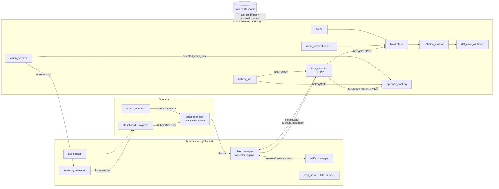

# Warehouse AMR System: Project Plan

> **Revision in progress (2026-11-03):** the answers to Q3, Q5, Q6 and Q7 (custom robot, our own Flask dashboard, ArUco first with ML/DL later, simulation only), the Phase 4a/4b split and the decisions in docs/decisions/ are being merged into this plan.

> Status: **planning**. No code yet. This file moves into the git repo in Phase 0 (see [Repo layout](#3-repository--package-layout)).
> Target: ROS 2 **Jazzy**, Gazebo **Harmonic** (gz-sim 8.15 via `ros_gz` 1.0.x), Nav2 1.3.x, BehaviorTree.CPP 4.10, ros2_control / `gz_ros2_control` 1.2.x. All versions were checked against `/opt/ros/jazzy` on 2026-11-02.

---

## 0. TL;DR

A simulated warehouse that fulfils orders with autonomous mobile robots (AMRs), built in 14 small phases (0-13). Each phase ends in a demo you can record and a git tag.

| Milestone | Phases | You can demo |
|---|---|---|
| **M0 Foundation** | 0 | CI passing on an empty repo, devcontainer, lint gates |
| **M1 Core AMR** | 1-6 | Custom robot fulfils a stream of orders in a custom warehouse, respects keepout and speed zones, docks to recharge on its own, and logs KPIs |
| **M2 Perception** | 7-8 | Inventory-scan patrol reads shelf tags, keeps inventory state, and flags discrepancies in RViz/Foxglove |
| **M3 Fleet** | 9-12 | 3 namespaced robots, a fleet manager with greedy then auction allocation, aisle traffic control, an operator dashboard, and the final showcase |
| **M4 Stretch** | 13 | Mobile manipulation: Nav2 to the shelf, then a MoveIt pick |

---

## 1. Assumptions (override any of these)

| # | Assumption | Why | Override impact |
|---|---|---|---|
| A1 | Simulation-first in Gazebo Harmonic. Hardware-agnostic through ros2_control | No hardware. ros2_control lets us swap `gz_ros2_control/GazeboSimSystem` for a real `SystemInterface` | Low |
| A2 | C++ (`rclcpp`) for runtime nodes. Python for launch, tooling, generators, and tests | This matches industry AMR stacks, and Nav2/BT.CPP plugins are C++ | Medium (BT/Nav2 plugins must stay C++) |
| A3 | **Custom AMR robot**, not TurtleBot3 (see D1) | Biggest learning payoff (URDF, ros2_control, gz sensors). TB3 makes the repo read as a tutorial | Fallback: `nav2_minimal_tb4_sim` (TB4, maintained for Jazzy+gz) |
| A4 | Host has 12 cores, 15 GB RAM, Intel Iris Xe iGPU, **no NVIDIA GPU** | Verified | Caps the fleet at about 3 robots in sim. Makes YOLO CPU-only, so ArUco is the primary perception path |
| A5 | Default RMW (Fast DDS), `ROS_AUTOMATIC_DISCOVERY_RANGE=LOCALHOST`, fixed `ROS_DOMAIN_ID` | Simplest choice. Only Fast DDS is installed | Revisit in Phase 9 if discovery or CPU becomes a problem (try `rmw_zenoh` or Cyclone) |
| A6 | Part-time pace of about 8-12 h/week. Effort below is in focused hours | | Scales linearly |
| A7 | Public GitHub repo, Apache-2.0 | Portfolio. Matches ROS ecosystem licensing | |
| A8 | Package prefix `warehouse_` (placeholder) | Readable | Rename before Phase 1 if you want a brand name (open question Q1) |
| A9 | The existing `maps/warehouse_map.*` is discarded. It is a TB3-world SLAM map, not a warehouse | | |

### Extra apt packages needed (not installed now)
| Phase | Packages |
|---|---|
| 0 | `pre-commit` (pip/pipx), `clang-format`, `ros-jazzy-ament-cmake-clang-format`, `ros-jazzy-ament-clang-format` |
| 1 | `ros-jazzy-rqt-tf-tree` |
| 5 | `ros-jazzy-diagnostic-aggregator`, `ros-jazzy-rqt-robot-monitor` |
| 4/6 | `ros-jazzy-foxglove-bridge`, `ros-jazzy-topic-tools` |
| 12 | `ros-jazzy-rosbridge-suite` |
| 13 | `ros-jazzy-moveit-setup-assistant`, `ros-jazzy-moveit-configs-utils` |
| opt. | `ros-jazzy-rmw-zenoh-cpp` or `ros-jazzy-rmw-cyclonedds-cpp`; `ultralytics` for the YOLO path |

---

## 2. System architecture

### 2.1 Logical view (end state, M3)



**Core split (D4).** Robots run the same robot-side stack inside `/robotN`. They know how to *execute a task* but know nothing about orders. System nodes know about orders, inventory, and allocation but never command velocities. This is the same split that Open-RMF and commercial fleet managers use.

### 2.2 Interfaces (`warehouse_interfaces`)

| Kind | Name | Key fields | Introduced |
|---|---|---|---|
| msg | `OrderLine` | `sku`, `quantity` | P4 |
| msg | `Order` | `order_id`, `OrderLine[] lines`, `priority`, `created` | P4 |
| msg | `OrderStatus` | `order_id`, `state` (QUEUED/ASSIGNED/IN_PROGRESS/COMPLETED/FAILED/CANCELLED), `robot_id`, stamps | P4 |
| msg | `Task` | `task_id`, `order_id`, `type` (MOVE/PICK/DROP/CHARGE/SCAN_AISLE/PARK), `location_ids[]` | P4 |
| msg | `RobotStatus` | `robot_id`, `mode` (IDLE/EXECUTING/DOCKING/CHARGING/ERROR/OFFLINE), `pose` (map), `battery_pct`, `task_id` | P4 |
| msg | `FleetState` | `RobotStatus[]` | P10 |
| msg | `InventoryObservation` | `location_id`, `tag_id`, `pose`, `confidence`, stamp | P7 |
| msg | `InventoryDiscrepancy` | `location_id`, `expected_sku`, `observed_sku`, `type` (MISSING/MISPLACED/UNEXPECTED) | P8 |
| srv | `SubmitOrder` / `CancelOrder` | `Order` -> `accepted`, `reason` | P4 |
| srv | `GetInventory` | filter -> records | P8 |
| srv | `ReserveZones` / `ReleaseZones` | `robot_id`, `zone_ids[]` -> `granted`, `retry_after` | P11 |
| action | `FulfillOrder` | goal `Order`. Feedback: `state`, `line_idx`, `robot_id`. Result: `error_code`, `error_msg`, `duration` | P4 |
| action | `ExecuteTask` | goal `Task`. Feedback: `stage`, `progress`. Result: `error_code`, `error_msg` | P4 |

Conventions: Nav2-style `uint16 error_code` constants inside each action, an `error_msg` string, and all IDs as strings. Messages carry IDs. Poses come from the location registry (the layout YAML), so topics never ship geometry they don't need.

### 2.3 Topics and QoS (robot-side names are relative, under `/robotN`)

| Topic | Type | Rate | QoS | Notes |
|---|---|---|---|---|
| `scan` | `sensor_msgs/LaserScan` | 10 Hz | SensorData (best-effort, depth 5) | gz `gpu_lidar` |
| `imu` | `sensor_msgs/Imu` | 100 Hz | SensorData | EKF input |
| `camera/image_raw`, `camera/depth/...` | `Image` | 10-15 Hz, 640x480 | SensorData | Turn off depth on robots that don't need it (CPU budget) |
| `odom` | `nav_msgs/Odometry` | 50 Hz | default reliable | From `diff_drive_controller`, with `enable_odom_tf: false` |
| `cmd_vel` chain | `geometry_msgs/TwistStamped` | 20 Hz | reliable | **Jazzy `diff_drive_controller` 4.42 accepts only stamped**, so set Nav2 `enable_stamped_cmd_vel: true` |
| `battery_state` | `sensor_msgs/BatteryState` | 2 Hz | reliable, depth 10 | Read by docking (`use_battery_status`) and the BT |
| `robot_status` | `RobotStatus` | 2 Hz + on change | reliable, depth 10 | Heartbeat. Fleet marks the robot OFFLINE after 3 s |
| `/map`, `/keepout_filter_mask`, `/speed_filter_mask`, `/costmap_filter_info` | `OccupancyGrid` / `CostmapFilterInfo` | latched | reliable + **transient_local** | Shared across robots |
| `/orders/status` | `OrderStatus` | on change | reliable, depth 50 | |
| `/inventory/discrepancies` | `InventoryDiscrepancy` | on change | reliable + transient_local, depth 100 | Late-joining UIs still see the history |
| `/fleet/state` | `FleetState` | 1 Hz | reliable, depth 1 | Dashboard feed |
| `/diagnostics` | `DiagnosticArray` | 1 Hz | default | `diagnostic_updater` in every custom node |

### 2.4 TF tree (per robot)

```
map ──(AMCL)──> odom ──(EKF: wheel odom + IMU)──> base_footprint ──(RSP)──> base_link
                                                                            ├── lidar_link
                                                                            ├── imu_link
                                                                            ├── camera_link ── camera_optical_frame
                                                                            ├── left/right_wheel_link (joint_states)
                                                                            └── caster_link(s)
```
- Multi-robot (D7): each robot uses **namespaced tf topics** (`/robotN/tf`) with unprefixed frames, which is the Nav2 convention. Fleet-level poses travel in `RobotStatus`, not TF.
- `map` frame = Gazebo world frame. The robot spawns at a known pose and SLAM is aligned to it, so the layout YAML, the masks, and the map all share one coordinate frame.

### 2.5 Execution model
| Node | Executor / threading | Why |
|---|---|---|
| `task_executor` | SingleThreaded. BT ticked from a 20 Hz wall timer. Action clients run in a dedicated callback group (Nav2 `BtActionNode` pattern) | A BT must never block. One thread keeps state access simple |
| `order_manager`, `fleet_manager` | MultiThreaded. Reentrant group for action/service servers, mutually-exclusive group for the allocation timer | Concurrent goals, with allocation serialised |
| `aruco_detector` | `rclcpp_components` component in a container with `image_transport`. Intra-process on | Zero-copy images |
| `battery_sim` | Lifecycle node, SingleThreaded | Deterministic model |
| Nav2 | Composed bringup (`use_composition: True`) | Standard. Lower overhead |

---

## 3. Repository & package layout

**Decision (D9):** the git repo root is **`/home/tanay/warehouse_ws/src/warehouse_amr/`**, a multi-package repo inside a standard colcon workspace.
- `build/ install/ log/` stay outside the repo automatically. Third-party sources go in `src/` next to it through `vcs import < warehouse_amr/dependencies.repos`.
- This is the layout `ros-tooling/action-ros-ci` expects.
- Phase 0 moves this file to `src/warehouse_amr/docs/PROJECT_PLAN.md` and deletes `warehouse_ws/docs/` and the stale `warehouse_ws/maps/`. Delete the stale `install/` and `log/` too.

```
warehouse_amr/
├── .github/workflows/        ci.yml (build/lint/test), sim-smoke.yml (nightly headless sim)
├── .devcontainer/            Dockerfile (osrf/ros:jazzy-desktop-full base), devcontainer.json
├── docs/                     PROJECT_PLAN.md, architecture.md, decisions/ADR-NNN-*.md, media/ (GIFs)
├── dependencies.repos        (vcs) third-party sources, initially empty
├── .pre-commit-config.yaml  .clang-format  .clang-tidy  README.md  LICENSE
├── warehouse_interfaces/     msgs/srvs/actions                                  [P4]
├── warehouse_description/    xacro AMR, ros2_control tags, gz sensor tags, meshes [P1]
├── warehouse_gazebo/         worlds, models (shelf, dock, tote, tags), bridge YAML, spawn launch [P1-2]
├── warehouse_layout/         (py) layout.yaml + generators: SDF world, filter masks, locations, route graph [P2]
├── warehouse_navigation/     nav2/ekf/amcl/docking params, maps, masks, BT XMLs, route graph [P2-3]
├── warehouse_battery/        (cpp) battery_sim lifecycle node                   [P5]
├── warehouse_task_executor/  (cpp) ExecuteTask server + BT.CPP plugin nodes      [P4]
├── warehouse_order_manager/  (cpp) order lifecycle, FulfillOrder, allocator plugin API [P4]
├── warehouse_perception/     (cpp) aruco_detector component; (py, opt) yolo node [P7]
├── warehouse_inventory/      (cpp) inventory_manager, markers                    [P8]
├── warehouse_fleet_manager/  (cpp) robot registry, Greedy/Auction allocators, traffic_manager [P10-11]
├── warehouse_ops/            (py) order_generator, kpi_tracker, scenario_runner, bag profiles [P4-6]
├── warehouse_bringup/        top-level launch + per-env config (sim.yaml, sim_fleet.yaml)  [P1+]
├── warehouse_system_tests/   launch_testing scenarios (headless gz)              [P3+]
├── warehouse_dashboard/      web UI (rosbridge) + Foxglove layouts               [P12]
└── warehouse_manipulation/   + warehouse_moveit_config (stretch)                 [P13]
```
Packages are created only in the phase that needs them. No empty scaffolding.

---

## 4. Decision log

| ID | Decision | Alternatives rejected | Why | Revisit if |
|---|---|---|---|---|
| D1 | Custom AMR (diff drive, ~0.6x0.45 m, 2D lidar, IMU, RGB-D on a mast) | TB3 as-is (reads as a tutorial, too small for warehouse aisles). TB4 (good fallback, but still borrowed) | You learn xacro, ros2_control, and gz sensors. Realistic footprint for aisles. Mast camera aims at shelf tags | Phase 1 exceeds about 2x its budget, so switch to `nav2_minimal_tb4_sim` |
| D2 | ros2_control + `gz_ros2_control` + `diff_drive_controller` | gz `DiffDrive` system plugin through the bridge | Hardware-agnostic. Industry standard. Teaches controller_manager | Multi-robot gz_ros2_control blocks Phase 9 (see R2) |
| D3 | EKF (`robot_localization`) fuses wheel odom + IMU into `odom->base_footprint`. AMCL on a static map | SLAM in production. Cartographer | Matches deployed AMRs (map once, localize). slam_toolbox is used only to build the map | |
| D4 | Robot-side `task_executor` (ExecuteTask action) vs system-side `order_manager`/`fleet_manager` | One monolithic manager that talks to Nav2 directly | Phase 4 single-robot code is reused unchanged in the fleet. Clean failure domains | |
| D5 | Task logic in **BehaviorTree.CPP v4** (XML trees, custom plugin nodes) inside `task_executor`. Nav2 keeps its own navigator BT | Hand-written state machine. SMACH-style Python | Industry-standard and inspectable (Groot2). Reuses Nav2's `BtActionNode` and the opennav_docking BT nodes (`libopennav_dock_action_bt_node.so`) | |
| D6 | Nav2 controller: **Regulated Pure Pursuit + Rotation Shim**. Planner: **Smac 2D** | MPPI (CPU-heavy x3 robots on an iGPU laptop). DWB | Predictable in aisles, cheap. MPPI becomes a benchmarked experiment in Phase 3 | MPPI wins the benchmark within the CPU budget |
| D7 | Multi-robot: namespaced topics + namespaced tf, unprefixed frames. Fleet state comes from `RobotStatus` | Global `/tf` with `robotN/` frame prefixes | Nav2's supported path. Real robots don't share a TF tree over WiFi | A single-RViz all-robots view becomes essential, so add a fleet MarkerArray instead |
| D8 | **Single source of truth `layout.yaml`** generates the SDF world, keepout/speed masks, location registry, ArUco placement, expected inventory, and the route graph | Hand-editing each artifact | Everything stays consistent, and scenarios can be randomized. This is what sets the project apart from tutorials | |
| D9 | Repo at `src/warehouse_amr` | Repo = workspace root | Standard. CI-friendly. Clean `vcs import` | |
| D10 | Docking via **opennav_docking `SimpleChargingDock`**. Phase 5 uses the database pose. Phase 7 upgrades to `detected_dock_pose` from ArUco | Writing a docking controller | It is installed and production-grade. The upgrade path itself is a learning step | |
| D11 | Battery = our own `battery_sim` ROS node (drain from `odom` twist + idle load, charging when within the dock contact zone **and** docked), publishing `BatteryState` | gz `LinearBatteryPlugin` + bridge | Hardware-agnostic, unit-testable, controllable from tests. `SimpleChargingDock` treats `current > charging_threshold` as charging, so we must set the current sign correctly | |
| D12 | Allocators are **pluginlib** plugins behind `warehouse_order_manager::AllocatorInterface` (Single -> Greedy -> Auction) | if/else in the manager | Lets you A/B benchmark allocators. Teaches pluginlib | |
| D13 | Traffic: zone (aisle) reservation mutex in `traffic_manager`, with an optional upgrade to `nav2_route` graph edges (installed: `route_server`, `ComputeRoute` BT nodes) | Open-RMF traffic schedule | Small enough to build yourself. Open-RMF is documented as the industrial comparison | |
| D14 | Lint: `ament_lint_auto` (copyright, xmllint, lint_cmake, flake8, pep257) + **clang-format** (exclude uncrustify & cpplint because they conflict). pre-commit runs the same formatters | uncrustify only | clang-format integrates with editors. Avoid two C++ formatters fighting | |
| D15 | Bags in **MCAP** (`rosbag2_storage_mcap` installed) with per-scenario topic profiles | sqlite3 | Opens natively in Foxglove. Industry default now | |
| D16 | Parameters declared with `generate_parameter_library` (installed) | Hand-written `declare_parameter` | Typed, validated params with auto-docs. Common in ros2_control and industry | |
| D17 | Dashboard: Foxglove (debug/ops, early) + a small web UI via rosbridge (Phase 12) | Only RViz. rqt plugins | Foxglove is the industry viewer. The web UI shows full-stack skill | |

Keep these as ADRs in `docs/decisions/`. Whenever a later phase contradicts one, write a new ADR that supersedes it.

---

## 5. Phases

Effort key: **S** about 8-12 h, **M** about 12-20 h, **L** about 20-35 h. Each phase gets a branch `phase-N-*`, a PR (merged by yourself), a git tag `vN.0`, a README section, and a GIF in `docs/media/`.

### Phase 0: Repo & tooling foundation [S]
- **Goal:** a professional skeleton where CI is green before any robotics code exists.
- **Deliverables:** git repo per D9. `.gitignore`. Apache-2.0 LICENSE. README skeleton with badges. `.clang-format` (ROS 2 style). `.pre-commit-config.yaml` (clang-format, ruff or flake8, xmllint, yamllint, trailing whitespace, check-added-large-files). `ci.yml` using `ros-tooling/setup-ros` + `ros-tooling/action-ros-ci` (target `jazzy`, ubuntu-24.04), with colcon build, colcon test, and test-result upload. Devcontainer (`osrf/ros:jazzy-desktop-full`, `/dev/dri` passthrough for the Iris Xe, X11/Wayland socket). `docs/decisions/ADR-000-template.md`. One trivial `warehouse_bringup` package so CI has something to build.
- **Concepts:** colcon workspaces/overlays, `package.xml` format 3, rosdep, ament_lint, CI for ROS.
- **Acceptance:** a fresh clone runs `rosdep install && colcon build && colcon test` and passes in both the devcontainer and GitHub Actions. pre-commit blocks a badly formatted C++ file.

### Phase 1: Custom AMR description + sim bring-up [M-L]
- **Goal:** the robot drives in an empty gz world through ros2_control, with all sensors visible in RViz.
- **Deliverables:** `warehouse_description`. Modular xacro: `base.xacro`, `sensors.xacro` (gz `gpu_lidar`, `imu`, `rgbd_camera`), `ros2_control.xacro` with a `use_sim` arg that switches hardware plugins. Correct inertias (macro helpers). Collision geometry simpler than the visual geometry. `warehouse_gazebo`: spawn launch, `ros_gz_bridge` YAML config (clock, scan, imu, camera). Controllers YAML: `diff_drive_controller`, `joint_state_broadcaster`, `imu_sensor_broadcaster`. Teleop with `teleop_twist_keyboard --ros-args -p stamped:=true`. All launch args take a `namespace` from day one. Launch files use relative topic names, never `/scan`.
- **Concepts:** URDF/xacro, `robot_state_publisher`, TF, ros2_control (hardware interface, controller_manager, controllers), ros_gz bridge, `use_sim_time`, sensor QoS.
- **Acceptance:** `ros2 launch warehouse_bringup sim.launch.py world:=empty` drives the robot by teleop. `ros2 run tf2_tools view_frames` matches section 2.4. `ros2 control list_controllers` shows all controllers active. Wheel odometry drift is under 5% over a 10 m straight line. A launch_testing check confirms `/scan`, `/imu`, and `/odom` publish at their expected rates. **GIF:** teleop with the RViz sensor view.

### Phase 2: Warehouse world from layout + mapping + localization [M-L]
- **Goal:** a realistic warehouse generated from one YAML file, mapped once, with reliable localization.
- **Deliverables:** `warehouse_layout` (Python).
  - `layout.yaml` describes the hall (about 30x20 m), shelf rows and aisles, slot IDs, the packing station, 1-3 charging docks, keepout zones (a fenced machinery area), speed zones (the pedestrian crossing and the packing area), and spawn poses.
  - Generators produce the `.sdf` world (shelves as reusable gz models), the location registry, and expected inventory.
  - Unit tests (pytest) check the geometry.
  - Build the map with `slam_toolbox` (online async), save it to `warehouse_navigation/maps/`, and archive the old TB3 map.
  - EKF config, AMCL config.
- **Concepts:** SDF/gz models, SLAM vs localization, `robot_localization`, map_server, lifecycle manager, transient_local QoS.
- **Acceptance:** regenerating the world from `layout.yaml` is deterministic (byte-identical output; CI test). The SLAM map overlays the world within 1 cell. AMCL converges within 2 m of driving from the spawn pose, and the localization error against gz ground truth stays under 0.10 m during a 5 min teleop run. A bag-based evaluation script reports this. **GIF:** mapping time-lapse.

### Phase 3: Navigation with zones and safety [M]
- **Goal:** reliable point-to-point navigation that respects warehouse rules.
- **Deliverables:** `warehouse_navigation` with Nav2 params (D6, `enable_stamped_cmd_vel: true`) and a robot footprint polygon. `KeepoutFilter` + `SpeedFilter` through `costmap_filter_info_server` and a mask `map_server`, with masks *generated from layout.yaml*. `collision_monitor` (stop polygon + slowdown polygon) in the standard Nav2 chain: controller -> `velocity_smoother` -> `collision_monitor` -> `diff_drive_controller`. Navigation to named locations via a small CLI (`nav2_simple_commander`). `warehouse_system_tests` gets its first headless launch_testing scenario. Benchmark script with MCAP bag recording.
- **Concepts:** Nav2 architecture (BT navigator, planner/controller/smoother servers, costmap layers, lifecycle), costmap filters, the safety layer, parameter tuning methodology.
- **Acceptance:** at least 95% success over 50 random reachable goals, with zero entries into keepout. Speed in the speed zones stays at or below the configured cap (verified from the bag). A pedestrian box dropped into the path triggers the collision-monitor stop. Optional: an RPP vs MPPI table (success, time, CPU%). **GIF:** robot detouring around keepout and slowing in a zone.

### Phase 4: Order manager + BT task executor [L]
- **Goal:** orders go in and the robot fulfils them autonomously.
- **Deliverables:**
  - `warehouse_interfaces` with the P4 rows of section 2.2.
  - `warehouse_task_executor`: an `ExecuteTask` action server running BT.CPP trees from XML. Custom nodes: `GoToLocation` (wraps NavigateToPose and resolves location IDs from the registry), `SimulatePick`/`SimulateDrop` (timed wait, then publish an event), `CheckBattery` (stub until P5). Publishes `RobotStatus`.
  - `warehouse_order_manager`: lifecycle node with a `SubmitOrder` service, a priority queue, and a `FulfillOrder` action. Orders are decomposed into tasks (pick lines grouped by aisle, then drop at the packing station). `AllocatorInterface` plugin API with a `SingleRobotAllocator`.
  - `warehouse_ops`: `order_generator` (Poisson arrivals, seeded) and `kpi_tracker` (orders/hour, cycle time, nav success rate, distance per order), which publishes and writes CSV.
  - Parameters via `generate_parameter_library`.
  - Start using Foxglove for debugging.
- **Concepts:** custom interfaces, actions (goal/feedback/cancel/preempt), lifecycle nodes, BT.CPP v4 (ports, blackboard, reactive vs sequence, Groot2), pluginlib, executors and callback groups, gtest with mocked action servers.
- **Acceptance:** the generator submits 20 orders and all complete, with KPIs logged. Cancelling an in-flight order aborts cleanly and the robot parks. gtest covers order decomposition and the state machine, BT tree logic runs against a fake Nav2 action server, and line coverage of the order manager is at least 70%. **GIF:** orders streaming in Foxglove with live KPI plots.

### Phase 5: Battery, autonomous docking, diagnostics [M]
- **Goal:** the robot runs indefinitely and manages its own energy.
- **Deliverables:**
  - `warehouse_battery` (`battery_sim` lifecycle node, D11, with unit-tested drain/charge curves).
  - Dock models in gz (with an ArUco tag already on the face for P7).
  - `opennav_docking` server with `SimpleChargingDock` (dock database from layout.yaml, `use_battery_status: true`, `use_external_detection_pose: false` for now).
  - BT branches: a reactive `BatteryLow` guard that finishes the current line or aborts by policy, then docks, charges to the threshold, and undocks. `CHARGE` task type. Opportunistic charging when idle.
  - `diagnostic_updater` in every custom node, plus a `diagnostic_aggregator` config (Power, Navigation, Tasks, Sensors).
  - Structured logging convention: a `[order=.. task=.. robot=..]` prefix and throttled logs.
- **Concepts:** Nav2 docking, reactive BTs and preemption, diagnostics, a real-world energy-policy trade-off.
- **Acceptance:** a 60 min sim-time soak with continuous orders shows at least 2 autonomous dock/charge/undock cycles, battery never below 10%, and dock success of at least 95%. `rqt_robot_monitor` shows all groups OK. The soak test is runnable via `scenario_runner`. **GIF:** low battery, then interrupting work, docking, and resuming.

### Phase 6: Core hardening (v1.0 release) [S-M]
- **Goal:** turn M1 into a polished, reproducible release.
- **Deliverables:**
  - The nightly `sim-smoke.yml` (headless `gz sim -s`, software or EGL rendering) runs the Phase 4 scenario.
  - Bag profiles (`warehouse_ops/bag_profiles/*.yaml`) and a `record.launch.py`.
  - A Foxglove layout committed to the repo.
  - `architecture.md` with diagrams. Per-env config overrides in `warehouse_bringup/config/`.
  - A failure-injection test (Nav2 goal fails, so the task retries N times, then the order is FAILED with a reason).
  - Tag `v1.0`.
- **Acceptance:** a stranger can go from clone to demo in 3 commands. The nightly sim job is green on 5 consecutive runs. **Video:** 2 min narrated M1 demo.

### Phase 7: Fiducial perception [M]
- **Goal:** the robot perceives shelf slots and the dock.
- **Deliverables:**
  - `warehouse_perception/aruco_detector` as an `rclcpp_components` component. OpenCV 4.6 `cv::aruco` (verified available), `image_transport`, `camera_info`. Poses are transformed into `map` via tf2 using the image stamp.
  - Publishes `InventoryObservation` and `visualization_msgs/MarkerArray`.
  - Tag textures generated and placed by `warehouse_layout`.
  - Dock tag publishes `detected_dock_pose`, with docking switched to `use_external_detection_pose: true` (D10).
  - Regression test that replays a recorded MCAP bag through the detector.
  - The YOLO path (vision_msgs `Detection2DArray`, CPU, Python) is optional and only behind the same interface (A4).
- **Concepts:** camera models, `image_transport`, component composition + intra-process, tf2 time travel, bag-based regression testing.
- **Acceptance:** at least 98% tag detection at 1.5 m and 10 Hz. Mean position error under 5 cm against ground truth. Docking still succeeds at least 95% with detection-based alignment, even when the dock is moved 10 cm in the world. **GIF:** detections overlaid on the camera feed and in RViz.

### Phase 8: Inventory patrol + discrepancy reporting [M]
- **Goal:** the robot keeps a live inventory and reports mismatches.
- **Deliverables:**
  - `warehouse_inventory/inventory_manager` fuses observations per slot (expected from layout vs observed, with confidence and last-seen), offers a `GetInventory` service, and publishes `InventoryDiscrepancy` (transient_local).
  - Colour-coded RViz/Foxglove markers.
  - `SCAN_AISLE` task type: a BT that follows the aisle via `NavigateThroughPoses`, with the camera pointing at the shelves.
  - Scheduled patrols are interleaved with orders by priority.
  - A scenario generator randomly removes or swaps N tags in the world.
- **Acceptance:** with 10 injected discrepancies, the patrol reports at least 9 with no more than 1 false positive. Order throughput drops by no more than 15% when patrols are enabled. **GIF:** patrol turning markers red. Tag `v2.0`.

### Phase 9: Multi-robot bring-up [M-L]
- **Goal:** 3 robots in one world, each with its own isolated stack.
- **Deliverables:**
  - Spawn N robots from `sim_fleet.yaml`, each with `/robotN` namespaces (D7).
  - Per-robot gz_ros2_control controller_manager (`<ros><namespace>` in the plugin, see R2).
  - Per-robot Nav2 via `nav2_bringup` namespacing with `RewrittenYaml`, sharing one map server and the filter servers.
  - Per-robot dock assignment.
  - RTF monitoring.
  - Other robots appear as obstacles in each costmap through lidar.
- **Concepts:** namespaces vs remapping, launch composition with `GroupAction`/`PushRosNamespace`, DDS discovery cost, sim performance budgeting.
- **Acceptance:** 3 robots navigate simultaneously to random goals for 10 min with no TF or topic cross-talk (a launch_testing check asserts the topic list per namespace). Real-time factor stays at or above 0.7 on this laptop. **GIF:** 3 robots in Foxglove.

### Phase 10: Fleet manager v1, greedy allocation [M]
- **Goal:** orders are distributed across the fleet.
- **Deliverables:**
  - `warehouse_fleet_manager`: robot registry (heartbeat via `RobotStatus`, OFFLINE detection), `FleetState`, and a `GreedyAllocator` plugin (nearest idle robot with battery margin).
  - Charge-aware dispatch (never assign to a robot below its threshold).
  - Robot failure handling: kill a robot mid-task and the task is re-queued.
  - Per-robot and fleet KPIs.
- **Acceptance:** throughput scales from 1 to 3 robots by at least 2x. The kill-robot test re-assigns its order within 5 s. Allocator unit tests are deterministic and seeded.

### Phase 11: Auction allocation + traffic management [L]
- **Goal:** smarter allocation and no aisle deadlocks.
- **Deliverables:**
  - `AuctionAllocator`: sequential single-item auction. Bids use the path cost from each robot's `compute_path_to_pose` plus the queued workload.
  - `traffic_manager`: aisles are exclusive zones from layout.yaml, managed with `ReserveZones`/`ReleaseZones`. A BT node `AcquireZones` runs before entering an aisle. Timeout-based deadlock detection, then re-route or back off.
  - Optional upgrade: lane graph via `nav2_route` (`route_server`, `ComputeAndTrackRoute`).
  - Benchmark: greedy vs auction across 3 seeded order mixes.
  - ADR comparing this to Open-RMF.
- **Concepts:** multi-agent task allocation, mutual exclusion and deadlock in distributed systems, experimental methodology.
- **Acceptance:** a scripted head-on aisle conflict resolves with no collision and no deadlock in 20/20 runs. The auction shows lower mean cycle time than greedy, or the result is honestly documented if it doesn't.

### Phase 12: Ops dashboard + showcase [M]
- **Goal:** an operator-facing UI and the portfolio finale.
- **Deliverables:**
  - `warehouse_dashboard`: a small web app (rosbridge + roslibjs, single page) with an order submission form, a fleet table (mode, battery, task), a live KPI panel, and a discrepancy list.
  - Foxglove layout for engineers.
  - Final **showcase scenario** (`scenario_runner showcase`): 3 robots, 15 min of order flow, a patrol, a forced low battery, a blocked aisle, and a robot failure, all handled autonomously, with an auto-generated KPI report.
  - Final README.
- **Acceptance:** the showcase runs headless in the nightly CI and produces a KPI report artifact. **Video:** 3-4 min narrated showcase. Tag `v3.0`.

### Phase 13 (stretch): Mobile manipulation [L+]
- **Goal:** pick a tote from a low shelf.
- **Deliverables:**
  - Mount OpenMANIPULATOR-X on the AMR by reusing the `open_manipulator_x.urdf.xacro` macro from `turtlebot3_manipulation_description` (installed).
  - Arm controllers alongside diff drive in the same controller_manager.
  - MoveIt config via the setup assistant.
  - gz `DetachableJoint` system (installed) to "grasp".
  - BT handoff: Nav2 to the pre-grasp pose, stop the base, MoveIt pick, stow, then Nav2.
  - Note: the reach is only about 0.38 m, so use a low pick shelf.
- **Acceptance:** 8/10 successful autonomous picks from 3 slot positions.

**Rough total:** M1 is about 110-150 h, M2 about 35-45 h, M3 about 75-100 h, and the stretch about 35+ h.

---

## 6. Cross-cutting engineering practices (applied in every phase)

| Practice | Rule |
|---|---|
| Namespacing | Every node and launch file is namespace-safe from Phase 1. No absolute topic names in robot-side code |
| Lifecycle | Custom long-running nodes (`order_manager`, `battery_sim`, `inventory_manager`, `fleet_manager`, `traffic_manager`) are lifecycle nodes managed by `nav2_lifecycle_manager` (or our own lifecycle manager instance) |
| Parameters | YAML per package with `generate_parameter_library` validation. No magic numbers in code. `warehouse_bringup/config/<env>.yaml` overrides |
| Testing pyramid | gtest/pytest for pure logic (no ROS where possible), launch_testing for node contracts with fakes, headless gz scenarios for system behaviour, bag replay for perception |
| Determinism | Seeded generators, `use_sim_time` everywhere, scenarios parameterised by seed |
| Observability | diagnostics in every custom node, KPIs as topics + CSV, MCAP bags per scenario, a structured log prefix, `RCUTILS_CONSOLE_OUTPUT_FORMAT` set in launch |
| Docs | ADR per decision, README section + GIF per phase, `architecture.md` kept current |
| Git | Branch and PR per phase, Conventional Commits, tags per milestone, CI required to merge |

---

## 7. Risks & mitigations (Jazzy + gz specific)

| # | Risk | Likelihood | Mitigation |
|---|---|---|---|
| R1 | **TwistStamped mismatch**: Jazzy `diff_drive_controller` (4.42) subscribes only to `TwistStamped`, while Nav2 and teleop default to `Twist` | High | `enable_stamped_cmd_vel: true` in all Nav2 servers. `stamped:=true` for teleop. Check with `ros2 topic info -v` |
| R2 | **gz_ros2_control multi-robot**: one controller_manager per model; namespace via `<ros><namespace>` in the plugin tag; past bugs with param files and `robot_description` lookup | Med-High | Prove 2 robots in a throwaway branch at the *start* of Phase 9. Fallback: gz `DiffDrive` + `JointStatePublisher` systems via the bridge (ADR) |
| R3 | **Sim performance** (iGPU, 15 GB): 3x (gpu_lidar + RGB-D) + 3x Nav2 | High | Headless server plus a separate GUI. Depth only on scanning robots. 10 Hz cameras at 640x480. RPP not MPPI. Monitor RTF in KPIs. Cap at 3 robots |
| R4 | Headless rendering sensors in CI (no GPU) | Med | EGL/Mesa software rendering (`--headless-rendering`). Nightly job separate from the required PR CI. PR CI only runs non-rendering tests |
| R5 | TF / clock issues (`use_sim_time` missing, stale transforms, EKF and diff_drive both publishing `odom->base`) | High (classic) | `enable_odom_tf: false` in the controller. Launch-level `use_sim_time` via `SetParameter`. Phase 1 TF check test |
| R6 | Map vs world misalignment breaks generated masks | Med | Spawn at the layout origin. Verify the overlay in a Phase 2 test. Fallback: rasterize the map directly from layout.yaml |
| R7 | Docking flakiness (staging pose, contact detection) | Med | Tune `staging_x_offset` and tolerances. Battery-based charge detection. Retry in the BT. Measured over 20+ dock cycles |
| R8 | BT.CPP v4 vs Nav2 plugin ABI: Nav2 Jazzy uses BT.CPP 4.x, so custom nodes must link against the same `behaviortree_cpp` | Low | Use the system `behaviortree_cpp` only. `behaviortree_ros2` is **not** installed, so use `nav2_behavior_tree::BtActionNode` or a thin wrapper of our own |
| R9 | DDS discovery storms with 3 robots of Nav2 (~150 nodes) | Med | Localhost discovery range. Composition. If needed, try `rmw_zenoh` (ADR) |
| R10 | Scope creep / burnout | High | Every phase is demoable alone. M1 alone is a complete portfolio piece. Stretch is explicitly optional |

---

## 8. Portfolio deliverables

- **README**: elevator pitch, a 20 s hero GIF, an architecture diagram, a feature matrix per milestone, a quick start (devcontainer, then 3 commands), KPI table, and a "What I'd do on real hardware" section.
- **docs/architecture.md**: section 2 of this plan, kept current. **docs/decisions/**: ADRs D1-D17 and later ones.
- **Media**: one GIF per phase. Narrated videos at v1.0 (M1), v2.0, and v3.0 (showcase).
- **Evidence**: CI badges, test-coverage badge, benchmark tables (RPP vs MPPI, greedy vs auction, 1 vs 3 robots), and a sample KPI report.
- **Showcase scenario**: Phase 12, reproducible from a single command.

---

## 9. Open questions for you

| # | Question | Default if unanswered |
|---|---|---|
| Q1 | Project/brand name (package prefix and repo name)? | `warehouse_` / `warehouse_amr` |
| Q2 | Weekly time budget, and is there a target date (e.g. a job application)? | 8-12 h/week. Treat M1 (v1.0) as the must-have |
| Q3 | Custom AMR (recommended) or TB4 to move faster? | Custom |
| Q4 | Are you OK installing the extra apt packages in section 1 (Foxglove bridge, rosbridge, diagnostic_aggregator, clang-format tooling)? | Yes, per phase |
| Q5 | Is Foxglove (free tier, proprietary app) acceptable, or should the UI be fully open source? | Foxglove + our own web UI |
| Q6 | Perception: ArUco only, or also invest in the YOLO path given CPU-only inference? | ArUco primary, YOLO optional |
| Q7 | Will real hardware ever exist? If yes, which base, so the ros2_control hardware interface can be planned | Sim only, with a hardware-ready design |
