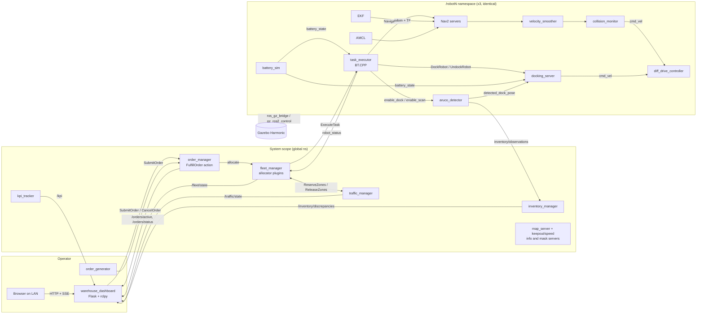

# Warehouse AMR System: Project Plan

> **Version 2, 2026-11-03.** Status: **M0 done** (Phase 0 delivered, decisions in [decisions/](decisions/); tag `phase-0` pending until this revision merges). Phase 1 is next.
> Target: ROS 2 **Jazzy**, Gazebo **Harmonic** (gz-sim 8.15 via `ros_gz` 1.0.24), Nav2 1.3.13, BehaviorTree.CPP 4.10, ros2_control 4.48 / ros2_controllers 4.42.1 / `gz_ros2_control` 1.2.20, OpenCV 4.6 (contrib). Versions checked against `/opt/ros/jazzy` on 2026-11-02 and 2026-11-03.

**Changes since v1**
1. Robot: our own tote-carrying AMR from one `robot.yaml`, built in revisions A-G. The EKF moves into Phase 1 and the cameras into Phase 7. Jazzy wiring fixed: controller and TF remaps, unprefixed frames, namespaced gz topics, `speed_limit`, separate filter servers, a rotation safety circle.
2. Phases: Phase 4 is split into 4a (interfaces + BT executor), 4b (orders + KPIs) and 4c (operator dashboard v1). Later phases add dashboard slices, and P12 stays lean.
3. Operator UI: our own Flask dashboard (backend-for-frontend, SSE, LAN testing) replaces v1's third-party web viewer and browser-side ROS bridge. Deployment is a post-project backlog (§10).
4. Perception: ArUco first (P7-8) with on-demand cameras, IPPE disambiguation and target-dock detection. Learned detection is an optional Phase 8b; its research is paused.
5. Process: Phase 0 is delivered (ADR-001..004). `phase-N` marker tags, releases only at v1.0.0, v2.0.0 and v3.0.0. Efforts re-estimated: about 243-417 h for M1-M3.

---

## 0. TL;DR

A simulated warehouse in which identical, custom-built AMRs fulfil orders, recharge themselves, scan inventory and work as a fleet. It is built in phases 0-13 (Phase 4 split into 4a/4b/4c, plus an optional 8b). From Phase 1 on, every phase ends with a recorded demo (GIF or video) and a `phase-N` tag; M1, M2 and M3 each end with a GitHub Release.

| Milestone | Phases | Release | Deliverables (what you can demo) |
|---|---|---|---|
| **M0 Foundation** (done) | 0 | — | CI green on a one-package repo, lint gates, GUI and headless dev containers, protected `main` |
| **M1 Core AMR** | 1-6 (incl. 4a, 4b, 4c) | v1.0.0 | A custom tote-carrying AMR that fulfils a stream of orders in a generated warehouse, respects keepout and speed zones, docks to recharge on its own and logs KPIs. Operators submit orders and watch the live map in our Flask dashboard |
| **M2 Perception** | 7-8 | v2.0.0 | Docking on a detected ArUco tag. An inventory patrol that reads tote tags with the side cameras, keeps inventory state and flags discrepancies in RViz and the dashboard |
| **M3 Fleet** | 9-12 | v3.0.0 | 3 identical robots, greedy then auction allocation, aisle traffic control, fleet and traffic views in the dashboard, and the final showcase |
| **Optional** | 8b, 13 | — | Learned tote detection trained on Colab (8b, research paused) and mobile manipulation (13, stretch) |

---

## 1. Assumptions

| # | Assumption | Why | Override impact |
|---|---|---|---|
| A1 | Simulation only (Gazebo Harmonic), no hardware. Hardware-agnostic through ros2_control: `hardware:=gz\|mock\|real`, with `real` reserved for a future `SystemInterface` | Decided (Q7) | Low |
| A2 | C++ (`rclcpp`) for runtime nodes. Python for launch, tooling, generators, tests and the operator dashboard (off the control path, D17) | Matches industry AMR stacks; Nav2/BT.CPP plugins are C++ | Medium |
| A3 | **Custom tote-carrying AMR**, designed here and refined in revisions A-G (§2.6, D1). Resolved | Biggest learning payoff; a borrowed TB3/TB4 reads as a tutorial | If Phase 1 runs over 2x budget, simplify our robot (primitive collisions, fewer sensors, gz `DiffDrive` per R2). TB3/TB4 sims stay reference code only |
| A4 | Host: Intel i5-1335U, **10 cores / 12 threads** (2P+8E hybrid, AVX2/AVX-VNNI), 15 GB RAM, Iris Xe iGPU, **no NVIDIA GPU** | Verified | Fleet capped at 3 robots. ArUco first; ML trains on Colab Pro and runs CPU-only. 2-thread latency varies about 2.3x between P- and E-cores, so benchmarks record power mode and load |
| A5 | Fast DDS. The dev containers set `ROS_AUTOMATIC_DISCOVERY_RANGE=LOCALHOST` and `ROS_DOMAIN_ID=42`. CI runs in an isolated job container with the defaults, and P1 adds LOCALHOST to `ci.yml` with the first launch tests. Launch tests use `domain_coordinator` domains everywhere | Isolated, reproducible | The host shell differs (A9, R16). Revisit the RMW in Phase 9 (`rmw_zenoh`, Cyclone) |
| A6 | About 8-12 h/week; effort is in focused hours | Q2 | Scales linearly |
| A7 | Public repo `github.com/TANAY779/ros2-warehouse-amr`, Apache-2.0; `main` protected (PR + both CI checks) | Portfolio | |
| A8 | Packages keep the `warehouse_` prefix | Q1 | |
| A9 | The host shell stays as it is: `~/.bashrc` sources three other workspaces (four other roots end up on `PYTHONPATH`), `ROS_AUTOMATIC_DISCOVERY_RANGE=SUBNET`, no `ROS_DOMAIN_ID`, and Flask 3.1.3 in the user site shadows the apt Flask 3.0.2 that rosdep installs | Your choice | CI and the dev containers are the clean reference; dashboard code targets the Flask 3.0 API (R16) |

### Dependencies per phase
All dependencies are rosdep keys in `package.xml` and resolve to apt. Nothing is pip-installed on the host (PEP 668).

| Phase | Still to install | Already installed (declare anyway) |
|---|---|---|
| 0 | `ros-jazzy-ament-cmake-clang-format` (pulls `ament_clang_format`): installed by `rosdep install` (a `warehouse_bringup` test_depend); the dev container has it | `clang-format` 18, `pre-commit` 3.6.2, `yamllint` |
| 1 | `ros-jazzy-rqt-tf-tree`; optional `ros-jazzy-gz-ros2-control-demos` (reference only) | `gz_ros2_control` 1.2.20, `ros2_controllers` 4.42.1, `ros2_control` 4.48, `xacro`, `ros_gz` 1.0.24, `robot_localization` 3.8.3, `teleop_twist_keyboard` 2.4.1, `launch_testing_ros`, `domain_coordinator` |
| 2-3 | — | `slam_toolbox` 2.8.5, `navigation2` 1.3.13 (AMCL, collision monitor, Smac, route server), `rosbag2_storage_mcap` |
| 4a-4b | `clang-tidy` 18 + `ros-jazzy-ament-cmake-clang-tidy` (test_depend; runs in `colcon test` on `compile_commands.json`), `python3-colcon-lcov-result` (C++ coverage) | `behaviortree_cpp` 4.10, `nav2_behavior_tree`, `opennav_docking_bt`, `generate_parameter_library` 0.7.6, PlotJuggler 3.17.2. Groot2 is a separate download, not a dependency |
| 4c | `python3-flask` (apt 3.0.2); test: `python3-pytest-timeout` | `python3-pil`, `python3-yaml`, `python3-pytest-cov` |
| 5 | `ros-jazzy-diagnostic-aggregator`, `ros-jazzy-rqt-robot-monitor` | `opennav_docking` 1.3.13, `diagnostic_updater` |
| 7 | Optional `ros-jazzy-aruco-opencv` (baseline comparison only) | OpenCV 4.6 + contrib (`libopencv-dev`), `cv_bridge`, `image_transport`, `image_geometry` |
| 8b (paused) | `ros-jazzy-onnxruntime-vendor` (ONNX Runtime, C/C++ API only). Python ML packages live only in Colab | `vision_msgs` (detector debug output) |
| 13 | `ros-jazzy-moveit`, `ros-jazzy-moveit-setup-assistant`, `ros-jazzy-moveit-configs-utils` | `turtlebot3_manipulation_description` (arm macro only) |
| opt. | `ros-jazzy-rmw-zenoh-cpp` or `ros-jazzy-rmw-cyclonedds-cpp` (P9, only if needed); `ros-jazzy-topic-tools` only if a bag profile needs `throttle` | |
| post-project | waitress ≥ 3.0.1 in the deployment image, not apt's 2.1.2 (§10) | |

Chart.js 4.6.1 (MIT) is a vendored file in `warehouse_dashboard` from P6, not a package.

---

## 2. System architecture

### 2.1 Logical view (end state, M3)



**Core split (D4).** Every robot runs the same stack inside `/robotN`. It knows how to *execute a task* but nothing about orders. System nodes know about orders, inventory and allocation but never command velocities. Open-RMF and commercial fleet managers use the same split. Until P10, `order_manager`'s `SingleRobotAllocator` sends `ExecuteTask` directly. Docking commands bypass the smoother and the collision monitor on purpose (D21).

### 2.2 Interfaces (`warehouse_interfaces`)

| Kind | Name | Key fields | Introduced |
|---|---|---|---|
| msg | `OrderLine` | `sku`, `quantity` | 4a |
| msg | `Order` | `order_id` (client-generated, unique), `OrderLine[] lines`, `priority`, `created` | 4a |
| msg | `OrderStatus` | `order_id`, `state` (QUEUED/ASSIGNED/IN_PROGRESS/COMPLETED/FAILED/CANCELLED), `robot_id`, `reason`, stamps | 4a |
| msg | `ActiveOrders` | `stamp`, `OrderStatus[] orders` (every non-terminal order): the state snapshot for late joiners | 4a |
| msg | `Task` | `task_id`, `order_id`, `type` (MOVE/PICK/DROP/CHARGE/SCAN_AISLE/PARK), `location_ids[]` | 4a |
| msg | `RobotStatus` | `robot_id`, `mode` (IDLE/EXECUTING/DOCKING/CHARGING/ERROR/OFFLINE), `pose` (map), `battery_pct`, `task_id`. No capability field: all robots are identical (D1) | 4a |
| msg | `KpiSnapshot` | `stamp`, `window_s`, completed/failed/cancelled counts, `throughput_per_h`, `cycle_time_mean_s`, `cycle_time_p95_s`, `nav_success_rate`, `distance_per_order_m`; per-robot array added in P10 | 4a |
| msg | `FleetState` | `RobotStatus[]` | 10 |
| msg | `InventoryObservation` | `header` (image stamp, `map`), `robot_id`, `source` (FIDUCIAL; DETECTOR reserved for 8b), `tag_id`, `pose`, `confidence`, `location_id`, `occupied` (negative evidence). The last two are filled from P8 | 7 |
| msg | `InventoryDiscrepancy` | `location_id`, `expected_sku`, `observed_sku`, `type` (MISSING/MISPLACED/UNEXPECTED) | 8 |
| msg | `ZoneState` / `TrafficState` | `zone_id`, `holder_robot_id` (empty = free), `waiting_robot_ids[]`, `since` / `ZoneState[] zones` | 11 |
| srv | `SubmitOrder` / `CancelOrder` | `Order` / `order_id` → `accepted`, `reason`. A repeated `order_id` returns `duplicate`, so retries are idempotent | 4a |
| srv | `EnableDockDetection` | `enable`, `dock_id` → `success` (the scan inputs use `std_srvs/SetBool`) | 7 |
| srv | `GetInventory` | filter → records | 8 |
| srv | `ReserveZones` / `ReleaseZones` | `robot_id`, `zone_ids[]` → `granted`, `retry_after` | 11 |
| action | `FulfillOrder` | goal `Order`. Feedback: `state`, `line_idx`, `robot_id`. Result: `error_code`, `error_msg`, `duration` | 4a |
| action | `ExecuteTask` | goal `Task`. Feedback: `stage`, `progress`. Result: `error_code`, `error_msg` | 4a |

Conventions: Nav2-style `uint16 error_code` constants inside each action plus an `error_msg` string; all IDs are strings. A cancelled goal ends with the action status `CANCELED`; the order state is spelled `CANCELLED`. Messages carry IDs; poses come from the location registry (generated from `layout.yaml`), so topics never ship geometry they don't need.

### 2.3 Topics and QoS (robot-side names are relative, under `/robotN`)

| Topic | Type | Rate | QoS | Notes |
|---|---|---|---|---|
| `scan`, `scan_rear` (P3) | `LaserScan` | 10 Hz | SensorData | Front-left / rear-right `gpu_lidar`. AMCL and SLAM use `scan`; costmaps and collision monitor use both |
| `imu` | `Imu` | 100 Hz | reliable (system default) | `imu_sensor_broadcaster` (gz IMU read through ros2_control). The EKF fuses yaw rate only |
| `odom/wheel` | `Odometry` | 50 Hz | reliable | `diff_drive_controller`, `enable_odom_tf: false`, `tf_frame_prefix_enable: false` |
| `odom` | `Odometry` | 50 Hz | reliable | EKF output; the EKF also publishes `odom -> base_footprint` |
| `cmd_vel` | `TwistStamped` | 20 Hz | reliable | Jazzy `diff_drive_controller` 4.42 accepts only stamped: `enable_stamped_cmd_vel: true` in all five Nav2 servers that publish velocity (controller, velocity smoother, collision monitor, behavior, docking). Publishers: collision monitor, docking server, teleop |
| `speed_limit` | `nav2_msgs/SpeedLimit` | on change | reliable | Published by the global costmap's SpeedFilter, read by `controller_server` (wiring below) |
| `camera_front/*`, `camera_left/*`, `camera_right/*` (P7) | `Image` + `CameraInfo` | 10 Hz | SensorData | 640x480 RGB, `*_optical_frame`. Bridged `lazy`; subscribed only while a detector input is enabled |
| `detected_dock_pose` (P7) | `PoseStamped` | camera rate | reliable, depth 1 | Target dock only, raw in the optical frame with the image stamp; `SimpleChargingDock` transforms it |
| `inventory/observations` (P7) | `InventoryObservation` | per frame | reliable, depth 50 | `inventory_manager` subscribes per robot |
| `battery_state` | `BatteryState` | 2 Hz | reliable, depth 10 | `percentage` is 0-1. Read by docking (`use_battery_status`), the BT and the dashboard |
| `robot_status` | `RobotStatus` | 2 Hz + on change | reliable, depth 10 | Heartbeat; the fleet marks a robot OFFLINE after 3 s |
| `ground_truth/odom` | `Odometry` | 50 Hz | reliable | gz `OdometryPublisher`; tests and evaluation only, never the robot stack |
| `/map`, `/keepout_filter_mask`, `/keepout_filter_info`, `/speed_filter_mask`, `/speed_filter_info` | `OccupancyGrid` / `CostmapFilterInfo` | latched | reliable + transient_local | System scope, shared by all robots |
| `/orders/status` | `OrderStatus` | on change | reliable, depth 50 | Live event stream (volatile) |
| `/orders/active` | `ActiveOrders` | on change | reliable + transient_local, depth 1 | State snapshot: a restarted dashboard rebuilds the order table from it |
| `/kpi` | `KpiSnapshot` | 1 Hz | reliable + transient_local, depth 1 | |
| `/inventory/discrepancies` | `InventoryDiscrepancy` | on change | reliable + transient_local, depth 100 | Late joiners still see the history |
| `/fleet/state` (P10), `/traffic/state` (P11) | `FleetState`, `TrafficState` | 1 Hz / on change + 1 Hz | reliable (+ transient_local for traffic), depth 1 | Dashboard feeds |
| `/diagnostics`, `/diagnostics_agg`, `/diagnostics_toplevel_state` | `DiagnosticArray` / `DiagnosticStatus` | 1 Hz | default | `diagnostic_updater` in every custom node and the aggregator, both from P5 |

**Remaps.**
- Controller topics are private (`~/cmd_vel`, `~/odom`, `~/imu`). Remap them with the spawner: `--controller-ros-args "-r ~/cmd_vel:=cmd_vel -r ~/odom:=odom/wheel"` for `diff_drive_controller`, `"-r ~/imu:=imu"` for `imu_sensor_broadcaster`. `<ros><remapping>` in the gz plugin tag is deprecated in ros2_control 4.48.
- EKF `odometry/filtered` → `odom` (Nav2 `odom_topic`).
- TF: tf2 always uses the absolute `/tf` and `/tf_static`, and `navigation_launch.py` remaps only Nav2's own nodes. Inside the `PushROSNamespace` group the robot-scope launch applies `SetRemap('/tf', 'tf')` and `SetRemap('/tf_static', 'tf_static')` to every robot-side node (RSP, EKF, AMCL, `task_executor`, `battery_sim`, `aruco_detector`); `SetRemap` also reaches composable nodes. Tools run per robot: `rviz2` and `view_frames` with `-r /tf:=/robot1/tf -r /tf_static:=/robot1/tf_static`, teleop with `-r __ns:=/robot1`.
- `navigation_launch.py` remaps the controller, behavior and smoother `cmd_vel` to `cmd_vel_nav`. The smoother publishes `cmd_vel_smoothed`, which the collision monitor turns into `cmd_vel`. The docking server publishes `cmd_vel` directly.

**Nav2 topic map** (applied with `ReplaceString` before `RewrittenYaml`; a pytest guards it):
- Server-level topics are relative: `odom_topic: odom`, collision monitor `footprint_topic: local_costmap/published_footprint`, sources `scan` and `scan_rear`.
- Topics read inside costmap plugins resolve under the costmap node, so they use the keyword: observation sources `topic: <robot_namespace>/scan`, SpeedFilter `speed_limit_topic: <robot_namespace>/speed_limit`. With the default, the filter publishes on `global_costmap/speed_limit` and the speed zones are silently ignored.
- Shared topics are absolute: `map_topic: /map` (costmaps, AMCL), `filter_info_topic: /keepout_filter_info` and `/speed_filter_info`.
- The pytest fails on `/scan`, `/odom` or `/local_costmap/...`, on any costmap-plugin topic that does not start with `<robot_namespace>/`, and on any of the five velocity servers without `enable_stamped_cmd_vel: true`.

### 2.4 TF tree (per robot)

```
map ──(AMCL)──> odom ──(EKF)──> base_footprint ──(RSP)──> base_link   (drive-axle centre)
                                                          ├── lidar_front_link (P1), lidar_rear_link (P3)
                                                          ├── imu_link
                                                          ├── charging_contact_link (P5)
                                                          ├── camera_front_link ── camera_front_optical_frame (P7)
                                                          ├── mast_link ── camera_{left,right}_link ── camera_{left,right}_optical_frame (P7)
                                                          ├── left/right_wheel_link (joint_states)
                                                          └── front/rear_caster_link
```
- Multi-robot (D7): namespaced tf topics (`/robotN/tf`, through the remaps of §2.3) with unprefixed frames, the Nav2 convention. `diff_drive_controller` must set `tf_frame_prefix_enable: false`; its default prefixes the namespace (`robot1/odom`) and breaks the EKF. Fleet-level poses travel in `RobotStatus`, not TF.
- Every gz sensor sets `<gz_frame_id>` to its unprefixed URDF frame; cameras set `<optical_frame_id>`, which sets both image and `camera_info` headers.
- `map` = Gazebo world frame. The robot spawns at a known pose and the SLAM map is aligned to it, so layout, masks and map share one frame.

### 2.5 Execution model

| Node | Executor / threading | Why |
|---|---|---|
| `task_executor` | Plain `rclcpp::Node` (a D22 exception), SingleThreaded. BT ticked at 20 Hz. The blackboard is seeded like `bt_navigator`'s: `node`, `bt_loop_duration` 50 ms, `server_timeout`, `cancel_timeout`, `wait_for_service_timeout` | Nav2's BT action nodes (NavigateToPose, DockRobot, UndockRobot) work unchanged. A BT must never block |
| `order_manager`, `fleet_manager` | `nav2_util::LifecycleNode` bonded to our system `lifecycle_manager` (D22). MultiThreaded: reentrant group for servers, mutually exclusive group for the allocation timer | Concurrent goals, serialised allocation |
| `aruco_detector` | Component in `perception_container` together with the camera `ros_gz_bridge::RosGzBridge` components, intra-process on. Camera inputs exist only while enabled. TF lookups at the image stamp (50 ms timeout) from a listener with its own thread | Saves serialization (zero-copy is not guaranteed); idle cameras stop rendering |
| `battery_sim`, `inventory_manager`, `traffic_manager` | Lifecycle (D22), SingleThreaded. `battery_sim` bonds to our robot-scope manager in `/robotN`, the other two to the system manager | Deterministic; bond topics are relative, so a bond works only within one namespace |
| Nav2 + AMCL | Composed: our launch creates one `nav2_container` per robot namespace and loads AMCL into it (D20) | Lower overhead; P9 only adds namespaces |
| `dashboard` (Python) | rclpy executor in the main thread, WSGI server in one background thread (§2.7) | Clean SIGINT/SIGTERM shutdown (measured) |

### 2.6 Robot design (D1)

A tote-carrying pick-assist AMR of our own design: a low diff-drive base with a scanner groove, a deck for one 400x300 mm tote, and a slim rear mast for the shelf cameras. All robots are identical. REP-103/105 apply.

**Single source.** `warehouse_description/config/robot.yaml` (SI units, heights above the floor, `revision:`). Rule: **geometry is generated, tuning is validated.** xacro reads it with `xacro.load_yaml`; the launch injects the Nav2 `footprint` with `RewrittenYaml`. `robot_config.py` derives radii and fields, and pytest checks `controllers.yaml`, Nav2 limits, the collision-monitor polygons, IMU covariances, `battery_sim` and `layout.yaml` against it.

| Item | Value |
|---|---|
| Outline = Nav2 footprint | 0.64 x 0.48 m, `footprint_padding: 0.04`. R_in 0.24 m, R_circ 0.40 m (0.46 m padded) |
| Frames | `base_footprint` is the URDF root (floor, no inertia). `base_link` sits on the drive axle, which is also the geometric centre, so the robot turns in place inside its own circle |
| Heights | clearance 0.03, scanner groove 0.15-0.25 (scan plane 0.20, body inset 0.03), deck 0.30, mast top 1.10 m |
| Mass | ≈35 kg, CoM 0.14 m; inertia from box/cylinder/sphere macros (breakdown in `warehouse_description/README.md`) |
| Drive | Wheel r 0.075 m, separation 0.40 m. Sphere wheel collisions with cylinder visuals (cylinders skew in-place yaw odometry, R13); the spheres stick out 3.5 cm past the outline, inside the 0.04 m padding. 2 frictionless caster spheres (r 0.03) at x ±0.25 |
| Hard limits (controller) | v +1.2 / -0.3 m/s, ω ±2.0 rad/s, accel 0.8 m/s², decel -1.5 m/s², α ±3 rad/s². Wheel ±22 rad/s, enforced only with `enforce_command_limits: true` on the controller manager |
| Operating limits (Nav2) | 1.0 m/s open, 0.5 m/s pick aisles, 0.3 m/s crossings (SpeedFilter); rotate 1.0 rad/s; smoother 0.5 / -1.0 m/s²; docking 0.15 m/s; reverse only to undock |
| 2D scanners | 2x gz `gpu_lidar` at diagonal corners: `scan` front-left (Rev B), `scan_rear` rear-right (Rev C). 264°, 529 samples, 10 Hz, 0.10-20 m, σ 0.01 m. Prototype: 0 self-hits, all 8 bearings covered together |
| IMU | Base centre, 100 Hz, through ros2_control; gyro σ 0.002 rad/s, accel σ 0.02 m/s²; covariances = σ². Orientation is noise-free gz ground truth, so the EKF does not fuse it |
| Cameras (Rev E) | Front: RGB 640x480, HFOV 1.2 rad, 10 Hz, at 0.275 m (dock tag). Left/right: RGB 640x480, HFOV 1.57 rad, on the mast at 0.85 m facing ±y (both shelf faces in one pass). No depth, no rear camera |
| Charging (Rev D) | 2 pads flush in the front face at 0.09 m (`charging_contact_link`); battery 25.6 V, 20 Ah, 10 A charge; forward docking |
| Safety fields | `collision_monitor` `velocity_polygon` stop fields: forward length v·0.2 + v²/(2·1.5) + 0.05 m (0.23 m at 0.5 m/s, 0.58 m at 1.0); reverse 0.14 m at -0.3 m/s; stopped or rotating: **circle r 0.48 m** (R_circ + 0.08). Hand-written YAML, pytest-checked |

**Layout fit rules** (enforced by `warehouse_layout` tests):
- Pick aisles 1.6 m clear: turning in place needs ≥ 2 x (0.46 + 0.10) ≈ 1.1 m, and the centreline (0.80 m from each face) is outside the 0.70 m inflation. A stopped robot on the centreline leaves 0.56 m per side. Main and cross aisles 2.4 m.
- `inflation_radius` 0.70 m (≥ R_circ padded + 0.1 ≈ 0.56): Smac 2D plans for a circle. Aisles below about 1.2 m would need Smac State Lattice (D6).
- Shelf plinth ≥ 0.25 m, so scanners at 0.20 m see continuous shelf faces.
- Tote tags 0.12 m with centres at 0.50 / 0.85 / 1.20 m: anywhere within ±0.15 m of the aisle centre, each tag is ≥ 40 px (D23) and fully inside the side cameras' view, quiet zone included (derivation in `warehouse_layout/README.md`).
- Dock: docking pose = contact face - 0.32 m; staging pose 0.7 m out. Contact bar ≤ 0.15 m high (below the scan plane, so `layout.yaml` adds a small keepout box around it). A 0.12 m tag on a board 0.25 m behind the contact face, at front-camera height (0.275 m), stays fully in view from staging to docked.
- Every Nav2 goal pose generated from layout (pick, drop, park, dock staging) has a free circle of ≥ 0.56 m around `base_link`, so the 0.48 m stopped/rotating field never blocks the departure turn.

| Rev | Phase | Change | Accepted when |
|---|---|---|---|
| A rolling chassis | P1 | Body, drive with sphere collisions, casters, ros2_control `gz`/`mock` | Controllers active in gz and mock; odom error < 1 % over 10 m straight and < 2 % over a 360° turn |
| B first sensors | P1 | Front-left scanner, IMU through ros2_control | Rates ±10 %; 0 self-hits; IMU σ within ±20 % (checked in P2) |
| C 360° safety | P3 | Rear-right scanner; footprint injection; safety fields | All 8 bearings seen; collision monitor stops in every sector |
| D dockable | P5 | Charging pads + contact link; `battery` block | Dock success ≥ 95 %; lateral contact offset ≤ 2 cm |
| E perception kit | P7 | Front camera; mast with left/right cameras | Intrinsics test; every tag ≥ 40 px along the scan route; dock tag in view from staging to docked |
| F fleet-ready | P9 | Per-robot colour and beacon (gz topics are namespaced since P1) | P9 acceptance |
| G manipulator | P13 | Arm mount plate, OpenMANIPULATOR-X, arm joints in our ros2_control | CoM inside the support polygon at full reach; P13 acceptance |

Phases 2, 4a-4c, 6, 8 and 10-12 use the robot unchanged. Every revision bump is noted in its PR.

### 2.7 Operator dashboard (`warehouse_dashboard`, D17)

Backend-for-frontend: the browser speaks only HTTP/JSON and Server-Sent Events to one Python process, which holds an rclpy node and a WSGI server. The browser never touches ROS or DDS. Page specs, design tokens, parameters and header strings live in `warehouse_dashboard/README.md` and the 4c ADR, not here.

| Concern | Rule |
|---|---|
| Threads | The rclpy `SingleThreadedExecutor` owns the main thread; `werkzeug.serving.make_server(threaded=True)` serves from one background thread, so the main thread can shut it down. Debugger and reloader always off. The reverse layout hangs on SIGTERM (R15) |
| Shutdown | On the first signal, ignore further SIGINTs, then run idempotent cleanup: close the store (ends SSE streams), gateway refuses calls, `server.shutdown()`, join, executor shutdown, `destroy_node()`, `rclpy.try_shutdown()` |
| ROS side | All entities created in the constructor. Callbacks stay O(1): msg → frozen DTO → versioned `StateStore` → `notify_all()`. Request threads only call `Client.call(req, timeout_sec=3)`: not ready → 503, timeout → 504. No actions: orders go through `SubmitOrder` / `CancelOrder` |
| Inputs | `robot_status` per namespace (`/fleet/state` from P10), `/orders/active` (state on start and reconnect) plus `/orders/status` (live), `/kpi`, `/map` (transient_local), the layout registry file. Later: diagnostics (P5), inventory (P8), `/traffic/state` (P11) |
| API | Pages; `GET /api/state` (snapshot, polling fallback, tests); `GET /api/stream` (SSE); `POST /api/orders` and `/api/orders/<id>/cancel` (JSON only); `GET /api/map.png` (ETag); `GET /api/layout`; `GET /healthz`. Status codes in the package README |
| SSE | One EventSource per tab: full snapshot on (re)connect, then changed sections coalesced to ≤ 4 Hz, heartbeat every 5 s when idle. Above `max_sse_clients` → 503 with `Retry-After`. Browsers do not retry a 503, so the client reconnects itself with backoff (1 s rising to 10 s) and polls `/api/state` meanwhile |
| Map | `/map` → cached grey+alpha PNG (Pillow); zones, docks, locations and robots as SVG layers in map metres, built from the layout registry (D8). Map origin yaw must be 0 |
| Security (LAN testing only) | Bind 127.0.0.1 by default; LAN only with an explicit `bind_address`, on trusted networks, with a "test mode: no login" banner, and from the dev container or behind a host firewall (R17). A `before_request` Host allowlist (bind address, localhost, hostname) stops DNS rebinding, and Origin is checked against the same list; Flask 3.0 has no `TRUSTED_HOSTS`. JSON-only POST, server-side validation, a strict CSP and security headers (values in the package README). Data reaches the DOM only through `textContent` |
| Frontend | Jinja2 + vanilla ES modules + hand-written CSS. No build step, no CDN. Chart.js 4.6.1 is vendored in P6 (SHA-256 in `VENDOR.md`, excluded from pre-commit) |
| Tests | pytest without ROS through a `Gateway` protocol + `FakeGateway` (the `dashboard_fake` entry point runs the UI without ROS); DTO tests with ROS messages; one launch_testing smoke in PR CI (`fake_system` node, `domain_coordinator` domain, free port, exit code 0 after one and after two SIGINTs) |
| Ops | `diagnostic_updater` from P5 (SSE clients, input ages, service latency). Logs `flask.__version__` and `flask.__file__` at startup and warns when Flask comes from the user site (R16) |

---

## 3. Repository & package layout

**Decision (D9, ADR-002):** one multi-package repo, `github.com/TANAY779/ros2-warehouse-amr`, cloned into `~/warehouse_ws/src/ros2-warehouse-amr`. `build/ install/ log/` stay outside the repo. Third-party sources without a Jazzy binary go next to it via `vcs import --input src/ros2-warehouse-amr/dependencies.repos src`. CI checks it out into `src/ros2-warehouse-amr` of a fresh workspace (ADR-004).

```
ros2-warehouse-amr/
├── .github/                  workflows/ci.yml (lint + build & test), dependabot.yml, PR template; sim-smoke.yml [P6]
├── .devcontainer/            Dockerfile (osrf/ros:jazzy-desktop-full), devcontainer.json (GUI), headless/, post-create.sh
├── docs/                     PROJECT_PLAN.md, PROJECT_STATUS.md, phase-reports/, decisions/ (ADR-000 template, ADR-001..004), architecture.md [P6], media/ [P1+]
├── .pre-commit-config.yaml  .clang-format  .flake8  .yamllint  .editorconfig  .gitattributes  .gitignore
├── README.md  CONTRIBUTING.md  LICENSE  dependencies.repos (empty)
├── warehouse_bringup/        package since P0; top-level launch, rviz/ configs [P1+]; per-env config [P6]
├── warehouse_description/    robot.yaml → xacro, ros2_control (gz|mock|real), controllers.yaml; robot_config.py [P1, P2]
├── warehouse_gazebo/         worlds, models (shelf, dock, tote, tags), bridge config, spawn launch [P1-2]
├── warehouse_navigation/     EKF [P1]; AMCL, maps [P2]; Nav2 params + topic map, masks, launch [P3]; docking [P5]
├── warehouse_system_tests/   launch_testing: rates/frames [P1], localization eval [P2], nav scenarios [P3+]
├── warehouse_layout/         (py) layout.yaml + generators: world, masks, registry, tags, route graph, dock DB [P2+]
├── warehouse_interfaces/     msgs/srvs/actions                                            [P4a+]
├── warehouse_task_executor/  (cpp) ExecuteTask server + BT.CPP plugin nodes                [P4a]
├── warehouse_order_manager/  (cpp) order lifecycle, FulfillOrder, allocator plugin API     [P4b]
├── warehouse_ops/            (py) nav benchmark [P3], order_generator, kpi_tracker [P4b], scenario_runner [P5], bag profiles, PlotJuggler layout [P6]
├── warehouse_dashboard/      (py) Flask operator UI: rclpy gateway, SSE, vendored static assets [P4c+]
├── warehouse_battery/        (cpp) battery_sim lifecycle node                              [P5]
├── warehouse_perception/     (cpp) aruco_detector [P7], slot_projector lib [P8], tote_detector [8b, opt.]
├── warehouse_inventory/      (cpp) inventory_manager, markers                              [P8]
├── warehouse_ml/             (py, opt.) dataset capture, Colab notebook, model fetch        [8b]
├── warehouse_fleet_manager/  (cpp) registry, Greedy/Auction allocators, traffic_manager      [P10-11]
└── warehouse_manipulation/   + warehouse_moveit_config (stretch)                           [P13]
```
Packages are created only in the phase that needs them, following the new-package checklist in CONTRIBUTING.md.

---

## 4. Decision log

Each decision becomes an ADR in `docs/decisions/` (ADR-001); a later contradiction gets a new, superseding ADR. The last column names the existing ADR, the phase that writes it, or the document that already records it.

| ID | Decision | Alternatives rejected | Why | Revisit if | ADR |
|---|---|---|---|---|---|
| D1 | Custom tote-carrying pick-assist AMR (§2.6) from one `robot.yaml`, built in revisions A-G; all robots identical; side cameras enabled only during `SCAN_AISLE` | TB3 (reads as a tutorial, too small). TB4 (borrowed). Kiva-style shelf lifter (other deck, docking and P13). Per-robot sensor profiles (need capability-aware allocation) | Teaches xacro, ros2_control and gz sensors; realistic aisle footprint; the robot-side twin of D8 | P1 runs over 2x budget: simplify our robot (A3) | P1 |
| D2 | ros2_control + `gz_ros2_control` + `diff_drive_controller`; one description with `hardware:=gz\|mock\|real` | gz `DiffDrive` system via the bridge; a `use_sim` bool (cannot express mock) | Hardware-agnostic; mock hardware gives Gazebo-free CI on the same launch path real hardware would use | Multi-robot gz_ros2_control blocks P9 (R2) | P1 |
| D3 | `robot_localization` EKF from P1: wheel twist (vx, vy = 0, ωz) + IMU yaw rate → `odom -> base_footprint`; IMU orientation not fused. AMCL on a static map from P2; slam_toolbox only builds the map | SLAM in production; Cartographer; fusing gz IMU orientation (ground truth flatters results) | How deployed AMRs localize; honest localization numbers | | P1 |
| D4 | Robot-side `task_executor` (ExecuteTask) vs system-side `order_manager` / `fleet_manager` | One monolithic manager talking to Nav2 | P4 code is reused unchanged in the fleet; clean failure domains | | 4b |
| D5 | Task logic in BehaviorTree.CPP v4 inside `task_executor`, reusing Nav2's `BtActionNode` nodes (NavigateToPose, `libopennav_dock_action_bt_node.so`, `libopennav_undock_action_bt_node.so`) via a seeded blackboard (§2.5) | Hand-written state machine; SMACH-style Python; `behaviortree_ros2` (not installed) | Industry standard, inspectable in Groot2, no wrapper code | | 4a |
| D6 | Controller: RPP + Rotation Shim. Planner: Smac 2D. MPPI is a benchmarked experiment in P3 | MPPI by default (CPU-heavy for 3 robots on this laptop); DWB | Predictable in aisles, cheap | MPPI wins within the CPU budget, or aisles must go below about 1.2 m (Smac State Lattice) | P3 |
| D7 | Multi-robot: namespaced topics + namespaced tf with unprefixed frames, namespaced gz topics; fleet poses in `RobotStatus` | Global `/tf` with `robotN/` frame prefixes | Nav2's supported path; real robots don't share a TF tree | A single all-robots RViz view becomes essential (add a fleet MarkerArray; the dashboard map already shows all robots) | P9 |
| D8 | Single source `layout.yaml` → SDF world, masks, location registry, tag placement, expected inventory, route graph, dock database, scan routes | Hand-editing each artifact | Everything stays consistent; scenarios can be randomized | | P2 |
| D9 | One multi-package repo inside a colcon workspace; `warehouse_` prefix | Repo = workspace root; one repo per package | Standard, CI-friendly, atomic cross-package PRs | | ADR-002 |
| D10 | Docking with opennav_docking `SimpleChargingDock`, forward (`dock_backwards: false`). Database pose in P5, `detected_dock_pose` from ArUco in P7, target dock only | Own docking controller; backward docking (1.3.13 has only a server-wide `dock_backwards`, and it needs a rear camera) | Installed and production-grade; the upgrade path is a learning step | A Nav2 upgrade brings per-dock direction | P5 |
| D11 | Own `battery_sim`: drain from twist + idle load; charges when the contacts are within tolerance of a dock's contact bar (pose from TF) and the robot is still. Never waits for the DockRobot result | gz `LinearBatteryPlugin`; charging only after DockRobot succeeds (deadlock: docking waits for charging, `wait_charge_timeout`) | Hardware-agnostic, unit-testable. `SimpleChargingDock` treats current > `charging_threshold` as charging, so the sign matters | | P5 |
| D12 | Allocators are pluginlib plugins behind `AllocatorInterface` (Single → Greedy → Auction). Auction bids use route-graph shortest paths | if/else in the manager; bids from each robot's own planner (a busy planner server aborts or preempts) | A/B benchmarks; pluginlib; deterministic seeded tests | Bids need planner accuracy: a fleet-level `planner_server` on `/map` | P10 |
| D13 | Traffic: aisle-zone reservation in `traffic_manager`; optional `nav2_route` lane graph | Open-RMF traffic schedule | Small enough to build; Open-RMF documented as the industrial comparison | | P11 |
| D14 | Lint per ADR-003: clang-format 18 with a copy of ament's style; `ament_lint_auto` minus uncrustify, **cpplint and cppcheck kept** (`AMENT_CPPCHECK_ALLOW_SLOW_VERSIONS=1`); flake8 pinned to Noble's versions; `check-xml` in pre-commit, `package.xml` schema in `ament_xmllint`; `.clang-tidy` from 4a through `ament_cmake_clang_tidy` | uncrustify; ruff; latest linter versions; a custom style | pre-commit and `colcon test` give the same result | cpplint conflicts with clang-format on real code | ADR-003 |
| D15 | Bags use rosbag2's Jazzy default (MCAP) with per-scenario topic profiles; inspect in PlotJuggler or replay | sqlite3 | The default needs no override; PlotJuggler's MCAP loader is installed | | P6 |
| D16 | C++ parameters via `generate_parameter_library`; the Python dashboard uses `declare_parameter` + `ParameterDescriptor` (deliberate exception) | Hand-written `declare_parameter` in C++ | Typed, validated, self-documenting | | 4a |
| D17 | Operator UI = our own Flask app `warehouse_dashboard` (§2.7), built in slices from 4c. Engineers debug with RViz2, rqt, PlotJuggler and Groot2 | A third-party web visualizer (proprietary); a ROS-to-browser WebSocket bridge (the ROS graph in the browser); Flask-SocketIO (unpackaged WebSocket dependency, refuses to start under `ros2 launch`); polling only | Small, validated HTTP surface; one new dependency; testable without ROS | Users beyond the LAN, more than about 10 viewers, browser teleop: revisit WebSocket and §10 | 4c |
| D18 | CI per ADR-004: a lint job (pre-commit) and a build/test job (`vcs import`, rosdep, `colcon build`, `colcon test`, `colcon test-result`) in `ros:jazzy-ros-base`; nightly headless sim job from P6, not required. CI and the dev containers are the reference environments | `ros-tooling/action-ros-ci` (hides the build); `industrial_ci`; own CI image | A failure reproduces locally with the same commands | rosdep install time grows past a few minutes (cache or prebuilt image) | ADR-004 |
| D19 | Versioning: marker tags `phase-N` (`phase-4a`); GitHub Releases only at v1.0.0 (P6), v2.0.0 (P8), v3.0.0 (P12); `package.xml` stays 0.1.0 until v1.0.0; robot revisions are letters | `vN.0` per phase (collides with the milestones); per-package versions | One numbering scheme per purpose | | CONTRIBUTING.md |
| D20 | Nav2 bringup: our launch with a system scope (one `map_server`, keepout and speed info + mask servers, own lifecycle manager) and a robot scope (AMCL + `navigation_launch.py` in one `nav2_container` per namespace); params through the topic map (§2.3); built namespaced in P3 | `bringup_launch.py` per robot (starts a `map_server` per robot; absolute topics in the default params); one info server for both filters (`CostmapFilterInfo` carries one type and one mask) | P9 only adds namespaces; scans and speed limits resolve per robot | | P3 |
| D21 | Safety layer: two diagonal 264° scanners; `collision_monitor` speed-switched `velocity_polygon` fields + a rotation circle (§2.6). Docking bypasses smoother and collision monitor by design; the docking controller's collision check (`use_collision_detection`, `dock_collision_threshold`) covers it | One static stop polygon; footprint + 0.05 m while rotating (corners sweep in about 10° before the stop, about 21° needed at 1 rad/s); one front scanner (blind at 180-270°); a 360° lidar on top (blocked by tote and mast) | Safety-scanner-like field sets; full coverage when turning in place and undocking | | P3 |
| D22 | Stateful custom C++ nodes (`order_manager`, `fleet_manager`, `inventory_manager`, `traffic_manager`, `battery_sim`) derive from `nav2_util::LifecycleNode` and bond to the `lifecycle_manager` of their own scope: ours in the system scope (separate from the map/filter manager), ours in `/robotN` for `battery_sim`. Exceptions: `task_executor` (plain node for Nav2's BT nodes, §2.5), `aruco_detector` (component switched by services), the Python dashboard | Plain `rclcpp_lifecycle` nodes under Nav2's manager (no bonds, so bringup aborts); `bond_timeout: 0.0` (no liveness); our nodes under Nav2's managers (one crash resets maps or navigation) | Liveness monitoring for free; separate failure domains | A node cannot bond: `bond_timeout: 0.0` for its manager | 4b |
| D23 | Fiducials: own `aruco_detector` on OpenCV 4.6's legacy `cv::aruco` API behind an adapter + `solvePnPGeneric(SOLVEPNP_IPPE_SQUARE)` with yaw disambiguation; `DICT_5X5_250` (IDs 0-9 docks, 10-19 test, 20-249 totes), 2-cell quiet zone, ≥ 40 px rule; camera inputs created only while the BT enables them | `ArucoDetector` (not in 4.6); `estimatePoseSingleMarkers` (deprecated upstream); AprilTag 36h11 (8 cells per side, no error correction in OpenCV 4.6, quiet-zone failures); `aruco_opencv` / `aruco_ros` as-is (less learning; `aruco_opencv` stays an optional baseline) | 5x5_250 has min Hamming distance 6; IPPE exposes both pose solutions; on-demand inputs let gz stop rendering idle cameras | More than 230 tote IDs: `DICT_5X5_1000` | P7 |
| D24 | Perception methods: ArUco first (P7-8). Learned detection is a second, optional method (8b, after v2.0.0) behind the same `InventoryObservation`; model and runtime are preliminary (Phase 8b) | Learned detection first (no labelled data, CPU-only host); Ultralytics (AGPL-3.0) | A deterministic baseline first; 8b reuses its ground truth and metrics | Research resumes | P7 |

---

## 5. Phases

Effort key (focused hours): **S** 8-12, **S-M** 10-16, **M** 12-20, **M-L** 16-28, **L** 20-35, **L+** 35-50; plan with the upper half of each range. Each phase gets a branch `phase-<N>-<name>`, a PR into protected `main` (CI green), a learning report `docs/phase-reports/phase-NN-<name>.md` (`phase-04a-<name>.md` for split phases) written before its marker tag `phase-N` (`phase-4a`), a README section and a demo: a GIF in `docs/media/` (≤ 3 MB) or a video (MP4 on a Release). Every feature PR updates `docs/PROJECT_STATUS.md`. Releases only at milestones: v1.0.0 (end of P6), v2.0.0 (end of P8), v3.0.0 (end of P12), each with `package.xml` versions set to the release number first.

### Phase 0: Repo & tooling foundation [S] — DONE
- **Goal:** a professional skeleton with green CI before any robotics code exists.
- **Concepts:** colcon workspaces, `package.xml` format 3, rosdep, ament_lint, CI for ROS, dev containers.
- **Delivered:**
  - Repo `TANAY779/ros2-warehouse-amr` (Apache-2.0) per ADR-002; `main` protected (PR + both CI checks). README (badges, roadmap, quick start), CONTRIBUTING.md (branches, Conventional Commits, `phase-N` tags, media limits, licence header, new-package checklist), PR template, ADR-000 template and ADR-001..004, `docs/PROJECT_STATUS.md` and the learning report `docs/phase-reports/phase-00-foundation.md`.
  - CI (ADR-004): `Lint (pre-commit)` with pre-commit 3.6.2, and `Build & test (ROS 2 Jazzy)` in `ros:jazzy-ros-base` running `vcs import`, rosdep, `colcon build`, `colcon test` and `colcon test-result --verbose`, with logs uploaded. Read-only permissions, per-PR concurrency, 10/30 min timeouts, Dependabot for actions.
  - Lint (ADR-003): clang-format 18.1.3 (repo `.clang-format` = ament's bundled style), `ament_lint_auto` minus uncrustify, cpplint kept, cppcheck enabled via `AMENT_CPPCHECK_ALLOW_SLOW_VERSIONS=1` (CI, containers, native setup), flake8 7.0.0 + plugins pinned to Noble (setuptools 68.1.2), yamllint, `check-xml` in pre-commit with schema validation in `ament_xmllint`, double-quoted non-standard includes. `.clang-tidy` deferred to 4a.
  - Dev containers: GUI (`osrf/ros:jazzy-desktop-full`, `/dev/dri`, X11 via `xhost +SI:localuser`) and headless (macOS, Windows, servers, Codespaces), both with `ROS_DOMAIN_ID=42` and LOCALHOST discovery.
  - `warehouse_bringup` (ament_cmake), the lint template for new packages; empty `dependencies.repos`.
  - Workspace: the old TB3 `maps/` and the stale `build/`, `install/`, `log/` are gone. The pre-repo plan copy in `warehouse_ws/docs/` is obsolete and can be deleted.
- **Acceptance (met):** a fresh clone runs `rosdep install --from-paths src --ignore-src -y && colcon build && colcon test && colcon test-result --verbose` with zero failures, locally and in CI (`colcon test` alone exits 0 even when tests fail). pre-commit blocks a misformatted C++ file. Tag `phase-0` once this revision merges.

### Phase 1: Custom AMR Rev A-B + sim bring-up [L]
- **Goal:** the robot from §2.6 drives in an empty gz world through ros2_control, namespaced from day one, with scanner, IMU and EKF odometry in RViz.
- **Deliverables:**
  - `warehouse_description`: `robot.yaml` (Rev B values); modular xacro with args `namespace` and `hardware` (`gz`, `mock`, `real` = `xacro.fatal`); inertia macros, one collision box for the body, sphere wheel collisions, front-left scanner (`scan`), IMU through ros2_control. No cameras until Rev E.
  - gz sensors: every `<topic>` is `<namespace>/...` (gz transport topics are global, so a fixed `scan` would merge all robots), and every sensor sets `<gz_frame_id>`.
  - `controllers.yaml` with `/**/` keys (plain keys are ignored in a namespace): `joint_state_broadcaster`; `diff_drive_controller` with `base_frame_id: base_footprint`, `enable_odom_tf: false`, `tf_frame_prefix_enable: false`, covariances set, limits with correct signs; `imu_sensor_broadcaster` with covariances = σ² and a large orientation covariance; `enforce_command_limits: true`. Spawner remaps per §2.3.
  - EKF (`robot_localization`, `two_d_mode`) in `warehouse_navigation`: wheel twist (vx, vy = 0, ωz) + IMU ωz only, `odom -> base_footprint`, output remapped to `odom`. Fusing the diff drive's vy = 0 keeps the y covariance bounded.
  - `warehouse_gazebo`: empty world with the Sensors (ogre2) and Imu systems the sensors need (full list in the package README), spawn launch (`ros_gz_sim create`), bridge config generated per robot (`/<ns>/scan` → `scan` with SENSOR_DATA QoS; `/clock` once per world) and a gz `OdometryPublisher` bridged as `ground_truth/odom`. `robot_state_publisher` runs in the robot namespace (the controller manager reads `<ns>/robot_description`).
  - `hardware:=mock` bring-up (`ros2_control_node` + `mock_components/GenericSystem`, `calculate_dynamics`, `use_sim_time:=false`) for PR CI without Gazebo.
  - `warehouse_bringup/sim.launch.py`: `namespace` arg, relative topic names only, `use_sim_time` via `SetParameter`, the `/tf` remaps of §2.3; an RViz2 config with the same remaps.
  - Teleop: `teleop_twist_keyboard --ros-args -r __ns:=/robot1 -p stamped:=true -p use_sim_time:=true` (a wall-clock stamp defeats `cmd_vel_timeout` in sim).
  - `warehouse_system_tests` with the first launch_testing checks; `ci.yml`'s build-test job gains `ROS_AUTOMATIC_DISCOVERY_RANGE=LOCALHOST` like the dev containers (noted in ADR-004). ADR: custom tote AMR (D1-D3).
- **Concepts:** URDF/xacro, `robot_state_publisher`, TF, ros2_control (hardware interfaces, controller manager, mock hardware), gz transport vs ROS topics, ros_gz bridge, sensor frames, `use_sim_time`, sensor QoS, EKF basics.
- **Acceptance:**
  - `ros2 launch warehouse_bringup sim.launch.py world:=empty namespace:=robot1` drives the robot by teleop, and it stops within `cmd_vel_timeout` after the key is released.
  - `ros2 control list_controllers` shows all controllers active with `hardware:=gz` and with `hardware:=mock` (mock in PR CI).
  - `ros2 topic info -v /robot1/cmd_vel` shows `TwistStamped` with `diff_drive_controller` as the only subscriber.
  - `view_frames` (remapped to `/robot1/tf`) matches the P1 part of §2.4. `ros2 topic info -v /robot1/tf` lists RSP and the EKF as publishers, and no transform arrives on the global `/tf`. Under `namespace:=robot1`, `odom/wheel` carries `frame_id: odom` and `child_frame_id: base_footprint` (no prefix).
  - Odometry against ground truth: < 1 % over 10 m straight and < 2 % over a 360° turn in place.
  - Rates: `scan` 10 Hz, `imu` 100 Hz, `odom/wheel` 50 Hz (±10 %). The self-hit test finds 0 scan returns inside the outline.
  - xacro builds for `gz` and `mock` (`real` stops with a clear message) and `check_urdf` passes. **GIF:** teleop with the RViz sensor view.

### Phase 2: Warehouse world from layout + mapping + localization [M-L]
- **Goal:** a realistic warehouse generated from one YAML file, mapped once, with reliable localization.
- **Deliverables:**
  - `warehouse_layout` (Python): `layout.yaml` with the hall (about 30x20 m), shelf rows and aisles, slot IDs, packing station, 1-3 charging docks, keepout zones (fenced machinery area), speed zones (pedestrian crossing, packing area) and spawn poses, following the fit rules of §2.6.
  - Generators: SDF world (shelf models with plinths), location registry, expected inventory. pytest geometry and robot-fit tests import `warehouse_description.robot_config` (added here).
  - Map with `slam_toolbox` (online async) on `scan`, saved to `warehouse_navigation/maps/`. AMCL config (`scan`, `map_topic: /map`).
  - Bag-based localization evaluation against `ground_truth/odom`, plus the IMU σ check (moved from P1). ADR: `layout.yaml` as the single source (D8).
- **Concepts:** SDF/gz models, SLAM vs localization, map_server, lifecycle manager, transient_local QoS.
- **Acceptance:** regenerating the world is deterministic (byte-identical output; CI test). The SLAM map overlays the world within 1 cell. AMCL converges within 2 m of driving from the spawn pose, and the error against ground truth stays under 0.10 m during a 5 min teleop run (reported by the script). IMU σ is within ±20 % of `robot.yaml`. **GIF:** mapping time-lapse.

### Phase 3: Navigation with zones and safety (robot Rev C) [L]
- **Goal:** reliable point-to-point navigation that respects warehouse rules, structured for many robots from the start.
- **Deliverables:**
  - Robot Rev C: rear-right scanner `scan_rear`. Both scans feed the costmaps and the collision monitor; AMCL stays on `scan`.
  - `warehouse_navigation` launch per D20: system scope (map server, keepout and speed info + mask servers) and robot scope (AMCL + `navigation_launch.py` in `nav2_container`), namespaced already. Params go through the topic map of §2.3, with its pytest.
  - Nav2 params: D6, `enable_stamped_cmd_vel: true` in all five velocity servers, footprint injected from `robot.yaml`, `inflation_radius` 0.70. `navigation_launch.py` always starts `docking_server` and `route_server`, so keep a minimal `docking_server` section (`dock_plugins` declared, no docks); P5 configures the same server.
  - `KeepoutFilter` + `SpeedFilter`, each with its own `costmap_filter_info_server` and mask `map_server` (4 lifecycle nodes under one manager); masks generated from `layout.yaml`; `speed_limit_topic: <robot_namespace>/speed_limit`.
  - `collision_monitor` with the §2.6 fields in the chain controller → `velocity_smoother` → `collision_monitor` → `diff_drive_controller`. pytest checks the polygons against `robot.yaml` and the formula, and `controllers.yaml` and Nav2 limits against the hard limits.
  - Navigation CLI (`nav2_simple_commander`) for named locations and pose lists; first headless launch_testing scenario; benchmark script with MCAP recording (`warehouse_ops`).
  - ADRs: Nav2 configuration and bringup structure (D6, D20), safety layer and diagonal scanners (D21).
- **Concepts:** Nav2 architecture (BT navigator, planner/controller/smoother servers, costmap layers, lifecycle), costmap filters, topic resolution in namespaces, the safety layer, tuning methodology.
- **Acceptance:**
  - At least 95 % success over 50 random reachable goals, zero keepout entries.
  - `ros2 topic info -v /robot1/speed_limit` shows 1 publisher (global costmap) and 1 subscriber (`controller_server`); speed in each zone stays at or below its cap (from the bag).
  - A pedestrian box dropped into the path triggers the stop. Turning in place with a box between the footprint and the 0.40 m swept circle stops before contact, in each of 8 sectors.
  - The topic-map pytest passes. Optional: an RPP vs MPPI table (success, time, CPU %). **GIF:** robot detouring around keepout and slowing in a zone.

### Phase 4a: Interfaces + BT task executor [M-L]
- **Goal:** the robot executes a task list autonomously through a behavior tree.
- **Deliverables:**
  - `warehouse_interfaces` with every 4a row of §2.2.
  - `warehouse_task_executor`: `ExecuteTask` action server running BT.CPP trees from XML (§2.5). Custom nodes: `GoToLocation` (registry lookup + NavigateToPose), `SimulatePick` / `SimulateDrop` (timed wait, then an event), `CheckBattery` (stub until P5). Publishes `RobotStatus`.
  - Parameters via `generate_parameter_library` (D16). `.clang-tidy` for C++ packages (deferred from Phase 0), run in `colcon test` by `ament_cmake_clang_tidy` (`CMAKE_EXPORT_COMPILE_COMMANDS=ON`). gtest of the tree logic against a fake Nav2 action server.
  - Debugging with RViz2, `rqt_graph` / `rqt_console` and Groot2.
  - ADR: interfaces, BT design and parameter conventions (D5, D16).
- **Concepts:** custom interfaces, actions (goal, feedback, cancel, preempt), BT.CPP v4 (ports, blackboard, reactive vs sequence, Groot2), executors and callback groups, gtest with mocked action servers.
- **Acceptance:** a MOVE → PICK → DROP → PARK task list runs end-to-end in sim from `ros2 action send_goal`. Cancelling mid-task stops the robot, and the goal ends with action status `CANCELED`. BT tests cover success, failure and cancel paths. `RobotStatus` arrives at 2 Hz. clang-tidy is clean. **GIF:** robot executing a task list with the live tree in Groot2.

### Phase 4b: Order manager + generator + KPIs [M]
- **Goal:** orders go in and the robot fulfils them, with KPIs.
- **Deliverables:**
  - `warehouse_order_manager`: lifecycle node bonded to our system `lifecycle_manager` (D22). `SubmitOrder` (rejects a repeated `order_id` as `duplicate`) and `CancelOrder`, a priority queue, the `FulfillOrder` action. Orders decompose into tasks (pick lines grouped by aisle, then a drop at the packing station). `AllocatorInterface` plugin API with a `SingleRobotAllocator`. Publishes `/orders/status` (events) and `/orders/active` (snapshot).
  - `warehouse_ops`: `order_generator` (Poisson arrivals, seeded) and `kpi_tracker` (`KpiSnapshot` on `/kpi`, plus CSV).
  - C++ coverage via `colcon lcov-result`. ADR: robot/system split and lifecycle conventions (D4, D22).
- **Concepts:** lifecycle nodes and bonds, pluginlib, executors, idempotent APIs, state vs event topics.
- **Acceptance:** the generator submits 20 orders and all complete, with KPIs logged. Cancelling an in-flight order aborts cleanly and the robot parks. A repeated `SubmitOrder` returns `duplicate` without a second order. `/orders/active` matches the queue in a test. Killing `order_manager` is reported by the lifecycle manager's bond. gtest covers decomposition and the state machine; line coverage of the order manager is at least 70 %. **GIF:** the generator streaming orders while the robot works, in RViz2 with PlotJuggler KPI plots.

### Phase 4c: Operator dashboard v1 (minimal) [M, about 15-20 h]
- **Goal:** an operator watches the robot and submits or cancels orders from a browser on the LAN.
- **Deliverables:**
  - `warehouse_dashboard` (ament_python) per §2.7: gateway node, `StateStore`, `create_app(gateway, config)`, `FakeGateway`, entry points `dashboard` and `dashboard_fake`, SSE stream and JSON API, Host allowlist, double-SIGINT-safe shutdown. Its diagnostics come in P5 with the other nodes'.
  - Pages: **Overview** (KPI numbers from `/kpi`, robot card, active orders, small live map), **Orders** (new-order form with ≤ 5 lines and a client-generated `order_id` reused on retry; active table with cancel; recent results with reasons) and **Map** (live map: `/map` PNG + layout vector layers + robot pose). KPI charts come in P6.
  - `dashboard.launch.py`; `sim.launch.py dashboard:=true`. Package README + ADR (D17) with the UI details: pages, tokens, parameters, status codes, headers.
  - Tests: pytest without ROS (API, SSE framing, store, map transform), DTO tests, launch_testing smoke with a `fake_system` node in PR CI.
  - If 4c passes 20 h, the full-size Map page (Overview keeps its small map), the recent-results table and the coverage target move to P6.
- **Concepts:** backend-for-frontend, rclpy executors vs Python threads, futures with timeouts, QoS durability for late joiners, WSGI and SSE, app factory and dependency injection, map-to-pixel transforms, XSS/CSRF/CSP basics.
- **Acceptance:**
  - From a fresh clone, `rosdep install`, `colcon build`, then `ros2 launch warehouse_bringup sim.launch.py dashboard:=true` serves the UI at `127.0.0.1:8080`.
  - A submitted order appears as QUEUED within 1 s of its `/orders/status` message and reaches COMPLETED without a reload; cancelling shows CANCELLED.
  - With `order_manager` stopped, submit fails within 1 s (503, toast); a hung service returns 504 after 3 s.
  - One Ctrl-C, or two SIGINTs 50 ms apart, exit with code 0 within 2 s with 3 tabs open; the tabs reconnect after a restart.
  - Restarting the dashboard mid-run with 30 or more orders (some queued for over 2 min) restores the Orders table to match `order_manager` within 2 s.
  - A request with a Host outside the allowlist is rejected. The map-transform test places known cells within 0.5 px.
  - At least 80 % coverage of the non-ROS modules; the launch smoke passes in PR CI. **GIF:** orders streaming in the dashboard.
  - Manual spot checks, not gated: with `bind_address` set to the LAN IP, a phone shows the test-mode banner; the robot marker matches RViz2.

### Phase 5: Battery, autonomous docking, diagnostics (robot Rev D) [L]
- **Goal:** the robot runs indefinitely and manages its own energy.
- **Deliverables:**
  - Robot Rev D: charging pads, `charging_contact_link`, `battery` block in `robot.yaml`.
  - `warehouse_battery`: `battery_sim` lifecycle node per D11, bonded to our robot-scope manager in `/robotN` (D22), with unit-tested drain/charge curves and the charging transition. A `time_scale` parameter (default 1.0) speeds drain and charge for test scenarios only; it is documented as a test accelerator and excluded from the `robot.yaml` equality check.
  - Dock model built from `robot.yaml` + `layout.yaml` (§2.6), with the P7 tag already on its board, and a keepout box around each contact bar.
  - The P3 `docking_server`, now configured: `SimpleChargingDock`, dock database generated from layout, `dock_backwards: false`, `use_battery_status: true`, `use_external_detection_pose: false` for now, collision detection with `dock_collision_threshold`. ADR: docking, charging detection and the docking `cmd_vel` path (D10, D11).
  - BT: a reactive `BatteryLow` guard that finishes the current line or aborts by policy, then docks, charges to the threshold and undocks. `CHARGE` task type; opportunistic charging when idle.
  - `diagnostic_updater` in every custom node, the dashboard included (§2.7 Ops); `diagnostic_aggregator` groups Power, Navigation, Tasks, Sensors, UI. Structured log prefix `[order=.. task=.. robot=..]` and throttled logs.
  - `warehouse_ops/scenario_runner` with the soak scenario; it stops launches with one SIGINT to the launch PID.
  - Dashboard slice: battery meter per robot (low/critical, charging), battery history stored decimated (1 point per 5 s, `history_window_s` ≥ 2 h), dock occupancy on the map, Health page and health pill from the aggregator, event log.
- **Concepts:** Nav2 docking, reactive BTs and preemption, diagnostics, an energy-policy trade-off.
- **Acceptance:** a 60 min sim-time soak with continuous orders (`time_scale` 4, start at 40 % SoC, low threshold 25 %, charge to 80 %) shows at least 2 autonomous dock/charge/undock cycles and battery never below 10 %. A separate 20-cycle docking scenario (`scenario_runner dock_cycles`) shows dock success at least 95 % and lateral contact offset ≤ 2 cm. `rqt_robot_monitor` shows all groups OK; the soak runs through `scenario_runner`. The dashboard battery equals `percentage x 100` within 1 point, its event log lists every dock, charge and undock, and stopping `battery_sim` shows Power as STALE within the aggregator timeout + 2 s. **GIF:** low battery, then interrupting work, docking and resuming.

### Phase 6: Core hardening, release v1.0.0 [L]
- **Goal:** turn M1 into a polished, reproducible release.
- **Deliverables:**
  - Nightly `sim-smoke.yml` (headless `gz sim -s`, software or EGL rendering) runs the 4b scenario and checks the dashboard's `/healthz` and one SSE event; not a required check.
  - Bag profiles and `record.launch.py` (ADR: D15); RViz2 configs for every scenario (`warehouse_bringup/rviz/`) and a PlotJuggler layout (`warehouse_ops/plotjuggler/`).
  - Dashboard **KPIs** page (moved from 4c): throughput and cycle-time charts with Chart.js 4.6.1, vendored with `VENDOR.md`, excluded from pre-commit by path, and a test of its SHA-256; KPI CSV export.
  - `docs/architecture.md` (§2, kept current); per-environment config overrides in `warehouse_bringup/config/`.
  - Failure-injection test: a Nav2 goal fails, the task retries N times, then the order is FAILED with a reason.
  - `package.xml` versions → 1.0.0; GitHub Release **v1.0.0**.
- **Concepts:** release engineering, nightly simulation CI, reproducibility, failure injection.
- **Acceptance:** a stranger goes from clone to demo, dashboard included, in 3 commands. The nightly job is green 5 runs in a row. **Video:** 2 min narrated M1 demo.

### Phase 7: Fiducial perception (robot Rev E) [L]
- **Goal:** the robot docks on a detected tag and reads tote tags with its side cameras.
- **Deliverables:**
  - Robot Rev E: front dock camera and a mast with left/right cameras (§2.6), bridged `lazy` with optical frames.
  - Tags from `warehouse_layout` (D23): PNG textures with a 2-cell quiet zone on matte plane visuals (material values in the D23 ADR). A layout CI validator checks that every tag is fully in frame at ≥ 40 px along the generated scan route, and that the dock tag stays in view from staging to docked.
  - `warehouse_perception/aruco_detector` (component, §2.5):
    - `CameraSubscriber`; intrinsics from `camera_info` via `image_geometry`, never hard-coded.
    - Legacy `cv::aruco::detectMarkers` with `CORNER_REFINE_SUBPIX` behind an adapter; pose from `solvePnPGeneric(IPPE_SQUARE)`.
    - IPPE disambiguation: pick the solution whose yaw is closest to the database dock yaw (or the previous filtered pose); reject a frame only when both solutions are far off and their reprojection errors are close (thresholds in the D23 ADR). Dropping every ambiguous frame would discard most near-frontal approach frames.
    - Inputs per camera, created only while enabled: `~/enable_dock` (`EnableDockDetection` with the target `dock_id`) and `~/enable_scan` (`SetBool`). BT nodes in `task_executor` enable them around DockRobot and `SCAN_AISLE`.
    - Outputs: `detected_dock_pose` (target ID only; rejects tags more than 0.5 m from the database pose); `inventory/observations` (tag ID + map pose); MarkerArray; lazily published `~/debug_image`; diagnostics (rate, p95 latency, TF failures).
  - Docking switch (D10): `use_external_detection_pose: true` with the code-default `external_detection_rotation` (the nav2_bringup sample's pitch -1.57 flips the dock by 180°) and the translation from layout; filter and timeout values in the D23 ADR. A gtest loads the real `SimpleChargingDock` through pluginlib and checks `getRefinedPose` on a synthetic detection.
  - Regression: MCAP bag replay through the detector; a texture-orientation scene (decoded ID and yaw within 2°). Perception group in the aggregator. ADR: fiducial design and perception methods (D23, D24).
- **Concepts:** pinhole model and `camera_info`, body vs optical frames, PnP and planar pose ambiguity, `image_transport`, composition and intra-process, tf2 at image stamps, bag-based regression tests.
- **Acceptance:**
  - At least 98 % detection of every tag the validator marks visible, at camera rate; detector p95 ≤ 20 ms per 640x480 frame.
  - Zero wrong IDs while driving the generated scan route with the Phase 3 CLI (or replaying its bag).
  - Camera-frame position error against ground truth: mean < 2 cm for tags at ≥ 55 px and < 5 cm at 40-55 px (error also grows with distance); map-frame error < 10 cm.
  - Detection-based docking succeeds at least 95 % over 20 cycles with the dock moved 10 cm and rotated 5°, with no `Lost detection` aborts. With two docks side by side, only the target dock's tag is used.
  - On an idle robot, `ros2 topic info` shows 0 subscribers on every `camera_*/image_raw`. **GIF:** detections on the camera feed and in RViz.

### Phase 8: Inventory patrol + discrepancy reporting, release v2.0.0 [L]
- **Goal:** the robot keeps a live inventory and reports mismatches.
- **Deliverables:**
  - `slot_projector` (C++ library, ROS-free core, gtest) in `warehouse_perception`: projects layout slot volumes into the image, assigns tags to slots (`location_id`), and emits `occupied: false` for fully visible empty slots (negative evidence). Moved here from P7 to keep P7 an L.
  - `warehouse_inventory/inventory_manager`: fuses observations per slot (expected vs observed, confidence, last seen). MISSING needs N `occupied: false` views, not just an unseen tag. `GetInventory` service; `InventoryDiscrepancy` (transient_local); colour-coded RViz markers.
  - `SCAN_AISLE` task: the BT enables the side cameras and drives the layout-generated route along the aisle centre, reading both shelf faces in one pass. It sends `NavigateThroughPoses` with its own BT XML (the goal's `behavior_tree` field), whose `FollowPath` selects a slow controller (`controller_id`, capped at 0.3 m/s): the aisle zone allows 0.5 m/s, and a second `speed_limit` publisher would fight the SpeedFilter.
  - Patrols scheduled and interleaved with orders by priority; a scenario generator removes or swaps N totes.
  - Dashboard **Inventory** page (aisle x slot grid, discrepancy table with filters, slot layer on the map) and `GET /api/inventory`.
  - `package.xml` versions → 2.0.0; GitHub Release **v2.0.0**.
- **Concepts:** evidence fusion and negative evidence, coverage routes, interleaving patrols with orders.
- **Acceptance:** with 10 injected discrepancies the patrol reports at least 9 with no more than 1 false positive. With every aisle patrolled once per sim hour during the order stream, order throughput drops by no more than 15 %. Scan speed stays ≤ 0.3 m/s (from the bag). The Inventory page matches `GetInventory` for all 10 (checked through `/api/inventory`), updates within 2 s of each discrepancy message, and still shows them after a dashboard restart. **GIF:** patrol turning markers red. **Video:** 2-3 min narrated M2 demo.

### Phase 8b (optional, research paused): Learned tote detection [L+]
- **Status:** placeholder. You paused this research on 2026-11-03; everything below is **preliminary, to be finalised when research resumes**. Nothing in M3 depends on it.
- **Goal:** a second, learned perception method that finds totes without relying on their tags, compared against the ArUco baseline.
- **Placement:** after v2.0.0, possibly in parallel with M3. Tag `phase-8b`, no release. Packages: `warehouse_ml` (dataset capture, Colab notebook, model fetch) and a `tote_detector` component in `warehouse_perception`.
- **Preliminary findings (unreviewed):**
  - Use case: tote-presence detection, which catches totes whose tag is missing or unreadable. It feeds the same `InventoryObservation` (`source: DETECTOR`) through `slot_projector` and adds an UNLABELED discrepancy type.
  - Data: labels generated automatically in gz (Label system + `boundingbox_camera` saving clean image/box pairs), split by seed with held-out conditions.
  - Model: D-FINE-N (Apache-2.0, COCO-only checkpoint), fine-tuned on your Google Colab Pro GPU and exported to ONNX. Fallback: YOLOX-Nano (Apache-2.0). Ultralytics is rejected (AGPL-3.0).
  - Runtime: a C++ component on apt's `ros-jazzy-onnxruntime-vendor` (no pip on the host), enabled only during `SCAN_AISLE` at ≤ 4 Hz. Gate it on sustained rate under sim load, not idle latency: D-FINE-N took 35-127 ms per 320 px frame on 2 threads, depending on core type and power state.
- **Concepts (expected):** synthetic data and domain randomization, transfer learning, ONNX export and parity tests, CPU inference budgeting, ML licensing.
- **Acceptance (to be defined):** held-out mAP, ONNX vs PyTorch parity, a sustained rate under sim load, and downstream discrepancy recall against the ArUco-only baseline.

### Phase 9: Multi-robot bring-up (robot Rev F) [M-L]
- **Goal:** 3 robots in one world, each with its own isolated stack.
- **Deliverables:**
  - Prove 2 robots in a throwaway branch first (R2).
  - Robot Rev F: per-robot colour and beacon.
  - `sim_fleet.yaml` spawns N robots under `/robotN` (D7): per-robot `gz_ros2_control` controller manager (`<ros><namespace>` in the plugin tag), per-robot bridge config, and the P3 robot-scope launch per namespace (`GroupAction` / `PushROSNamespace` with the `/tf` remaps) sharing the system scope.
  - Per-robot dock assignment; RTF in the KPIs; other robots appear as obstacles through the scanners. ADR: multi-robot namespacing (D7).
- **Concepts:** namespaces vs remapping, launch composition, DDS discovery cost, sim performance budgeting.
- **Acceptance:** 3 robots navigate to random goals simultaneously for 10 min with no TF or topic cross-talk: launch_testing asserts the topic list per namespace, and `gz topic -l` / `gz topic -i` show 3 distinct scan and IMU topics with one publisher each. RTF stays at or above 0.7. Idle cameras have 0 subscribers, and RTF with cameras idle is within 0.05 of RTF with cameras absent. **GIF:** 3 robots in Gazebo and on the dashboard map.

### Phase 10: Fleet manager v1, greedy allocation [M-L]
- **Goal:** orders are distributed across the fleet.
- **Deliverables:**
  - `warehouse_fleet_manager`: robot registry (heartbeat via `RobotStatus`, OFFLINE after 3 s), `FleetState`, `GreedyAllocator` plugin (nearest idle robot with battery margin), charge-aware dispatch, re-queueing when a robot fails mid-task, per-robot and fleet KPIs (`KpiSnapshot` per-robot array).
  - Dashboard fleet slice: the gateway switches to `/fleet/state` (no UI rewrite); Fleet page, fleet strip on Overview, per-robot utilization bars, assigned robot in the order table.
  - ADR: allocator plugin API and allocation policy (D12).
- **Concepts:** robot registries and heartbeats, greedy task allocation, failure detection and re-queueing.
- **Acceptance** (correctness; aisles are effectively single-lane until P11): no robot-robot contact (ground-truth poses) during a 30 min sim-time order stream with 3 robots. Killing a robot re-assigns its order within 5 s. Allocator tests are deterministic and seeded. 1-robot vs 3-robot throughput and time spent blocked are recorded as the P11 baseline. The UI shows OFFLINE within 1 s of `/fleet/state` reporting it, and the new robot within 1 s of the reassignment message. SSE traffic stays under 20 KB/s per client with 3 robots. **GIF:** a robot killed mid-order and the Fleet page showing the reassignment.

### Phase 11: Auction allocation + traffic management [L]
- **Goal:** smarter allocation and no aisle deadlocks.
- **Deliverables:**
  - `AuctionAllocator`: sequential single-item auction. Bid = shortest path on the route graph generated from layout (Dijkstra inside the allocator), from the robot's last queued location, plus its queued workload. Never query a robot's own planner (D12).
  - `traffic_manager`: aisles are exclusive zones from layout, managed with `ReserveZones` / `ReleaseZones`. A BT node `AcquireZones` runs before entering an aisle. Timeout-based deadlock detection, then re-route or back off. Publishes `TrafficState` on `/traffic/state`.
  - Optional: lane graph via `nav2_route` (`route_server`, `ComputeAndTrackRoute`).
  - Benchmark greedy vs auction across 3 seeded order mixes. ADR: traffic management compared with Open-RMF (D13).
  - Dashboard traffic slice: zones tinted by holder, waiting badges, conflict/deadlock/back-off events, wait time per robot.
- **Concepts:** multi-agent task allocation, mutual exclusion and deadlock in distributed systems, experimental methodology.
- **Acceptance:** a scripted head-on aisle conflict resolves with no collision and no deadlock in 20/20 runs, and `scenario_runner` checks automatically (via `/api/state`) that the dashboard's hold, wait and handover events are within 1 s of `traffic_manager`'s log. With `traffic_manager` on, throughput scales by at least 2x from 1 to 3 robots (gate moved from P10; compared with its baseline). The auction shows lower mean cycle time than greedy, or the result is documented honestly. **GIF:** a head-on aisle conflict with zone tint and waiting badges on the dashboard map.

### Phase 12: Showcase + polish, release v3.0.0 [M]
- **Goal:** the portfolio finale; keep it lean.
- **Deliverables:**
  - **Showcase scenario** (`scenario_runner showcase`): 3 robots, 15 min of order flow, a patrol, a forced low battery, a blocked aisle and a robot failure, all handled autonomously, with an auto-generated KPI report.
  - Dashboard polish: empty, loading and error states on every page; every page usable at 360 px; README screenshots.
  - Optional (only if time allows): a `/showcase` kiosk view, a printable `/report` page, a nightly Playwright smoke + axe scan from a venv, Lighthouse accessibility ≥ 95, an RSS-growth check.
  - Final README; `package.xml` versions → 3.0.0; GitHub Release **v3.0.0**.
- **Concepts:** scenario design, end-to-end reproducibility, presenting engineering results.
- **Acceptance:** a nightly CI profile of the showcase (shorter run, fewer robots or lower sensor rates, timeouts in sim time) produces the KPI report as an artifact; the full 15 min, 3-robot showcase runs locally for the v3.0.0 report. With the dashboard open for the whole showcase, the browser console shows no errors or CSP violations. **Video:** 3-4 min narrated showcase.

### Phase 13 (stretch): Mobile manipulation (robot Rev G) [L+]
- **Goal:** pick a tote at a pick station.
- **Deliverables:** Rev G arm mount plate at the deck front with OpenMANIPULATOR-X: include only the `open_manipulator_x` macro from `turtlebot3_manipulation_description` and declare the arm joints in our ros2_control xacro (`GazeboSimSystem` / `mock_components/GenericSystem`). Arm controllers in the same controller manager; MoveIt config via the setup assistant; gz `DetachableJoint` to grasp. The 0.38 m reach cannot reach aisle shelves from the centreline, so add a head-on pick station approached like a dock (`SimpleNonChargingDock`). BT handoff: Nav2 to the station, dock, MoveIt pick, stow, undock.
- **Concepts:** MoveIt 2, mobile-manipulation handoff, grasp simulation, stability of a loaded base.
- **Acceptance:** CoM inside the support polygon at full reach; 8/10 autonomous picks from 3 slot positions at the station. **GIF:** a pick at the station.

### Effort summary

| Milestone | Phase efforts | Total |
|---|---|---|
| M0 | 0 (S) | done |
| M1 | 1 L, 2 M-L, 3 L, 4a M-L, 4b M, 4c 15-20 h, 5 L, 6 L | about 139-236 h |
| M2 | 7 L, 8 L | about 40-70 h |
| M3 | 9 M-L, 10 M-L, 11 L, 12 M | about 64-111 h |
| Optional | 8b L+ (paused), 13 L+ | about 35-50 h each |

M1 to M3 total about 243-417 h. Plan with the upper half: M1 about 190-236 h (roughly 4-7 months at 8-12 h/week), M1 to M3 about 330-417 h (roughly 6.5-12 months). M1 (v1.0.0) alone is a complete portfolio piece; R10 lists what slips first.

---

## 6. Cross-cutting engineering practices (every phase)

| Practice | Rule |
|---|---|
| Namespacing | Every node, launch file and gz topic is namespace-safe from Phase 1. No absolute topic names in robot-side code, except the shared system-scope topics. Robot-side nodes get the `/tf` remaps and Nav2 params go through the topic map (§2.3) |
| Single sources | `layout.yaml` (D8) and `robot.yaml` (D1): geometry is generated, tuning is validated by tests |
| Lifecycle | Stateful custom C++ nodes derive from `nav2_util::LifecycleNode` and bond to our manager of their own scope (system or `/robotN`). Exceptions: `task_executor`, `aruco_detector`, the dashboard (D22) |
| Parameters | YAML per package, `generate_parameter_library` for C++ (D16); no magic numbers; `warehouse_bringup/config/<env>.yaml` overrides |
| Time | `use_sim_time` everywhere, set at launch level, including every `TwistStamped` publisher (teleop, test scripts). HTTP timeouts and heartbeats use monotonic time |
| Testing pyramid | gtest/pytest for pure logic (no ROS where possible); mock hardware and launch_testing with fakes in PR CI; headless gz scenarios nightly; bag replay for perception; the dashboard through its fake gateway |
| Determinism | Seeded generators and scenarios; `domain_coordinator` domains in launch tests |
| Observability | Diagnostics in every custom node from P5 (dashboard included); KPIs as topics + CSV; MCAP bags per scenario; structured log prefix; `RCUTILS_CONSOLE_OUTPUT_FORMAT` set in launch |
| Operator UI | The browser talks only HTTP/SSE to `warehouse_dashboard`. Each phase that adds operator-visible state adds its slice with acceptance criteria. No CDN, no JS build step, no `innerHTML` with data |
| Environment | CI and the dev containers are the reference. Dependencies only through rosdep keys. Reproduce anything odd in a clean shell or the headless container first (R16) |
| Docs | ADR per decision (ADR-001); `docs/PROJECT_STATUS.md` updated by every feature PR; a learning report per finished phase in `docs/phase-reports/`; README section + GIF or video per phase; `architecture.md` kept current |
| Git | Per CONTRIBUTING.md: branch and PR per phase into protected `main`, Conventional Commits with the package as scope, `phase-N` tags, milestone releases (D19) |

---

## 7. Risks & mitigations

| # | Risk | Likelihood | Mitigation |
|---|---|---|---|
| R1 | **TwistStamped and stamping**: Jazzy `diff_drive_controller` 4.42 accepts only `TwistStamped`, and a wall-clock stamp defeats `cmd_vel_timeout` in sim (verified: the robot kept turning) | High | `enable_stamped_cmd_vel: true` in all five Nav2 velocity servers (a server left unset publishes unstamped `Twist` that never reaches the base), checked by the topic-map pytest; teleop with `stamped:=true use_sim_time:=true`; every `TwistStamped` publisher uses sim time. Check with `ros2 topic info -v /robot1/cmd_vel` |
| R2 | **gz_ros2_control multi-robot**: one controller manager per model, plain YAML keys ignored in a namespace, `robot_description` read from `<ns>/robot_description` | Med | Namespaced from Phase 1: `/**/` keys, RSP in the robot namespace, spawner remaps. Prove 2 robots at the start of Phase 9. Fallback: gz `DiffDrive` + `JointStatePublisher` via the bridge (ADR) |
| R3 | **Sim performance** (iGPU, 15 GB): 3x (2 gpu_lidars + 3 RGB cameras) + 3x Nav2 | High | Headless server + separate GUI. No depth cameras; cameras only from P7. Detector inputs subscribe only while enabled, so `lazy` bridges stop idle cameras rendering (an always-on subscriber would keep them all rendering). RPP, not MPPI. RTF in the KPIs. Cap at 3 robots |
| R4 | Headless rendering of sensors in CI (no GPU), and low RTF on a 4-vCPU runner | Med | EGL/Mesa software rendering (`--headless-rendering`). The nightly job is separate from the required PR checks and runs reduced profiles with timeouts in sim time; PR CI runs only non-rendering tests (mock hardware) |
| R5 | **TF and clock**: missing `use_sim_time`, two publishers of `odom -> base_footprint`, namespace-prefixed frames (`robot1/odom`), our nodes on the global `/tf` while Nav2 listens on `/robotN/tf`, no `/clock`, IMU orientation that is ground truth | High | `enable_odom_tf: false` and `tf_frame_prefix_enable: false`; `SetRemap` of `/tf` and `/tf_static` for every robot-side node (§2.3); `/clock` bridged; launch-level `use_sim_time`; the EKF fuses only IMU yaw rate. Phase 1 checks frame ids and the `/robot1/tf` publishers under `namespace:=robot1` |
| R6 | Map vs world misalignment breaks the generated masks | Med | Spawn at the layout origin; overlay test in Phase 2. Fallback: rasterize the map directly from `layout.yaml` |
| R7 | **Docking**: staging and contact flakiness, a charging handshake deadlock, the dock frame flipped by 180° (`external_detection_rotation` sign), ambiguous IPPE poses, dock bars invisible to other robots | Med-High | Pose-based charging that never waits for DockRobot (D11); code-default rotation checked by a pluginlib gtest; IPPE disambiguation by database yaw; keepout box around each dock bar; tuned staging and retries, measured over 20+ cycles |
| R8 | **BT.CPP and Nav2 BT nodes**: the ABI must match Nav2's `behaviortree_cpp`, and a missing blackboard key throws at construction | Low-Med | System `behaviortree_cpp` only (`behaviortree_ros2` is not installed); seed `node`, `bt_loop_duration`, `server_timeout`, `cancel_timeout`, `wait_for_service_timeout` |
| R9 | DDS discovery storms with 3 Nav2 stacks (about 150 nodes) | Med | LOCALHOST discovery in the dev containers and, from P1, in CI; composition. If needed, try `rmw_zenoh` (ADR) |
| R10 | Scope creep, burnout, underestimated effort | High | Every phase demoable on its own; M1 alone is a complete portfolio piece. 4c is minimal by design, 8b and 13 are optional, P12 optional items stay optional. Plan with the upper half of each range and re-estimate at each milestone. When an M1 phase passes 1.5x its budget, cut in this order: the P3 MPPI benchmark; 4c's full Map page, recent-results table and coverage target (to P6); P5's battery history, event log and opportunistic charging; P6's KPI CSV export and per-environment overrides. Never cut CI gates, safety-field tests or the core-flow acceptance tests |
| R11 | **Nav2 topic resolution in namespaces**: speed zones silently ignored (`speed_limit` published under the costmap node), absolute topics in the default params | High | Topic map + `ReplaceString` + pytest (§2.3); P3 acceptance checks the `speed_limit` publisher and subscriber |
| R12 | **gz topics are global**: robots with a fixed `<topic>scan</topic>` share one gz topic, and ROS topic checks cannot see it | High (in P9) | gz topics are `<namespace>/...` from Phase 1; P9 checks `gz topic -l` / `-i` |
| R13 | Sim odometry artifact from the wheel collision shape (cylinders gave -8 to -9 % yaw odometry in place) | Low with mitigation | Sphere wheel collisions (0.00 %); turn-in-place odometry test in P1; `wheel_separation_multiplier` only for real-hardware calibration |
| R14 | Marker rendering: thin quiet zone, flipped or mirrored textures, mipmap blur at grazing angles | Med | 2-cell quiet zone; plane visuals with a PBR albedo map; texture-orientation test; the layout validator enforces ≥ 40 px |
| R15 | **rclpy + Flask in one process**: a blocking call in a ROS callback deadlocks; an unbounded wait pins a request thread; with the server in the main thread, SIGTERM hung; a second SIGINT during cleanup killed the node (exit -2) | High (classic) | Layout and shutdown rules of §2.7; bounded `Client.call` only; the launch smoke asserts exit code 0 after one and after two SIGINTs; `scenario_runner` sends one SIGINT to the launch PID |
| R16 | **Host environment drift** (kept as is, A9): other workspaces on the paths, SUBNET discovery in domain 0 (other ROS machines on the LAN can join), user-site Flask 3.1.3 vs apt 3.0.2 in CI | High (present now) | CI and the dev containers are the clean reference. Dashboard code targets the Flask 3.0 API and implements the Host allowlist itself; it logs Flask's version and path and warns on the user site. Launch tests use `domain_coordinator` domains. When something behaves oddly, reproduce it in a clean shell that sources only `/opt/ros/jazzy` and this workspace, or in the headless container, before debugging the code |
| R17 | **Unauthenticated control UI on the LAN**: anyone on the network can submit or cancel orders; DDS sockets listen on all interfaces, and from the host shell (SUBNET discovery, domain 0, A9) any ROS 2 machine on the LAN could call `SubmitOrder` / `CancelOrder` or publish `cmd_vel` directly, bypassing the dashboard's checks | Med | Loopback by default, LAN only via an explicit `bind_address` on trusted networks, test-mode banner; Host allowlist + Origin check, JSON-only POST, CSP. LAN demos run the whole stack from the dev container (LOCALHOST, domain 42) or behind a host firewall (ufw) that leaves only the HTTP port open. Auth and TLS before any wider use (§10) |
| R18 | **SSE limits**: one server thread per stream, 6 HTTP/1.1 connections per host, no browser retry after a 503 | Low-Med | One stream per tab, latest-value coalescing, `max_sse_clients` with `Retry-After`, client-side backoff reconnect, 5 s idle heartbeats. At deployment: HTTP/2 at the proxy, waitress threads ≥ clients + 4 |
| R19 | UI scope creep: CSS polish eats robotics time | Med | Fixed component set from 4c; per-phase slices gated by acceptance criteria; polish only in P12, with its extras optional |
| R20 | (8b, paused) Synthetic-only training overfits the generator; Colab session limits; Python/C++ pre-processing drift; AGPL contamination | Med | Revisit when research resumes; preliminary mitigations: split by seed with held-out conditions, checkpoints on Drive, golden-tensor parity tests, no Ultralytics |

---

## 8. Portfolio deliverables

- **README:** elevator pitch, a 20 s hero GIF, the architecture diagram, a feature matrix per milestone, quick start (dev container, then 3 commands), dashboard screenshots (desktop and phone), KPI table, and a "What I'd do on real hardware" section (4-caster suspension, real safety scanners, a future `warehouse_hardware` `SystemInterface`).
- **docs/architecture.md:** §2 of this plan, kept current. **docs/decisions/:** ADR-001..004 now, then one ADR per decision row as its phase lands. **docs/phase-reports/:** one learning report per phase (what was built, concepts, what broke and how it was fixed).
- **Media:** a GIF or video per phase from P1; narrated videos at v1.0.0 (P6), v2.0.0 (P8) and v3.0.0 (P12) as MP4s on the GitHub Releases.
- **Evidence:** CI badges, a coverage badge, benchmark tables (RPP vs MPPI, greedy vs auction, 1 vs 3 robots, ArUco pixel size vs pose error), the robot design table with its prototype measurements, and a sample KPI report.
- **Showcase scenario:** Phase 12, reproducible from a single command. Optional 8b adds a model card and a sim → Colab → ONNX → ROS pipeline diagram.

---

## 9. Questions

| # | Question | Answer |
|---|---|---|
| Q1 | Project/brand name? | Repo `ros2-warehouse-amr`; packages keep the `warehouse_` prefix |
| Q2 | Weekly time budget, target date? | 8-12 h/week (default kept); M1 (v1.0.0) is the must-have |
| Q3 | Custom AMR or TB4? | Custom tote-carrying AMR, refined in revisions A-G (§2.6) |
| Q4 | OK to install the extra apt packages? | Yes, per phase through rosdep (§1) |
| Q5 | Third-party web viewer, or a fully open-source UI? | Our own Flask dashboard (D17); no third-party viewer and no browser-side ROS bridge. Engineers use RViz2, rqt, PlotJuggler, Groot2 |
| Q6 | Perception: ArUco only, or also ML? | ArUco first (P7-8); learned detection is optional Phase 8b after v2.0.0, research paused |
| Q7 | Will real hardware exist? | No. Simulation only; the xacro reserves `hardware:=real` |

**Still open**

| # | Question | Default until answered |
|---|---|---|
| O1 | Does Phase 8b happen, and when does its research resume? | Decide after v2.0.0; nothing depends on it |
| O2 | Publish the synthetic dataset and trained weights publicly (GitHub Release assets with a model card)? | Decide when 8b resumes; nothing large goes into git either way |

---

## 10. Deployment backlog (post-project)

The LAN setup is for testing only. Before anyone else uses the dashboard:

| Item | Plan |
|---|---|
| WSGI server | waitress **≥ 3.0.1** in a venv inside the deployment image (apt's 2.1.2 lacks the fixes for CVE-2024-49768/49769; fine only for trusted-LAN testing), started with `waitress.create_server()` in the same background-thread layout; threads ≥ max SSE clients + 4; one process (the ROS node lives in it) |
| Reverse proxy + TLS | Caddy or nginx; HTTP/2 lifts the 6-connection SSE limit; buffering off for `/api/stream`, read timeout above the heartbeat |
| Auth | Login with viewer and operator roles (or OIDC at the proxy); CSRF tokens once cookies exist; audit log of operator commands |
| Container | From `ros:jazzy-ros-base` + rosdep; non-root; healthcheck on `/healthz`; SIGTERM-safe (already measured) |
| Operations | systemd unit or compose; JSON logs; a metrics endpoint |
| Hardening | Request-size and rate limits; CVE checks for the Flask, Werkzeug and waitress versions in use; vendored-asset updates; SBOM; firewall so only HTTPS is reachable |
