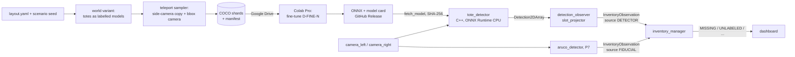

# Learned perception (ML/DL): research report

> **Status:** research finished, nothing built. Paused on 2026-11-03, resumed and completed on 2026-11-06.
> **Scope:** the second perception method from [PROJECT_PLAN.md](../PROJECT_PLAN.md) (D24, optional Phase 8b). ArUco (Phases 7-8) stays the first method.
> **How it was made:** four research topics (use cases and evaluation, synthetic data, model and training, inference and ROS 2 integration), a skeptical review of each against the current project, then re-checks on 2026-11-06 (§12). Every number is marked as verified, an estimate, or third-party.
> **Read first:** §1 for the decision, §9 for the work plan, §13 for the questions that need your answer.
> **Related files:** [PROJECT_STATUS.md](../PROJECT_STATUS.md), [ADR-004](../decisions/ADR-004-ci-pipeline.md) (checks paused), [layout.yaml](../../src/warehouse_layout/config/layout.yaml) and the [warehouse_layout README](../../src/warehouse_layout/README.md) (both from Phase 2, which is not merged yet), [robot.yaml](../../src/warehouse_description/config/robot.yaml).

---

## 1. Executive summary

| Area | Recommendation |
|---|---|
| **Use case** | **Tote presence per shelf slot, one class (`tote`).** The detector catches totes whose tag is missing, covered or unreadable, which becomes a new `UNLABELED` discrepancy instead of a false `MISSING`. It also backs up ArUco's `MISSING`. Identity (SKU) stays ArUco's job: every tote is the same grey box, and SKUs exist only as data. |
| **Data** | A world variant generated from `layout.yaml`, with each tote as its own labelled model and some tags missing or covered. A headless "teleport" sampler moves a copy of the Rev E side camera, with Gazebo's `boundingbox_camera` beside it, through the aisles. v1 is about 3,000 COCO images, split by world seed. |
| **Model** | **D-FINE-N** (Apache-2.0, COCO-only checkpoint), fine-tuned on Colab Pro at a 320x320 input. Fallback: **YOLOX-Nano** (Apache-2.0). RF-DETR-N is rejected for its CPU cost (about 12x at equal input size, estimate). Ultralytics is never used (AGPL-3.0, D24). |
| **Runtime** | ONNX FP32 on **ONNX Runtime 1.24.3, CPU**, from apt (`ros-jazzy-onnxruntime-vendor`). 2 threads, no spin-waiting, 1-2 Hz per side camera, only during `SCAN_AISLE`. The Iris Xe iGPU (OpenVINO) is an optional later experiment, not the plan. |
| **ROS integration** | Two C++ components in `warehouse_perception`. `tote_detector` turns an image into `vision_msgs/Detection2DArray`. `detection_observer` turns detections into the existing `InventoryObservation` (`source: DETECTOR`) through Phase 8's `slot_projector`. Both use the same `~/enable_scan` switch as `aruco_detector`. The only message change is `UNLABELED` in `InventoryDiscrepancy`. |
| **Benchmark** | A slot-level head-to-head against ArUco on the same patrols. Ground truth comes from the simulator. It uses at least 10 held-out seeds with Wilson 95 % intervals, plus an "oracle" row fed with Gazebo's ground-truth boxes. |
| **Effort** | Five steps, ML-0 to ML-4, about **40-58 h** (the plan's L+ is 35-50 h). It starts after v2.0.0 and can interleave with M3. Nothing in M3 depends on it. |

**Why ArUco stays the first method**
1. **Identity.** A tag gives the tote ID, and `expected_inventory.yaml` maps that ID to a SKU. A detector looking at identical grey totes cannot do this.
2. **Cost and determinism.** ArUco's Phase 7 budget is p95 ≤ 20 ms per 640x480 frame, with no training. The smallest suitable network took 35-127 ms per 320 px frame on 2 threads here (recorded in plan §8b, not re-measured).
3. **Dependencies.** The learned method needs the Rev E cameras, tagged tote models, `slot_projector`, `inventory_manager` and the Phase 8 scenario generator. All of that is ArUco-era work.
4. **Baseline.** A learned result means nothing without a tuned, deterministic baseline. ArUco is that baseline, and it also gives an independent sanity check of the simulator's ground truth.
5. **Industry practice.** Warehouses identify stock with barcodes, RFID or fiducials. Camera "location occupancy" is sold as an add-on (vendor claim, unverified).

**What the reviews changed** compared with the paused research:
- one class instead of SKU classes;
- a CPU-first C++ ONNX Runtime node instead of a GPU-first Python OpenVINO node;
- the existing `InventoryObservation` instead of new fields;
- RGB-only geometry (Rev E has no depth);
- all camera maths redone for f ≈ 320 px;
- scope cut to fit Phase 8b.

The full list of corrections is in §12.5.



---

## 2. Use cases

### 2.1 What the side cameras actually see (recomputed)

The Rev E side cameras (plan §2.6) are 640x480 RGB with an HFOV of 1.57 rad, so f = 320 / tan(0.785) ≈ 320 px. They sit on the mast at 0.85 m and face ±y. Totes are 0.40 x 0.30 x 0.20 m with the 0.40 m side pointing into the shelf, so the camera sees a **0.30 x 0.20 m face** (`warehouse_layout/model.py`). They stand flush with the face. The robot keeps within ±0.15 m of the aisle centre, which is the same assumption the layout's tag rule uses.

| Camera to shelf face | Tag 0.12 m | Tote face 0.30 x 0.20 m | Shelf seen (width; heights) | Full-view time per tote at 0.3 m/s |
|---|---|---|---|---|
| 0.65 m (near side) | 59 px | 148 x 98 px | 1.30 m; 0.36-1.34 m | 3.3 s |
| 0.80 m (aisle centre) | 48 px | 120 x 80 px | 1.60 m; 0.25-1.45 m | 4.3 s |
| 0.95 m (far side) | 40 px (D23 limit) | 101 x 67 px | 1.90 m; 0.14-1.56 m | 5.3 s |

What this means:
- **All three levels are in view.** Totes sit at 0.40-0.60, 0.75-0.95 and 1.10-1.30 m.
- **The detector can work at half resolution.** A tote is 2.5x wider than its tag (4.2x the area). At a 320x320 network input, the smallest tote is still about 50 x 45 px. ArUco, which must resolve the tag's cells, needs the full 640 px.
- **1-2 Hz per camera is enough.** Each tote stays fully in view for at least 3.3 s at the 0.3 m/s scan cap (P8), so 1 Hz gives 3 or more views and 2 Hz gives 6 or more.
- **Motion blur is negligible.** At 0.3 m/s it is about 1 px (assuming a 10 ms exposure), and Gazebo renders none anyway.
- These are pinhole estimates. The Rev E mast may offset the cameras from the robot centreline by a few centimetres.

### 2.2 Evaluation

Scores run from 1 to 5, where higher is better. For Effort, 5 means least work.

| Use case | Adds over ArUco | Portfolio | Learning | Effort | CPU fit | Sim-measurable | Total | Verdict |
|---|---|---|---|---|---|---|---|---|
| **A1 Tote presence per slot (1 class)** | Sees totes with missing, covered or unreadable tags; separates UNLABELED from MISSING | 5 | 5 | 4 | 4 | 5 | **23** | **Primary** |
| B People and forklifts → non-safety slowdown polygon | Less needless slowing than "slow for everything" | 5 | 4 | 2 | 2 | 3 | 16 | **Optional secondary, deferred** |
| C Pallet detection + pose | Future fork pickup | 2 | 4 | 2 | 4 | 4 | 16 | Defer: nothing consumes it (no forks; P13 is an arm) |
| E Learned fiducial reading (DeepArUco++-style) | Tag reading in bad light | 2 | 3 | 3 | 4 | 4 | 16 | Skip: it still needs tags, and the reference code is AGPL-3.0 |
| A2 SKU from appearance | MISPLACED without tags | 3 | 3 | 2 | 4 | 3 | 15 | Skip: totes are identical (`style.tote` is one colour) and the 60 SKUs are data only. We would be inventing the appearance we then "detect" |
| D Generic obstacle classes | Labels for reports | 2 | 3 | 3 | 3 | 2 | 13 | Skip: costmaps already handle geometry |

**Primary use case (A1)**
- **Input:** the left and right side cameras, while the behaviour tree has `SCAN_AISLE` active.
- **Output:** boxes of the class `tote` for each processed frame. These become one `InventoryObservation` per fully visible slot (`source: DETECTOR`, `occupied` true or false).
- **Value:** fused with ArUco's observations, `inventory_manager` reports `UNLABELED` (tote present, ID unknown) where ArUco alone would report `MISSING`. This is a measurable gain: on tag-damaged totes, the false-MISSING rate drops from about 100 % to about 0 % if the detector works.
- **Limits:** the detector cannot read identity, so `MISPLACED` and `UNEXPECTED` stay ArUco's job.

**Optional secondary use case (B): deferred, not in the 8b budget.** It has four preconditions:
1. **A forward-camera decision after Rev E.** The front camera is a dock camera at 0.275 m with an HFOV of 1.2 rad (f ≈ 468 px). It sees up to about 1.3 m at 2 m distance and a whole 1.8 m person only beyond about 3 m (estimate).
2. **A heartbeat design.** In Jazzy, `collision_monitor` stops the robot when an enabled polygon source holds no data. The research verified this in the source; I did not re-check it.
3. **Continuous front-camera rendering,** which plan R3 avoids.
4. **Strictly non-safety framing.** The lidar stays the safety layer.

When B does come, it starts cheaply: a COCO-pretrained detector already has a `person` class, so a zero-shot test on Gazebo actors needs no training.

---

## 3. Decisions

| # | Decision | Chosen | Rejected alternatives | Why |
|---|---|---|---|---|
| 1 | What the model detects | One class, `tote` | SKU classes (identical totes). An "empty slot" class (emptiness comes from negative evidence, exactly as for ArUco). Tag classes (230 IDs; ArUco reads them already). The old "200 + tag_id" label scheme (needs fewer than 56 IDs) | The only thing pixels can tell us here that tags cannot |
| 2 | Label source | Gazebo `boundingbox_camera` (`visible_2d`) plus a regular camera with the same spec on the same link, paired by identical sim stamp | Projection-only labels: 8.5 % of in-view objects were fully occluded in the research's test scene. The sensor's own `<save>`: no stamps, slow, and nothing at all without a subscriber. Hand labelling. ArUco as teacher (noisy; stretch study) | Exact, occlusion-aware, free |
| 3 | Capture method | "Teleport" sampler: a paused, headless gz server driven over gz-transport `/blocking` services | Driven patrols as the main source (correlated frames, real time; used for the benchmark instead). Isaac Sim (needs an NVIDIA RTX GPU). BlenderProc (GPL-3.0, and a second pipeline) | Fast, deterministic, decorrelated frames |
| 4 | World | A variant generated from `layout.yaml`: totes shown, each tote its own top-level model with a Label plugin, tag state per tote | Editing `layout.yaml` per dataset. Fuel warehouse models (`OpenRobotics/Warehouse` is CC BY-NC-ND) | One source of truth (D8). Labels need top-level models (§5.9) |
| 5 | Model | D-FINE-N at 320 px | YOLOX-Nano (the fallback: cheapest, but needs NMS and is maintenance-only). RF-DETR-N (best ergonomics, about 12x the compute). RF-DETR Atto/Femto/Pico/XL/2XL (PML 1.0). Ultralytics YOLO (AGPL-3.0). DEIMv2 and EdgeCrafter (non-commercial). RT-DETRv2-S (about 60 GFLOPs). MMDetection RTMDet (too old for Colab's torch). torchvision SSDLite (weak; an optional exercise) | Fits the CPU budget, permissive, no NMS, post-processing inside the ONNX graph |
| 6 | Training setup | Colab Pro; the D-FINE repo at a pinned commit; a thin notebook plus a versioned config in git; one seed for v1; checkpoints on Drive | Local training (no NVIDIA GPU). Geti Tune (version 0.x, pins its own torch). Multi-seed runs, sweeps, W&B and DVC in v1 | Simple and reproducible |
| 7 | Export | ONNX FP32, batch 1, static 320x320, written by our own export wrapper, with parity tests | INT8 (stretch). OpenVINO IR (only for the iGPU stretch). TensorRT (needs NVIDIA) | One artefact that the runtime reads |
| 8 | Runtime | ONNX Runtime CPU from apt (`ros-jazzy-onnxruntime-vendor`, ORT 1.24.3), C++ | OpenVINO in a Python venv on the iGPU (a pip exception; a 2023 driver untested on kernel 7.0; the iGPU is shared with Gazebo) → stretch. ORT from pip (needs protobuf ≥ 4.25.8, apt has 4.21.12; PEP 668). ORT with the OpenVINO EP (older OpenVINO, an extra layer). OpenCV 4.6 DNN (probably cannot import DETR ops) | Matches plan A2, A4 and the §1 rule "apt only, nothing pip-installed on the host". No venv |
| 9 | Node design | Two C++ components in the perception container (isolated executors). Inputs exist only while enabled. 1-2 Hz per camera, `SCAN_AISLE` only | A Python node (an A2 exception, a venv, the shebang trap). Always-on detection (R3). A pluginlib backend inside `aruco_detector` (couples failure domains). A shared observer that replaces ArUco's own output (changes P7/P8) | Reuses the Phase 7 patterns |
| 10 | Interface | The existing `InventoryObservation` (`source: DETECTOR`, `tag_id` empty, `occupied`). `Detection2DArray` for debugging and evaluation. `UNLABELED` added to `InventoryDiscrepancy` | New fields (ARUCO/LEARNED/FUSED, `present`, `sku`, `model_id`) | Plan §2.2 already reserves `DETECTOR` |
| 11 | Benchmark | Slot level, simulator ground truth, the same patrols, at least 10 held-out seeds, Wilson intervals, an oracle row, 3 robustness factors | ArUco as ground truth (circular). AP for ArUco (it has no scores). 8 factors, TIDE, calibration, McNemar and LOCO sweeps in v1 | Fair, and sized for a learner |
| 12 | Model distribution | GitHub Release assets with SHA-256 and a model card; `models.yaml` plus a fetch script | Weights in git or Git LFS (quota, clone size). Hugging Face Hub as the only home (fine as an optional mirror) | Matches the plan's O2 direction |
| 13 | Data storage | Manifest, checksums and dataset card in git; tar shards on Google Drive | DVC (its Drive remote needs your own GCP OAuth client). Images in git. HF datasets (optional) | The simplest option that stays reproducible |

---

## 4. Licences

"OK" means the item can be used by, or published with, the public Apache-2.0 repo. **Verified** means re-checked on 2026-11-06 (§12.2). **Review** means checked by the research and confirmed by a reviewer.

**Models and weights**

| Model | Code | Weights | OK? | Status |
|---|---|---|---|---|
| **D-FINE-N** (`dfine_n_coco.pth`) | Apache-2.0 | Apache-2.0 (repo licence), trained on COCO only. The README warns that Objects365 checkpoints (`*_obj365`, `*_obj2coco`) "should not be assumed to be commercially cleared" | **Yes** (chosen) | Verified |
| **YOLOX-Nano / Tiny** | Apache-2.0 | Apache-2.0 (COCO); pre-exported ONNX in the 0.1.1rc0 release | **Yes** (fallback) | Verified |
| RF-DETR Nano/Small/Medium/Large (`rfdetr`) | Apache-2.0 | Apache-2.0; the paper's recipe adds Objects365 pre-training | Yes (stretch) | Licence split verified; Objects365 from research |
| RF-DETR Atto/Femto/Pico/XL/2XL, NAS (`rfdetr[plus]`) | PML 1.0 | PML 1.0 ("commercial self-hosting requires the Enterprise add-on") | **No.** Never install `rfdetr[plus]` | Verified |
| Ultralytics YOLO11 / YOLO26 | AGPL-3.0 or Enterprise | AGPL-3.0 by default, including models you train | **No** (D24) | Review |
| DEIMv2, EdgeCrafter | Custom, non-commercial | Non-commercial | **No** | Review |
| RT-DETR / RT-DETRv2 | Apache-2.0 | Apache-2.0 | Yes, but RT-DETRv2-S is too heavy | Research |
| DEIM v1 | Apache-2.0 | Not stated separately | Possible, not needed | Research |
| torchvision SSDLite / Faster R-CNN MobileNetV3 | BSD-3 | "may have their own licenses or terms" | Only as a learning exercise | Research |
| MMDetection RTMDet | Apache-2.0 | n/a | The licence is fine; rejected because its last releases (2024) predate Colab's torch, so its compiled ops would need building by hand | Research |
| DeepArUco++ | AGPL-3.0 | n/a | **No** | Research |

**Libraries and tools**

| Component | Where | Licence | OK? | Status |
|---|---|---|---|---|
| ONNX Runtime via `ros-jazzy-onnxruntime-vendor` | Laptop | MIT (ORT) + Apache-2.0 (wrapper) | Yes | Verified |
| OpenCV 4.6 (resize, blob, NMS for YOLOX) | Laptop | Apache-2.0 | Yes | Not re-verified |
| gz-sim 8, gz-sensors 8, `ros_gz`, `vision_msgs` | Laptop | Apache-2.0 | Yes | Research |
| torch, torchvision | Colab only | BSD-3 | Yes | Research |
| D-FINE's dependencies: `faster-coco-eval`, PyYAML, tensorboard, scipy, transformers, loguru, calflops | Colab only | `faster-coco-eval` Apache-2.0 (verified); the others are permissive (not re-verified one by one) | Yes | Mixed |
| `pycocotools` | Colab | BSD-2 (FreeBSD) | Yes | Research |
| `onnx` / `onnxsim` | Colab | Apache-2.0 / "MIT AND (Apache-2.0 OR BSD-2-Clause)" | Yes | Research |
| `albumentations` ≤ 2.0.8 | Colab, only if a trainer pulls it in | MIT (that line is archived) | Yes | Review |
| AlbumentationsX ≥ 2.1.3 (same import name!) | n/a | AGPL-3.0 or commercial | **No.** Pin `albumentations==2.0.8` if anything pulls it in | Review |
| OpenVINO 2026.4.1, NNCF 3.4.0 | Stretch only | Apache-2.0 | Yes | Review (PyPI) |
| Intel compute runtime, Level Zero, IGC | Stretch only | MIT | Yes | Research (not re-verified) |
| `rclone` | Laptop, optional | MIT | Yes | Not re-verified |
| `wandb` client | Colab, optional | MIT client plus the SaaS terms | Optional | Research |
| BlenderProc | n/a | GPL-3.0 | No (and it is a second pipeline) | Research |

**Data and assets**

| Item | Licence | Use? |
|---|---|---|
| Our synthetic dataset (rendered from our own generated world, no third-party assets) | Ours to choose: CC BY 4.0 if published (O2) | Yes |
| Our fine-tuned weights | Apache-2.0, with pre-training lineage in the model card | Yes |
| COCO (only through pre-trained checkpoints) | Annotations CC BY 4.0; images under Flickr terms | Indirectly; disclose in the model card (standard practice) |
| LOCO: real logistics images whose "small load carrier" class is a KLT tote | **CC0-1.0** (verified) | Stretch: a zero-shot sim-to-real check |
| SKU-110K / Amazon Bin Image / Parcel3D | Non-commercial / CC BY-NC-SA / academic | No |
| Gazebo Fuel `OpenRobotics/Warehouse` | CC BY-NC-ND 4.0 | No. Not needed: the world comes from `layout.yaml` |
| ambientCG / Poly Haven textures | CC0 | Not needed in v1 (the world uses flat colours) |

---

## 5. Synthetic data pipeline (Gazebo Harmonic, driven by `layout.yaml`)

### 5.1 What gets labelled
- **One class.** gz label `1` means `tote` (COCO `category_id` 1, trainer class index 0). Everything else stays unlabelled; the bounding-box camera uses 255 for background. Only use labels 1-254.
- **The box includes the tag.** The label sits on the tote model, so its tag plane, and any sticker covering the tag, belong to the tote box. Tags are never a class of their own.
- **Box type `visible_2d`,** which is the COCO convention.

### 5.2 World variants from `layout.yaml`
The Phase 2 generator (on its branch as of 2026-11-06) shows totes only when `style.show_totes` is true. It currently emits them as **visuals inside each shelf segment's model**. The research's reading of the gz-rendering source says boxes merge per top-level model; that was not tested. So the generator needs an option that:
- emits **each tote as its own top-level static model** (`tote_<id>`), optionally with `<plugin filename="gz-sim-label-system" name="gz::sim::systems::Label"><label>1</label></plugin>`;
- takes a **scenario file**, not edits to `layout.yaml`. The file states which slots hold totes (fill 0.3-0.55, so that at most 230 tag IDs are needed), the tag state of each tote (present, missing, or covered by a given fraction), the light intensity and direction, and a small tote tint jitter;
- stays deterministic: the same scenario gives the same bytes, like the Phase 2 world test.

Emitting totes as top-level models is worth doing already in **Phase 7**, when `show_totes` turns on. Phase 8 can then remove or swap totes at runtime (`/world/<w>/remove`, `set_pose`), and 8b gets clean labels for free (§9.5).

**The canonical world** (the layout's inventory seed 2) is **never used for training**. It is the deployment and benchmark world.

### 5.3 Capture rig and sampler
- **Rig.** A static model with no visuals and one link carrying two sensors:
  - a regular `camera` (the RGB that is saved, with Rev E's Gaussian noise and no lens distortion);
  - a `boundingbox_camera` (`visible_2d`) with the same HFOV, size and clip.

  Both read their values from the Rev E camera block in [`robot.yaml`](../../src/warehouse_description/config/robot.yaml), so there is one source (D1). Rev E does not exist yet; the robot is still Rev B with no cameras.
- **Poses** match what the robot sees:
  - the aisle centreline ±0.15 m sideways, anywhere along the aisle;
  - height 0.85 m ±0.01;
  - facing the shelf face ±3° in yaw, ±2° in pitch, no roll;
  - both faces of each aisle;
  - about 5 % "background" frames at aisle ends.
- **Loop**, as built and measured by the research on this laptop:
  1. Generate `world_<seed>.sdf` and start `gz sim -s --headless-rendering`, paused.
  2. Subscribe to both sensor topics **before** stepping.
  3. For each frame, call `/world/<w>/set_pose/blocking` on the rig, then optionally `/light_config/blocking`, then `/world/<w>/control` with `multi_step`.
  4. Wait until the image and the boxes arrive **with the same new stamp**, then write them.
  5. Stop the server and move to the next seed.
- **The tool** is `ros2 run warehouse_ml datagen` (Python). It uses the `gz.transport13` and `gz.msgs10` bindings that ship with Jazzy's gz vendor packages; the imports were verified today after sourcing `setup.bash`. It needs no pip.

### 5.4 Randomisation (deliberately light)
Training and deployment use the same simulator. Randomisation therefore buys generalisation (new fill patterns, lighting, damaged tags), not a reality gap.

| Knob | Range | Changes per | Mechanism |
|---|---|---|---|
| Which slots hold totes | fill 0.3-0.55 | seed | scenario → world variant |
| Tag state | train: 80 % present, 10 % missing, 10 % covered 25-75 %. OOD test: covered tags and lighting extremes only | seed | scenario → world variant |
| Light | intensity 0.3-1.5x, direction jitter; colour components ≤ 1 | seed (and frame) | world variant, `/light_config/blocking` |
| Tote tint | `style.tote` ±10 % brightness | seed | world variant |
| Camera pose | §5.3 | frame | `/set_pose/blocking` |
| Exposure, JPEG artefacts, mild blur | small | training time | the trainer's augmentation (D-FINE's defaults; flips are fine because a tote is mirror-symmetric) |

### 5.5 Filters and formats
- **Filters.**
  - Drop boxes with a side under 8 px (slivers at the image edge).
  - Keep truncated boxes (the COCO convention).
  - No visibility threshold is needed: totes are flush with the shelf face and nothing stands in front of them, so truncation at the image edge is the only partial case.
- **Formats.**
  - Images: JPEG q95.
  - Labels: **one COCO JSON per split**, which is canonical. All three candidate trainers read COCO, so there is no YOLO txt.
  - Metadata: one JSON per frame with seed, frame index, stamp, rig pose, light, generator git SHA and the scenario hash.

### 5.6 Splits (by world seed, never by frame)
| Split | Seeds (example) | Frames | Purpose |
|---|---|---|---|
| train | 0-23 | ~2,400 | training |
| val | 24-26 | ~300 | model selection, score threshold |
| test | 27-29 | ~300 | headline mAP |
| test-OOD | 100-102 | ~300 | covered tags, extreme light |
| benchmark | 200+ (canonical world + injected discrepancies) | patrol bags | §8 only, never trained on |

Consecutive frames are near-duplicates. Splitting by frame would leak between splits and inflate mAP.

### 5.7 Size and time targets (estimates)
| Version | Content | Generation | Storage |
|---|---|---|---|
| v0 smoke | 2 seeds, ~500 frames | minutes | ~30 MB |
| **v1** | 30 seeds x 100 frames + 300 OOD frames; about 12-15k tote boxes (~4-5 totes per frame at a fill near 0.5) | ~4-18 min at 3-15 samples/s, plus ~33 world starts of ~2.5 s each | ~0.1-0.3 GB |
| v2 | only if held-out mAP is still rising with more data (stretch learning curve) | | |

The rates are extrapolated from the research's measurements on this laptop: about 30 samples/s in a simple scene and about 20 fps with 529 labelled objects, varying ±30 % under another workflow's load. Re-measure them in the real world with no other simulation running. Disk is fine: 17 GB free (verified today). Keep one dataset version plus the regression set locally.

### 5.8 Versioning and storage
- **Dataset semver** `whds-vMAJOR.MINOR.PATCH`:
  - MAJOR: the class map or label meaning changed;
  - MINOR: more data or new randomisation;
  - PATCH: label fixes.
- **In git**, as small text files under `src/warehouse_ml/datasets/<version>/`:
  - `manifest.json`: generator and repo SHA plus a dirty flag, sha256 of `layout.yaml`, the datagen config and the camera block, gz versions (sim 8.15.0, sensors 8.2.2), seeds per split, counts, filters, and the sha256 of every shard;
  - `README.md`, a Hugging Face-style dataset card: how to regenerate it, classes, splits, randomisation ranges, limitations, licence.
- **On Google Drive:** plain tar shards (`<split>-NNN.tar`, under 10k files per folder) in `MyDrive/warehouse_amr/datasets/<version>/`. Upload through the web UI, or with `rclone` (apt, optional).
- **Never in git:** images, shards, checkpoints, ONNX files. `.gitignore` covers `datasets/`, `*.onnx`, `*.pth` and `*.ckpt`. The repo already limits files to 1 MB.

### 5.9 Gotchas (found by the research on this laptop unless marked)
- **Lazy sensors.** A rendering sensor with no subscriber renders nothing; `<save>` alone produced 0 frames.
- **`<topic>_image` of the bounding-box camera has green boxes drawn on it.** Never train on it.
- **The bounding-box camera's internal RGB ignores `<noise>` and `<distortion>`.** Keep the robot camera distortion-free, and take the RGB from the paired regular camera.
- **Bridged ground truth** (`ros_gz_bridge` 1.0.24 → `Detection2DArray`):
  - `class_id` is `str(label)` and `score` is 1.0;
  - per-detection headers are empty;
  - the array's `frame_id` is the scoped gz sensor name, not a TF frame.
- **Boxes merge per top-level model** (source reading only, untested). This is why totes must be top-level models.
- **Use the `/blocking` service variants.** The async ones returned `True` even when the command failed.
- **Light colour components above 1.0 render nearly black.** Change brightness with `intensity` instead.
- **`create_multiple` is slow** (4.8 s for 200 models). Regenerate the world per seed instead.

---

## 6. Training on Colab Pro

### 6.1 Workflow
1. **Laptop:** `ros2 run warehouse_ml datagen --version 1.0.0` makes the shards, manifest and card. Upload the shards to Drive.
2. **Colab:** `src/warehouse_ml/colab/train_dfine.ipynb` is about 8 cells with no logic in them:
   1. Mount Drive.
   2. `git clone --branch <tag>` this repo.
   3. Clone `Peterande/D-FINE` and `git checkout <pinned SHA>`, then `pip install -r requirements.txt`. Its pins are loose (`torch>=2.0.1`, verified), so Colab's preinstalled torch stays.
   4. Copy the shards to `/content`, verify their SHA-256, untar.
   5. Train: `torchrun --nproc_per_node=1 train.py -c <our config> --use-amp --seed=0 -t dfine_n_coco.pth`, with `output_dir` on Drive.
   6. Evaluate on the test and OOD seeds (`--test-only -r <best>.pth`).
   7. Export ONNX with our wrapper (§6.5) and run the parity tests.
   8. Write the model card, `metrics.json` and `SHA256SUMS` to Drive.
3. **Laptop:** `gh release create whdet-v1.0.0 ...`, then update `models.yaml`.

**Our config** is `src/warehouse_ml/colab/configs/dfine_n_tote.yml`. It includes D-FINE's N COCO config and overrides:
- `num_classes: 1` and `remap_mscoco_category: False`, as the D-FINE README says to do for custom datasets (verified);
- the dataset paths;
- the input size;
- the epoch count.

### 6.2 Recipe (starting points)
| Setting | Start with | Why |
|---|---|---|
| Initialisation | `dfine_n_coco.pth`, fine-tuned with `-t` | Transfer learning, and the cleanest licence |
| Input | 320x320. Train and export at the same size; D-FINE also derives anchors from the configured eval size, so check that key in the pinned commit | Totes are at least 50 px at 320. 416 costs about 1.7x more on the CPU (estimate) |
| Batch, precision | The config default with `--use-amp`; halve the batch if memory runs out | |
| Epochs | About 50-80; keep the checkpoint that is best on val | Small, easy dataset |
| Augmentation | D-FINE's defaults (photometric, zoom-out, crop, flip) | Tuned upstream; flips are fine for totes |
| Seeds | One for v1 | Three seeds with mean ± SD is a stretch |
| Resize in evaluation | Evaluate with **exactly** the resize the C++ node uses (`cv2.resize`, the same interpolation) | Avoids skew between Colab and the node |

### 6.3 Tracking and reproducibility
- **TensorBoard logs** in the Drive run folder. D-FINE writes them to its output directory; check this in the pinned commit.
- **The run folder** also holds the resolved config, `pip freeze`, `nvidia-smi`, both git SHAs and the dataset manifest hash.
- **`src/warehouse_ml/results/RESULTS.md`** is the record: one row per run with run ID, SHAs, dataset version, config, seed, GPU, minutes, and val/test/OOD mAP@0.5 and mAP@0.5:0.95. Trackers are only views.
- **W&B** is optional and needs an account (§13).

### 6.4 Checkpoints and session limits
- Colab's FAQ says paid notebooks run at most about 12 h and resources are not guaranteed. Keep runs under 1 h and the browser tab open.
- To resume after a disconnect, use D-FINE's resume. The `-r` flag is the RT-DETR-family convention; the README documents `reference/safe_training.sh` for auto-resume. Test it once in the pinned commit.
- Store the dataset as a few tar shards. Mounted Drive is slow with many small files, and a Drive root with more than about 10k items can fail to mount.
- Delete large intermediate checkpoints after export, or the 15 GB free Drive quota fills quickly.

### 6.5 Export and parity
- **Use our own wrapper** (about 30 lines) based on D-FINE's `tools/deployment/export_onnx.py`. That script hard-codes a 640x640 dummy input, and its `--check` and `--simplify` flags always run (verified).
  - **Shape:** inputs `images` 1x3x320x320 and `orig_target_sizes` 1x2; outputs `labels`, `boxes` and `scores`, with post-processing inside the graph. Batch is static at 1.
  - **Opset:** 16, D-FINE's choice; ORT 1.24 supports newer ones too.
  - If Colab's torch uses the dynamo exporter and it fails, pass `dynamo=False`. PyTorch defaults to dynamo since 2.9, and 2.11 removed the automatic fallback (training research).
  - If `onnxsim` has no wheel for Colab's Python, skip the simplification step.
- **Metadata inside the ONNX file:** model name, version, class list, input size, resize mode and normalisation. The node checks them at start-up.
- **Parity in Colab:** PyTorch against ONNX Runtime on 50 val images must give at least 99 % matching detections (same class, IoU ≥ 0.9), scores within 1e-3, and an mAP change of at most 0.3 points.
- **Golden fixtures:** 5 small PNG frames (in git, well under 1 MB) plus the expected detections as JSON, produced by ORT with the cv2 pre-processing. The C++ gtest must reproduce them within 1 px and 1e-3.

### 6.6 Quantisation: stretch only
FP32 comes first. Try INT8 only if the CPU gate fails, or as a learning exercise: ORT static (QDQ) quantisation, or OpenVINO NNCF in the iGPU stretch. Accept a drop of at most 1.5 mAP points. Whether INT8 kernels use this CPU's AVX-VNNI is unverified, so measure it.

### 6.7 Model distribution
- **Release `whdet-v1.0.0`**, separate from the code tags, with these assets:
  - `whdet-dfine-n-320-v1.0.0.onnx` (D-FINE-N is about 4M parameters, so roughly 15-20 MB at FP32, estimate);
  - `labels.json`, `model_card.md`, `metrics.json`, `SHA256SUMS`.
- **`warehouse_perception/config/models.yaml`** (in git) lists name, version, URL, SHA-256, size, input size and contract major version.
- **`ros2 run warehouse_ml fetch_model`** downloads with the standard library to `~/.cache/warehouse_amr/models/`, verifies the SHA-256 and renames atomically. The node never downloads; if the model is missing, it fails with a message that names this command.
- **Semver:**
  - MAJOR: the class list, input, pre-processing or output contract changed;
  - MINOR: retrained;
  - PATCH: re-export or metadata only.
- **Model card:** architecture, upstream checkpoint and its licence, pre-training lineage (COCO), training data version and seeds, test and OOD metrics, latency on the i5-1335U with the sim on and off, intended use ("simulation-only inventory aid, not safety"), limitations, how to reproduce.

### 6.8 Budget (third-party numbers, labelled)
- **Third-party, unverified:** Colab Pro is reported as $9.99 for 100 compute units a month, and an L4 at about 1.71 CU/h (a third-party measurement from March 2026).
- **Estimate:** a v1 run of under 1 h on an L4 costs under 2 CU. Measure epoch 1 before trusting it, and plan for 1.5-2x.
- **So:** compute is not the bottleneck. Data quality and evaluation discipline are.

---

## 7. On-laptop inference and ROS 2 integration

### 7.1 Runtime: CPU first, measured
| Option | Devices here | How to install | Verdict |
|---|---|---|---|
| **ONNX Runtime 1.24.3 via `ros-jazzy-onnxruntime-vendor`** (C/C++, target `onnxruntime::onnxruntime`) | CPU (it vendors `onnxruntime-linux-x64-1.24.3.tgz` and has no GPU option; verified) | apt through rosdep; candidate 0.1.0, not installed (verified) | **Chosen** |
| OpenVINO 2026.4.1 (pip wheel, or Intel's APT repo) | CPU + iGPU | A venv or a third-party apt repo. The iGPU also needs `intel-opencl-icd` (noble candidate 23.43, from November 2023) and the `render` group | **Stretch S1:** a go/no-go benchmark. Adopt it only through an ADR |
| `onnxruntime` from pip (Python) | CPU | pip; needs protobuf ≥ 4.25.8, apt has 4.21.12 (the gz-msgs bindings use apt's) | Colab parity tests only |
| `onnxruntime-openvino` from pip | CPU + iGPU | pip; bundles the older OpenVINO 2025.4.1 | No |
| OpenCV 4.6 DNN | CPU | Installed | No: it probably cannot import DETR ops (string-grep evidence, not a load test) |
| TensorRT | n/a | NVIDIA only | No |

Why not the iGPU first:
- Its compute driver is not installed, and the noble driver dates from 2023, untested on kernel 7.0.
- The only published Iris Xe figure for this model family (Frigate, about 33 ms) is third-party, on an unstated SKU, with an idle GPU.
- The iGPU has no separate compute engine (`rcs0` only), so inference would share it with Gazebo's rendering.

Plan A4 already says "runs CPU-only".

### 7.2 CPU budget
- **ORT's defaults would starve the simulator.** It uses one intra-op thread per physical core (10 here) and spin-waits (verified in the ORT docs). Set `SetIntraOpNumThreads(2)`, `SetInterOpNumThreads(1)` and `session.intra_op.allow_spinning = 0`. Record the thread settings with every measurement.

| Candidate at 320 px | Compute (published, scaled) | Measured or estimated latency | 2 cameras x 2 Hz on 2 threads |
|---|---|---|---|
| **D-FINE-N** | 1.75 GFLOPs (7 at 640, D-FINE README) | 35-127 ms idle (recorded in plan §8b, not re-measured); 1.5-3x slower under sim load (estimate) | about 0.3-1.0 cores (idle basis) |
| YOLOX-Nano | 0.64 GFLOPs (1.08 at 416) | Not measured; expect it to be cheaper than D-FINE-N, plus NMS | less |
| RF-DETR-N | about 22 GFLOPs (31.8 at 384, third-party) | 120-350 ms on 4 threads (estimate) | several cores: does not fit next to Gazebo and Nav2 |

**ML-0 measures all three** with COCO checkpoints, idle and with Gazebo and Nav2 running, before any data or training work. It also checks P-cores (CPUs 0-3) against E-cores (CPUs 4-11) with `taskset`. The P/E spread was about 2.3x in earlier measurements (A4).

### 7.3 Packaging under PEP 668
- **The core track pip-installs nothing on the laptop.**
  - ORT comes from apt via rosdep, and the nodes are C++.
  - The Python tools (datagen, scorer, fetch) use apt packages (numpy 1.26.4, scipy, PyYAML, Pillow, OpenCV) plus the gz-transport and gz-msgs bindings from the Jazzy vendor packages.
  - Training packages live only in Colab, which is the plan's rule.
- **If a Python ML runtime is ever needed** (stretch S1), follow what the research verified on this laptop:
  - **Venv:** create it with `--system-site-packages`, add `<venv>/COLCON_IGNORE`, and pin `numpy==1.26.4` in a constraints file (apt's `python3-opencv` needs the numpy-1 ABI).
  - **Build:** build with **`<venv>/bin/python -m colcon build`**. A plain `colcon build`, even with the venv activated, writes `#!/usr/bin/python3` into the node scripts, and the node then cannot import the venv's packages.
  - **Run:** set `PYTHONNOUSERSITE=1` for that node, or your user-site packages (Flask 3.1.3 and others) leak in (R16).
  - **Decide it in an ADR first.** The simpler alternative is a throwaway venv outside the workspace, used only for offline benchmarks.

### 7.4 `tote_detector` (C++ component, `warehouse_perception`)
| Aspect | Design |
|---|---|
| Structure | rclcpp component `ToteDetector` over a ROS-free core `OnnxDetector` (pre-process, ORT session, decode), which has gtests |
| Container | The Phase 7 perception container, run as **`component_container_isolated`** (installed; verified). Each component gets its own executor thread, so a ~100 ms inference never stalls `aruco_detector` or the camera bridges. Images stay intra-process |
| Switch | `~/enable_scan` (`std_srvs/SetBool`), the same contract as `aruco_detector`. Camera subscriptions are created on enable and destroyed on disable, so the lazy bridges stop rendering (R3) |
| Inputs | `camera_left/image_raw` and `camera_right/image_raw` (+ `camera_info`) via `image_transport`; SensorData QoS, keep last 1 |
| Scheduling | Callbacks keep only the latest frame per camera. A sim-time timer ticks at `rate_hz` times the number of cameras and runs one inference per tick, alternating cameras (`rate_hz` default 2, minimum 1). Stale frames are dropped. Option: trigger on distance travelled (every 0.15 m) instead of time |
| Pre-processing | cv_bridge (`rgb8`: gz publishes RGB) → `cv::resize` to 320x320 with the interpolation used in Colab's evaluation → float32 NCHW, normalised as the model metadata says |
| Inference | ORT CPU, 2 threads, no spinning. The model is loaded and warmed up at start-up, never at enable |
| Outputs | `~/detections` (`vision_msgs/Detection2DArray`): header = **the source image's header** (stamp + optical frame); **one message per processed frame, including empty ones** (negative evidence must tell "looked, saw nothing" from "did not look"); `class_id` `"1"`, the same string as the gz ground truth; the model's score. Also `~/label_info` (`vision_msgs/LabelInfo`, transient_local: `1 → tote`) and a lazy `~/debug_image` |
| Diagnostics | Rate, p50/p95 inference ms, dropped frames, model version and threads. OK "idle" while disabled |
| Failures | A missing model or a metadata mismatch fails at start-up, naming `fetch_model` |

### 7.5 `detection_observer` and the shared interface
`detection_observer` (C++ component) works like this:
- It subscribes to one or more `Detection2DArray` topics.
- It caches `camera_info` per optical frame.
- It looks up TF at the image stamp (50 ms timeout; it drops the frame on failure, like Phase 7).
- It calls the **same `slot_projector` library** as ArUco and publishes on `inventory/observations`.
- It can take Gazebo's ground-truth boxes instead of the model's (the "oracle", §7.7). The bridged ground truth carries the gz sensor name, not a TF frame, so a parameter maps each ground-truth topic to its optical frame.

| `InventoryObservation` field (plan §2.2) | ArUco (P7-8) | Learned (8b) |
|---|---|---|
| `header` | image stamp, `map` | same |
| `robot_id` | the robot | same |
| `source` | `FIDUCIAL` | **`DETECTOR`** (already reserved) |
| `tag_id` | the decoded ID | `""` (all IDs are strings, plan §2.2) |
| `pose` | the tag pose from PnP, in `map` | where the box centre's ray meets the shelf-face plane, in `map`. Monocular; no depth needed |
| `confidence` | detection quality | the detector score (uncalibrated in v1) |
| `location_id` | slot from `slot_projector` | slot from `slot_projector`. A box is matched to the projected slot face by overlap, one tote per slot |
| `occupied` | true for a tag; false for a fully visible slot with no tag | true for a matched box; false for a fully visible slot with no box |

Both methods **must use the same visibility rule** from `slot_projector`, or their `MISSING` decisions are not comparable. The only message change is `UNLABELED` in `InventoryDiscrepancy.type`; `observed_sku` stays empty for it.

### 7.6 Fusion in `inventory_manager` (8b)
Per slot after a pass, where N is the Phase 8 negative-evidence count:

| Expected | ArUco (FIDUCIAL) | Detector (DETECTOR) | Report |
|---|---|---|---|
| tote T | reads T | any | OK |
| tote T | reads another tote U | any | MISPLACED / UNEXPECTED (Phase 8 logic) |
| tote T | no tag in ≥ N views | tote in ≥ N views | **UNLABELED** (tote present, ID unknown) |
| tote T | no tag in ≥ N views | no tote in ≥ N views | MISSING |
| empty | no tag | tote in ≥ N views | **UNLABELED** (unexpected, untagged) |
| empty | no tag | no tote | OK |

With the detector off, Phase 8's rules stay unchanged.

### 7.7 Testing
CI is paused ([ADR-004](../decisions/ADR-004-ci-pipeline.md)), so these are local commands (`colcon test --packages-select ...` plus one gate script). Tests that need the model file skip with a message until `fetch_model` has run.

| Level | What | Pass |
|---|---|---|
| Unit (gtest, no ROS) | Pre-processing, threshold and decode, message building; golden fixtures from Colab | Within 1 px and 1e-3 of the Colab ORT output |
| Contract (launch_testing) | Enable and disable, one message per processed frame, header copied, rate | 0 camera subscribers while disabled; rate within ±10 % |
| **Oracle** | `detection_observer` fed with Gazebo's ground-truth boxes on the Phase 8 route. The robot needs an eval-only xacro argument `gt_labels:=true` that adds a bounding-box camera beside each side camera | Occupancy of fully visible slots matches the actual world for ≥ 99 % |
| Bag replay | A short MCAP (images, `camera_info`, TF, ground-truth boxes; a release asset, not in git) through the detector | ≥ 99 % of the golden detections match; precision and recall stay above the model-card floor |
| In-situ gate | A 5-minute `SCAN_AISLE` run with both detectors on | §8.6 |

---

## 8. ArUco vs learned: benchmark design

### 8.1 Questions it answers
1. In nominal conditions, does the detector match ArUco on **presence**?
2. Does it catch what ArUco cannot, such as missing or covered tags?
3. At what cost in CPU, latency and simulator speed?

Identity is not compared: only ArUco reads it.

### 8.2 Ground truth and fairness
- **Ground truth always comes from the simulator:** the scenario file, which says what is really in each slot and the state of each tag. ArUco is never ground truth, because scoring it against itself would be circular.
- **Same inputs:** the same patrols and cameras, and ArUco as tuned in Phase 7.
- **Same rules:** the same `slot_projector`, visibility rule and per-slot aggregation for both.
- **Each method runs at its deployed rate.** ArUco is cheap, so it sees more frames, and that is part of the real trade-off. An equal-rate offline replay is a stretch ablation.
- **No AP for ArUco,** because it has no scores. The slot-level comparison is the primary result.
- **The oracle row** (ground-truth boxes through `detection_observer`) is the upper bound of the learned pipeline. It separates association errors from model errors.

### 8.3 Unit of analysis and metrics
- **Opportunity:** a (pass, slot) pair that both methods observed at least once in that pass. Every processed frame yields an observation for each fully visible slot, true or false, so this set comes straight from the data. Report each method's coverage separately.
- **Decision per opportunity and method:** a majority vote over that pass's views, with at least 2 views; otherwise "unknown", which counts against recall.
- **Slot metrics:** presence precision, recall and F1. They are reported per subset: nominal totes, missing tags, covered tags, empty slots (for false positives).
- **Mission metrics:** discrepancy recall and precision per type (MISSING, UNLABELED, MISPLACED), from the real fused `inventory_manager`.
- **Runtime:** p50 and p95 inference ms (steady clock), processed views per visible slot, process CPU % (`pidstat`), RTF with the detector on and off, and the power profile.
- **Frame-level mAP** on the held-out teleport seeds comes from ML-2. mAP on frames recorded during patrols is a stretch.

### 8.4 Scenarios and robustness factors (v1: three, one at a time)
| Factor | Levels | Why |
|---|---|---|
| Tag occlusion | 0 %, 25 %, 50 %, 100 % (= tag missing) | Attacks ArUco specifically; it is the use case |
| Lighting | 0.25x, 0.5x, 1x, 1.5x intensity | Common failure mode for both methods |
| Viewing geometry | Route offset 0 and ±0.15 m | Checks the 40 px design margin and the image-edge angles |

Discrepancies are injected Phase 8-style: removed totes, swapped totes, and totes with removed or covered tags. Use **at least 10 held-out seeds in the canonical world**, plus 3-4 seeds per factor level. A run covers 1-2 aisles, and the runs are scripted with `scenario_runner` (P5) on a machine with no other simulation running. Blur, glare, the TIDE error breakdown, calibration, McNemar's test and LOCO sweeps are stretch items.

### 8.5 Statistics
- **Wilson 95 % intervals** on every proportion, the pooled value plus the per-seed range. Slots within one seed are correlated, so say so.
- **Why at least 10 seeds:** Phase 8's acceptance of "at least 9 of 10 in one run" has a Wilson 95 % interval of **0.60-0.98**, which cannot tell a good method from a mediocre one. With about 100 events, 90/100 gives **0.83-0.94** (computed).
- **Pre-register** the hypotheses and thresholds in the 8b ADR before the first benchmark run:
  - **H1:** in nominal conditions, presence is about equal.
  - **H2:** with tag occlusion, ArUco's presence recall collapses at 50-100 % while the detector stays at 0.9 or above.
  - **H3:** in low light, the method that degrades first is unknown. Report it either way.
  - **H4:** neither method moves much within ±0.15 m.

### 8.6 Proposed acceptance (baseline-relative)
1. **Nominal presence:** detector F1 ≥ ArUco F1 − 0.03, pooled over at least 10 seeds, with intervals reported.
2. **UNLABELED:** recall ≥ 0.9 over at least 30 totes with missing or covered tags (Wilson lower bound reported), and at most 1 false MISSING per run caused by an unreadable tag. ArUco alone reports all of them as MISSING.
3. **No regression:** with the detector on, ArUco still meets Phase 7 and Phase 8 (p95 ≤ 20 ms per frame, the patrol acceptance).
4. **Runtime gate.**
   - **Scenario:** 1 robot, headless gz server, the canonical world with totes, Nav2 running the `SCAN_AISLE` route at 0.3 m/s, both side cameras on, AC power, power profile recorded.
   - **Pass:** at least 3 processed views per visible slot per pass, inference p95 ≤ 250 ms, and RTF ≥ 0.7 and no more than 0.1 below the same run with the detector off.
   - This deliberately relaxes the research's "p95 ≤ 150 ms". A slot stays in view for 3-5 s, so what matters is views per slot and simulator speed, not latency.
5. **Report without thresholds:** robustness curves, the oracle row, and held-out and OOD mAP.

### 8.7 Reporting honestly (README template)
> Everything runs in Gazebo; no physical robot was used. The tote detector was trained only on synthetic images of this simulator's totes, so its numbers say nothing about real warehouses. On held-out simulated seeds it scores X mAP@0.5. Next to ArUco it reaches presence F1 Y and catches Z % of untagged totes. Latency was measured on an i5-1335U laptop next to the simulator. It is an inventory aid, not a safety function.

---

## 9. ML track: Phase 8b in five steps

### 9.1 Steps
| Step | Goal | Deliverables | Concepts learned | Acceptance | Effort | Depends on |
|---|---|---|---|---|---|---|
| **ML-0 Feasibility spike + ADR** | Choose the model, input size, threads and rate from measurements before any data or training work | Colab notebook v0 exporting the COCO D-FINE-N (320 and 640) and RF-DETR-N (384) to ONNX; YOLOX-Nano's published ONNX; `ort_bench` (C++, links `onnxruntime_vendor`) timing 1/2/4 threads, no spinning, P-cores vs E-cores, idle and with Gazebo + Nav2; **ADR-0xx "Learned perception (8b)"** recording use case, model, runtime, interface, gate and hypotheses | ONNX, the ORT C++ API, threads on a hybrid CPU, latency methodology (warm-up, p95, power profile), writing an ADR | A latency and CPU table in the ADR. At least one candidate reaches p95 ≤ 250 ms on 2 threads with the sim running, or the ADR records the fallback (YOLOX-Nano, or 1 Hz) | 5-8 h | `onnxruntime_vendor` (rosdep), Colab, a Phase 3+ world for load (Rev E cameras for the final number) |
| **ML-1 Synthetic dataset v1** | Exact, reproducible training data from `layout.yaml` | A world-variant option in `warehouse_layout` (top-level labelled totes, tag state, fill, light; deterministic). `warehouse_ml datagen` (rig from Rev E's camera block, teleport sampler, COCO writer, metadata). Split-by-seed tool, validator, QA mosaic, manifest and card. v0, then v1, on Drive | gz Label system and `boundingbox_camera`, the gz-transport Python API, synthetic data and domain randomisation, COCO, leakage-free splits, dataset versioning | The same seeds regenerate identical labels. 100 % of images pair with boxes by identical stamp. The QA mosaic shows one box per visible tote (no merges, no slivers). The validator passes (no seed in two splits, only label 1). v1 builds in under 30 min | 10-14 h | Phase 7 (Rev E camera spec, tote and tag models), the Phase 2 generator |
| **ML-2 Train, export, release** | A fine-tuned tote detector shipped as a versioned ONNX file | Our D-FINE config; a thin notebook; one training run; held-out and OOD mAP; export wrapper; parity tests; golden fixtures; model card; GitHub Release `whdet-v1.0.0`; `models.yaml` + `fetch_model` | Transfer learning, DETR-style detectors, mAP, the Colab workflow (Drive, resume), export and parity, model cards, release engineering | Held-out-seed mAP@0.5 ≥ 0.90 (mAP@0.5:0.95 reported). PyTorch vs ORT: ≥ 99 % of detections match and mAP changes by at most 0.3 points. On a fresh clone, `fetch_model` verifies the SHA-256. No weights in git | 6-10 h | ML-0, ML-1 |
| **ML-3 ROS integration** | The detector runs inside the robot stack during `SCAN_AISLE` and emits DETECTOR observations | `tote_detector` and `detection_observer`; golden gtest; launch and BT change (`SCAN_AISLE` also enables `tote_detector` when `learned_perception:=true`); eval-only `gt_labels:=true` robot profile; oracle test; diagnostics; in-situ gate run | A C++ inference node, component containers and executors, on-demand subscriptions, monocular projection with TF at image stamps, oracle testing | §7.7 unit, contract and oracle tests pass. The in-situ gate (§8.6 item 4) passes, or the ADR records the failure and the fallback taken | 10-14 h | Phase 8 (`slot_projector`, `inventory_manager`, `SCAN_AISLE`), ML-2 (the oracle part can start earlier) |
| **ML-4 Benchmark, UNLABELED, report** | A fair, honest head-to-head and the UNLABELED feature | Scenario variants (tag missing or covered, light, route offset); `UNLABELED` in `InventoryDiscrepancy` and its `inventory_manager` rule; slot-level scorer (numpy/scipy, Wilson intervals); ≥ 10 held-out seeds; results report and model card update; UNLABELED on the dashboard's Inventory page; README section, GIF and learning report `phase-08b-learned-perception.md` | Evaluation methodology, confidence intervals, evidence fusion, honest reporting | §8.6 items 1-3 and 5 | 8-12 h | ML-3, the Phase 8 scenario generator |

**Total: about 40-58 h.** The plan's L+ is 35-50 h, so plan for the top of L+.
- **Cut first, in this order:** robustness factors other than tag occlusion; the OOD split; release automation (upload by hand); the dashboard styling.
- **Never cut:** held-out seeds, the parity test, the measured gate, the slot-level comparison with ArUco.

### 9.2 Running in parallel with Phases 9-12
- **ML-0, ML-1 and ML-2 run any time after Phase 8.** ML-0 can even run after Phase 7. They touch `warehouse_ml`, the layout generator option and Colab, none of which M3 changes.
- **ML-3 and ML-4 go between M3 phases,** for example after Phase 9 or Phase 10. They edit the `SCAN_AISLE` BT, `warehouse_perception` and `inventory_manager`; avoid overlapping Phase 11's BT and traffic changes. Run the benchmark on a quiet machine.
- **If 8b lands after Phase 9,** also check RTF with 3 robots and only one of them running the learned detector. Learned perception is a per-robot launch argument, default off.

### 9.3 Stretch backlog (not budgeted)
| ID | Item | Value |
|---|---|---|
| S1 | iGPU go/no-go: install the compute runtime and the `render` group, check `clinfo -l`, run OpenVINO `benchmark_app` (CPU and GPU) in a throwaway venv with the sim idle and running | Adopt only if it is at least 2x faster with RTF intact, through an ADR (C++ via Intel's APT repo, or a Python node in a venv per §7.3) |
| S2 | RF-DETR-N trained on the same data: accuracy vs latency chart | Portfolio chart; settles the training topic's preference with data |
| S3 | LOCO zero-shot on its "small load carrier" class (CC0, real KLT totes) | An honest sim-to-real gap number |
| S4 | INT8 (ORT QDQ or NNCF) | Speed-up, quantisation skills |
| S5 | Fusion sensor model (per-source TPR and FPR from ML-4, log-odds) plus score calibration | Better than counting views |
| S6 | Use case B, people slowdown, after a camera decision | Second demo; non-safety only |
| S7 | ArUco-as-teacher label-noise study | How real warehouses bootstrap labels |
| S8 | Learning curve and 3 seeds | Data-size evidence |
| S9 | Blur degrader, glare | More robustness factors |
| S10 | Publish the dataset on HF Hub (if O2 says yes) | Visibility |

### 9.4 Proposed plan edits
- **§1 dependencies, Phase 8b row:** `ros-jazzy-onnxruntime-vendor` (ORT 1.24.3, CPU) via rosdep. Training packages stay in Colab. Stretch only: the Intel GPU runtime and a throwaway OpenVINO venv.
- **§2.2:** `InventoryObservation` is unchanged (`DETECTOR` is already reserved; `tag_id` is `""` for the detector). `InventoryDiscrepancy` gains `UNLABELED` in 8b.
- **§2.3:** add `tote_detector/detections` (`Detection2DArray`, one per processed frame, reliable, depth 10), `tote_detector/label_info` (`LabelInfo`, transient_local) and the eval-only `camera_{left,right}/gt_boxes`.
- **§2.5 / §3:** the perception container runs as `component_container_isolated`. `warehouse_perception` adds `tote_detector` and `detection_observer` [8b].
- **Phase 7:** when `show_totes` turns on, emit each tote as its own top-level model named by tote ID (§5.2).
- **Phase 8 (optional, cheap):** describe the actual world of a scenario as data that the world generator renders, so 8b can add tag states. Measure the acceptance over at least 10 seeds with Wilson intervals; this is ArUco's baseline (§13).
- **Phase 8b:** replace the preliminary text with §9.1.
- **D24:** finalise it as D-FINE-N (fallback YOLOX-Nano), ORT CPU in C++, the ADR written in ML-0.
- **R20:** point to §11.
- **O2:** pending your answer.

### 9.5 What to keep in mind while building Phases 7 and 8
None of these is required for M2, and each costs minutes when done at the time:
- **Top-level tote models** (§5.2).
- **An isolated container type** (§7.4).
- **An `occupied` observation for every fully visible slot on every processed frame.** This gives the benchmark its denominator.
- **A route-offset parameter** for the scan route.
- **Camera values read from `robot.yaml`,** so the datagen rig can reuse them.

---

## 10. Repository layout for ML code

```
warehouse_ws/  (the repo)
├── docs/research/ML_PERCEPTION.md           this report
├── docs/decisions/ADR-0xx-learned-perception.md      [ML-0]
└── src/
    ├── warehouse_layout/                    (py, Phase 2) + world-variant option and scenario file   [ML-1]
    ├── warehouse_description/               (Rev E, P7) + eval-only gt_labels:=true bbox cameras        [ML-3]
    ├── warehouse_perception/                (cpp, P7) aruco_detector, slot_projector lib (P8)
    │   ├── include/warehouse_perception/onnx_detector.hpp   ROS-free core: pre-process, ORT, decode  [ML-3]
    │   ├── src/tote_detector.cpp            component: Image -> Detection2DArray                    [ML-3]
    │   ├── src/detection_observer.cpp       component: Detection2DArray -> InventoryObservation      [ML-3]
    │   ├── tools/ort_bench.cpp              latency benchmark                                        [ML-0]
    │   ├── config/models.yaml               name, version, URL, SHA-256 (no weights)                 [ML-2]
    │   └── test/ (gtest + fixtures/*.png, golden_detections.json)                                    [ML-2/3]
    ├── warehouse_inventory/                 (cpp, P8) + UNLABELED rule                                [ML-4]
    └── warehouse_ml/                        (ament_python, optional; no torch imports)
        ├── warehouse_ml/datagen/            rig, teleport sampler (gz-transport), COCO writer       [ML-1]
        ├── warehouse_ml/dataset/            split by seed, validator, QA mosaic, manifest, card     [ML-1]
        ├── warehouse_ml/eval/               slot and mission scorer, Wilson intervals, report       [ML-4]
        ├── warehouse_ml/fetch_model.py      download + SHA-256 check (stdlib only)                  [ML-2]
        ├── config/datagen.yaml              sampler, randomisation ranges, filters                  [ML-1]
        ├── datasets/<version>/              manifest.json + README.md only (shards on Drive)        [ML-1]
        ├── results/RESULTS.md               one row per training run                                [ML-2]
        ├── colab/                           Colab-only: train_dfine.ipynb, configs/, export_onnx.py,
        │                                    parity.py, make_golden.py (never imported by ROS code)  [ML-0/2]
        └── test/                            pytest without ROS or torch
```
- **`.gitignore`** gets `datasets/**/*.tar`, `*.onnx`, `*.pth` and `*.ckpt`. The existing 1 MB file limit catches mistakes.
- **New packages** follow CONTRIBUTING.md's new-package checklist, including the `colcon.meta` entry.
- **`colab/` is a folder, not a Python package,** so `setup.py` never installs it.

---

## 11. Risks and mitigations

| # | Risk | Likelihood | Mitigation |
|---|---|---|---|
| 1 | The detector plus Gazebo plus Nav2 exceed the CPU: RTF drops, or ArUco slows | Med | Measure in ML-0 before any training. Duty-cycle (`SCAN_AISLE` only, 1-2 Hz), 2 threads with no spinning, 320 px, an isolated container. Fallbacks: YOLOX-Nano, 1 Hz, INT8 |
| 2 | Shortcuts: the model learns "tag = tote" or memorises which slots are full | Med | 20 % of training totes have missing or covered tags. Fill patterns vary per seed. The canonical world is never trained on. UNLABELED scenarios are tested explicitly |
| 3 | Label-pipeline traps: merged boxes, labels 0 or 255, lazy sensors, the `_image` topic, noise missing in the bbox camera's RGB | Med | Top-level tote models; labels 1-254 only; subscribe before stepping; a paired regular camera; a validator plus a QA mosaic on every version (§5.9) |
| 4 | Skew between Colab and the C++ node (resize, RGB/BGR, normalisation) | Med | One resize definition used in both; golden fixtures checked by a gtest; metadata in the ONNX checked at start-up; request `rgb8` |
| 5 | An unfair benchmark discredits the result | Med | Simulator ground truth; the same patrols, `slot_projector`, visibility rule and aggregation; slot-level results first; pre-registered hypotheses; an oracle row |
| 6 | Licence contamination | Low | An allowlist in the ADR (D-FINE-N COCO, YOLOX, RF-DETR N-L). Never `ultralytics`, `albumentationsx`, `rfdetr[plus]`, DEIMv2 or EdgeCrafter. Lineage in the model card. No Fuel NC/ND assets |
| 7 | The D-FINE repo (last feature news 2024-11) breaks on Colab's newer Python or torch, or its export fails | Med | Pin a commit and record `pip freeze`. Our own export wrapper (`dynamo=False`, skip `onnxsim` if needed). Fallback: YOLOX; edit its `onnx-simplifier==0.4.10` pin if that fails on Colab |
| 8 | Colab disconnects, no GPU available, or Drive limits | Med | Runs under 1 h, checkpoints on Drive, resume tested once, tar shards, a T4 profile as backup |
| 9 | Scope creep in an optional phase | High | A strict v1 (§9.1), a cut list, the stretch backlog, about 50 h time-boxed. Nothing in M3 depends on it (R10) |
| 10 | Phase 2-8 designs shift (camera block, `slot_projector` API, scenario format) before 8b | Med | 8b reads `robot.yaml` and `layout.yaml` (the single sources), never copies. Re-check §9.5 at the start of 8b |
| 11 | No automated gates while CI is paused (ADR-004) | High | Tests runnable locally (`colcon test --packages-select`, one gate script), documented in the package READMEs; they become CI jobs when CI resumes |
| 12 | Disk (17 GB free) and bag size | Low | Datasets of ~0.1-0.3 GB; one local version; bags only during `SCAN_AISLE` with zstd |
| 13 | iGPU stretch: the 2023 noble driver on kernel 7.0 fails, or the iGPU is shared with rendering | Med (stretch only) | `clinfo` first; Intel's newer runtime as a fallback; CPU stays the baseline whatever happens |

---

## 12. Facts: what is verified and what is not

### 12.1 Verified locally on 2026-11-06 (read-only commands)
| Fact | Evidence |
|---|---|
| `ros-jazzy-onnxruntime-vendor` candidate 0.1.0-2noble, "Vendor package for ONNX Runtime 1.24.3", not installed | `apt-cache policy`, `apt-cache show` |
| `intel-opencl-icd` and `libze-intel-gpu1` candidates 23.43.27642.40-1ubuntu3; `libze1` 1.16.1; none installed. No `python3-pycocotools` in apt; `python3-onnx` 1.14.1 available | `apt-cache policy` |
| Python: numpy 1.26.4, OpenCV 4.6.0 (no `cv2.aruco.ArucoDetector`), protobuf 4.21.12, PyYAML 6.0.1, Pillow 10.2.0, scipy 1.11.4, matplotlib 3.6.3, psutil 5.9.8. Not installed: onnxruntime, openvino, torch, pandas, pycocotools | `python3 -c import ...` |
| `gz.transport13` (Node), `gz.msgs10` (image, `annotated_axis_aligned_2d_box_v`) and `gz.sim8` import after sourcing Jazzy | `python3 -c` |
| ros_gz_bridge 1.0.24, vision_msgs 4.1.1, cv_bridge 4.1.0, image_transport 5.1.8, diagnostic_updater 4.2.7, nav2_collision_monitor 1.3.13, rosbag2_storage_mcap 0.26.11; `libros_gz_bridge.so` contains Detection2DArray converters | `dpkg -l`, `strings` |
| gz-sensors 8.2.2 `boundingbox_camera` and `segmentation_camera`; gz-sim 8.15.0 Label system | `/opt/ros/jazzy/opt/gz_*_vendor/lib` |
| `component_container_isolated` and `component_container_mt` are installed | `/opt/ros/jazzy/lib/rclcpp_components/` |
| 17 GB free of 108 GB; 12 logical CPUs; 15 GB RAM | `df -h`, `nproc`, `free` |
| Layout (Phase 2 branch): 414 slots, 207 totes (fill 0.5), 60 SKUs; tote 0.40 x 0.30 x 0.20 m with the 0.40 m side into the shelf, flush; tote tag IDs 20-249; `show_totes: false`; one tote colour `#a7b0ba`; the tag rule f = 320.3 px gives 40.4 px at 0.95 m | `layout.yaml`, `model.py`, `rules.py`, the package README |
| The world generator puts totes inside each shelf segment's model (as visuals), not as top-level models | `warehouse_layout/world.py` (`_shelf`) |
| The robot is Rev B with no cameras. The plan's Rev E side cameras are 640x480, HFOV 1.57 rad, at 0.85 m, facing ±y, RGB only, "No depth" | `robot.yaml`, plan §2.6 |
| Plan §2.2 `InventoryObservation` already has `source` (FIDUCIAL, DETECTOR reserved), `location_id` and `occupied`; IDs are strings | plan §2.2 |
| Pixel, view and Wilson numbers in §2.1 and §8.5 | computed with `python3` from the values above |

### 12.2 Verified on the web on 2026-11-06
| Fact | Source |
|---|---|
| RF-DETR licence split: the package plus Nano/Small/Medium/Large detection and all segmentation sizes are Apache-2.0; Atto/Femto/Pico/XL/2XL and NAS are PML 1.0 via `rfdetr[plus]`. Nano is 48.4 AP, 30.5M parameters, 384x384 | https://github.com/roboflow/rf-detr |
| Latest rfdetr release v1.11.2 (4 Oct); v1.11.0 added OpenVINO IR export | https://github.com/roboflow/rf-detr/releases |
| D-FINE: Apache-2.0; D-FINE-N 42.8 AP, 4M parameters, 7 GFLOPs; `dfine_n_coco.pth`; the Objects365 warning; custom-dataset steps; `-t` fine-tuning; export via `tools/deployment/export_onnx.py`; last news 2024-11-07 | https://github.com/Peterande/D-FINE |
| D-FINE `requirements.txt` has loose pins (`torch>=2.0.1`, `faster-coco-eval>=1.6.6`, ...) | https://github.com/Peterande/D-FINE/blob/master/requirements.txt |
| D-FINE export: opset 16; inputs `images` and `orig_target_sizes`; outputs `labels`, `boxes`, `scores`; dummy input hard-coded at 640x640; `--check` and `--simplify` default to on | https://github.com/Peterande/D-FINE/blob/master/tools/deployment/export_onnx.py |
| YOLOX: Apache-2.0; Nano 0.91M / 1.08 GFLOPs / 25.8 AP and Tiny 5.06M / 6.45 / 32.8 at 416; pre-exported ONNX at release 0.1.1rc0; `requirements.txt` pins `onnx-simplifier==0.4.10` | https://github.com/Megvii-BaseDetection/YOLOX, its `demo/ONNXRuntime` README, `requirements.txt` |
| `onnxruntime_vendor`: Apache-2.0 plus MIT; `ORT_VERSION 1.24.3`; downloads `onnxruntime-linux-x64-<ver>.tgz` (or aarch64), no GPU variant; target `onnxruntime::onnxruntime` | https://github.com/ros-controls/onnxruntime_vendor (README, CMakeLists.txt) |
| ONNX Runtime threading: the default intra-op threads equal the physical cores; spin-waiting on by default; `session.intra_op.allow_spinning` | https://onnxruntime.ai/docs/performance/tune-performance/threading.html |
| LOCO: CC0-1.0; 37,988 images, 5,593 annotated, 152,421 annotations; classes forklift, pallet truck, pallet, small load carrier, stillage | https://github.com/tum-fml/loco |
| faster-coco-eval: Apache-2.0 | https://github.com/MiXaiLL76/faster_coco_eval |
| Frigate's "Intel Iris XE" row includes "320-n: 33 ms" (column inferred as RF-DETR; SKU and conditions unstated) | https://docs.frigate.video/frigate/hardware/ |

### 12.3 From the research, confirmed by the reviews (2026-11-02 to 11-06), not re-checked by me
- **Licences:**
  - Ultralytics models are AGPL-3.0 by default (https://www.ultralytics.com/license; plan D24).
  - AlbumentationsX is AGPL-3.0 from 2.3.2, and the MIT line ends at 2.0.8 (https://albumentations.ai/docs/license/).
  - DEIMv2 and EdgeCrafter are non-commercial (their LICENSE.md files).
  - openvino 2026.4.1 and nncf 3.4.0 are Apache-2.0, and onnxruntime 1.31.1 is MIT (PyPI).
- **Gazebo and ROS behaviour:**
  - Label system range 0-255 (local strings) and the Label system source: https://github.com/gazebosim/gz-sim/blob/gz-sim8/src/systems/label/Label.cc
  - Bridged ground-truth format: https://github.com/gazebosim/ros_gz/blob/jazzy/ros_gz_bridge/src/convert/vision_msgs.cpp
  - Lazy sensors and `<save>` producing 0 frames, `_image` boxes drawn, `/blocking` vs async results, colour clamping (measured by the research on this laptop).
  - The collision_monitor polygon-source stop behaviour (https://github.com/ros-navigation/navigation2/blob/jazzy/nav2_collision_monitor/src/collision_monitor_node.cpp).
- **Platform limits:**
  - Hugging Face Hub storage limits: https://huggingface.co/docs/hub/storage-limits
  - GitHub Release files under 2 GiB: https://docs.github.com/en/repositories/releasing-projects-on-github/about-releases
  - Colab FAQ: the 12 h limit and resources not guaranteed (https://research.google.com/colaboratory/faq.html).
- **Laptop findings by the research:**
  - The colcon shebang behaviour and the venv sys.path order (probe builds; matches https://docs.ros.org/en/jazzy/How-To-Guides/Using-Python-Packages.html, which omits the fix).
  - The i915 driver, no `render` group membership, and no `ccs` engine on the iGPU (sysfs).

### 12.4 Unverified: estimates and third-party numbers
| Claim | Status |
|---|---|
| D-FINE-N takes 35-127 ms per 320 px frame on 2 threads here | Recorded in plan §8b by the paused research; runtime and conditions not recorded; re-measured in ML-0 |
| RF-DETR-N is 31.8 GFLOPs at 384, so about 12x D-FINE-N at equal input | Third-party FLOPs count (OpenDetect); the ratio is my estimate |
| RF-DETR-N runs in 33 ms on an Iris Xe at 320 px | Third-party (Frigate); unknown SKU (this laptop's i5-1335U Iris Xe may have fewer execution units); idle GPU; column mapping inferred |
| 1.5-3x slowdown under simulator load | Estimate |
| Datagen at 3-15 samples/s in the real world; 0.1-0.3 GB per version | Extrapolated from simple-scene measurements (±30 %) |
| Colab Pro at $9.99 per 100 CU, L4 at about 1.71 CU/h, a v1 run under 1 h | Third-party prices; training time is my estimate |
| The noble 23.43 compute runtime works with OpenVINO 2026 on kernel 7.0 | Untested; the OpenVINO pages I fetched did not state a driver version |
| OpenCV 4.6 DNN cannot load DETR models | Indirect evidence (op names missing from the library's strings) |
| Boxes merge per top-level model; labels inside one model may not split | Source reading only; the design avoids depending on it |
| Camera location occupancy is a product category (Gather AI) | Vendor press release |
| D-FINE derives anchors from the configured eval size; `-r` resumes training | From the RT-DETR-family design; check in the pinned commit |

### 12.5 Claims the reviews corrected
| Earlier claim | Correction |
|---|---|
| A 60° camera with f ≈ 554 px, 10 cm tags, and the tote 148 px at 1.5 m | f ≈ 320 px (HFOV 1.57 rad), 0.12 m tags, the camera 0.65-0.95 m from the face: tags 40-59 px, tote face 101-148 x 67-98 px. The visible tote face is **0.30 x 0.20 m**, not 0.40 m (the review's own "0.40 m, 85 px" was also wrong) |
| Depth as a consistency check; people's 3D positions from depth | Rev E is RGB only. Association is geometric through `slot_projector`; people (deferred) via a floor-plane ray |
| New `InventoryObservation` fields (ARUCO/LEARNED/FUSED, `present`, `sku`, `model_id`) or a `source` enum to add | They already exist: `source: DETECTOR`, `occupied`, `location_id`. The only change is `UNLABELED` in `InventoryDiscrepancy` |
| Label scheme "200 + tag_id"; 8-12 SKU classes with textures and a class catalogue | One class, `tote`. Totes are identical, SKUs are data, and there are 230 tag IDs |
| 28 GB disk free | 17 GB (verified) |
| One forward camera at HFOV 1.2 at "mast height" for datagen | The rig copies the Rev E side cameras (HFOV 1.57, 0.85 m, ±y), aisle centre ±0.15 m |
| Plan §8b: "`boundingbox_camera` saving clean image/box pairs" | A paired regular camera plus the bbox camera, matched by stamp; `<save>` is fine only for a first experiment |
| A Python OpenVINO node on the GPU first, in a venv, with a shared observer replacing ArUco's output | CPU first via the apt ORT vendor in C++. iGPU is stretch S1. P7/P8 are unchanged; `detection_observer` serves only the learned path and the oracle |
| `libze-intel-gpu1` 1.16.1 | It is 23.43.27642.40; 1.16.1 is `libze1` |
| RF-DETR-N as primary | D-FINE-N as primary, for the CPU budget; RF-DETR-N is a stretch comparison |
| "2-5 Hz is enough" (60° FOV, 1.5 m, 0.5 m/s) | Recomputed at 0.3 m/s and 0.65-0.95 m: each tote is in view for at least 3.3 s, so 1-2 Hz per camera |
| Nightly CI, a pip-licenses CI gate, a CI model cache | CI is paused (ADR-004): local commands, with the licence allowlist checked in the ADR and the model card |
| Effort of 60-130 h across the four topics | About 40-58 h in five steps, with a cut list |
| p95 ≤ 150 ms gate (scenario unstated) | The scenario is stated; the gate is views per slot, p95 ≤ 250 ms, and RTF ≥ 0.7 within 0.1 of detector-off (§8.6) |

---

## 13. Open questions for you

Each question has a default that the plan will assume until you answer.

1. **Use case.** Is v1 a one-class tote-presence detector whose job is UNLABELED plus backing up MISSING, with no SKU recognition from appearance (all totes look the same)? *Default: yes.*
2. **Runtime.** Keep the plan's C++ node on ONNX Runtime (CPU, apt via rosdep, nothing pip-installed on the laptop)? The iGPU/OpenVINO path would need sudo installs (the Intel OpenCL runtime and the `render` group) and would stay an optional later experiment. *Default: CPU first; iGPU experiment later, or never.*
3. **Model.** D-FINE-N (fallback YOLOX-Nano) for CPU speed, instead of RF-DETR-N (a friendlier pip workflow but about 12x the compute)? *Default: yes, with RF-DETR-N measured once in ML-0 for the record.*
4. **Publishing (plan O2).** Publish the trained weights as GitHub Release assets (Apache-2.0, model card noting COCO pre-training)? Keep the dataset private on Google Drive and regenerable from seeds, or also publish it (for example Hugging Face, CC BY 4.0)? *Default: publish the weights; keep the dataset private.*
5. **Phase 7 world.** When totes appear, emit each tote as its own model named by its ID? This also lets Phase 8 inject discrepancies at runtime. *Default: yes.*
6. **Phase 8 acceptance.** Also measure it over at least 10 seeds with confidence intervals? A single 9-of-10 run has a 95 % interval of 0.60-0.98. It costs a scripted loop and gives ArUco's baseline numbers. *Default: yes, if it fits Phase 8's budget; otherwise it moves to 8b's ML-4.*
7. **Secondary use case (people and forklift slowdown).** Keep it as a deferred idea that needs a forward-camera decision after Rev E, or drop it? *Default: deferred, not budgeted.*
8. **Timing and budget.** Start 8b after v2.0.0, interleaved with M3, at about 40-58 h? Or a smaller v1 (only the tag-occlusion factor, no OOD split; about 35-45 h)? *Default: after v2.0.0, full v1 with the cut list.*
9. **Experiment tracking.** TensorBoard plus `RESULTS.md` in git only, or also a public Weights & Biases project (needs an account)? *Default: TensorBoard and `RESULTS.md` only.*
